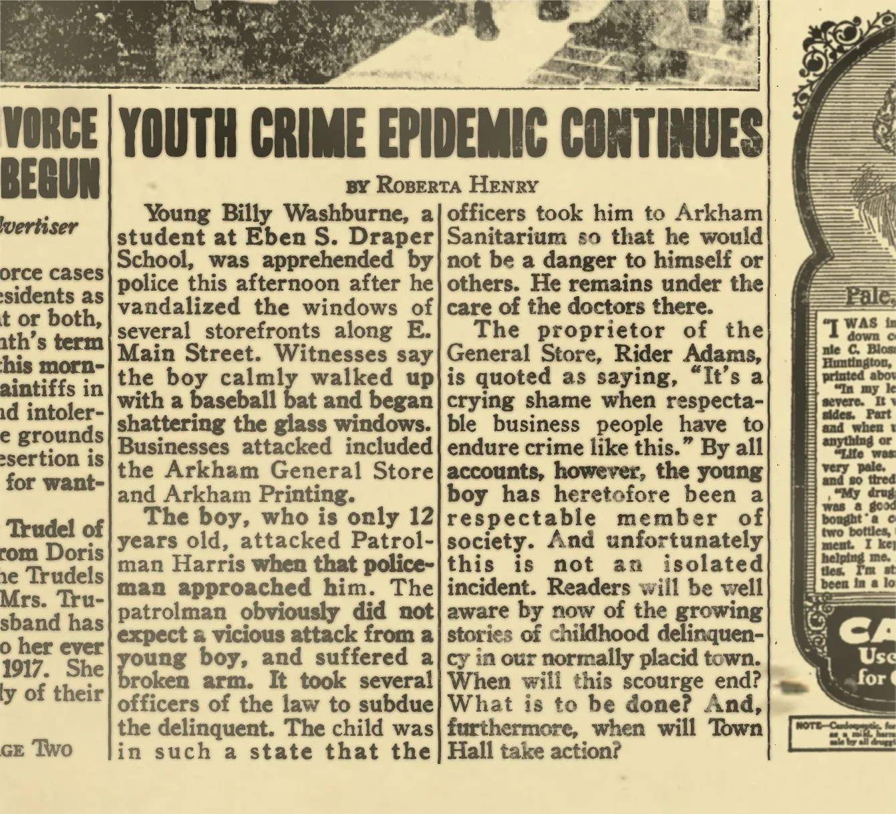

#### Протоколы вскрытия

Если сыщики прочтут протоколы вскрытия, они сразу заметят два совпадения. В желудках обоих мальчиков обнаружено постороннее вещество, смолистая чёрная слизь. Каждый образец весил меньше четырёх граммов. Пищи в желудках почти или совсем не было. У обоих были признаки заболевания мозга — значительное разрушение мозговых клеток.

Ни состав загадочной слизи, ни характер заболевания мозга установить не удалось. В обоих случаях в протоколе значится «неизвестно».

В протоколах этого нет, но доктор Спрег опасается, что у мальчиков могла быть какая-то заразная болезнь, хотя понятия не имеет, какая именно.

### Аркхэмская психбольница

Сыщики могут отправиться в Аркхэмскую психбольницу в надежде узнать больше о состоянии Билли Уошберна. Доктор Харкорт без труда найдёт время для врача или человека, прибывшего по официальному поручению полиции или властей. В остальных случаях нужна успешная проверка Средств.

С санитарами поговорить проще. Двое из них, Джим Бартлетт и Томми Слокам, помогали принимать Билли. Молодая разговорчивая медсестра Труди Хоутон, работающая в приёмной, охотно назовёт их по именам и скажет, когда у них смена. На работе оба санитара откажутся говорить без разрешения одного из врачей, опасаясь увольнения. Но их можно встретить за пределами больницы. Любой из них разговорится, если по-дружески предложить ему перекусить или хлебнуть из фляжки. Иначе нужна успешная проверка Обаяния, Красноречия или Убеждения.

#### Приём Билли

Доктор и санитары могут повторить то, что было в газете, и добавить кое-какие подробности. Пока санитары держали Билли, доктор Харкорт попытался дать ему успокоительное через рот. Это был бромид натрия. Первая доза почти или совсем не подействовала. Харкорт решил попробовать другое успокоительное, бромид калия. Билли забился ещё сильнее. Он извивался в судорогах и чуть не вырвался из рук санитаров. Наконец Джим зажал ему нос, чтобы заставить открыть рот.

Вторая доза подействовала почти сразу. Билли вырвало чёрной жижей, затем у него закатились глаза, и он потерял сознание. Если спросить, доктор или санитары объяснят, что рвота после успокоительного, особенно после большой дозы, бывает часто. Успешная проверка Медицины или Науки (Фармакология) даст тот же ответ.

О рвоте Джим и Томми скажут, что вытерли её шваброй.

> **Раздатка 3. «Эпидемия детской преступности продолжается»**
>
> ЭПИДЕМИЯ ДЕТСКОЙ ПРЕСТУПНОСТИ ПРОДОЛЖАЕТСЯ
>
> Роберта Генри
>
> Юный Билли Уошберн, ученик школы имени Эбена С. Дрейпера, задержан сегодня днём полицией, после того как разбил витрины нескольких лавок на Ист-Мейн-стрит. По словам свидетелей, мальчик спокойно подошёл с бейсбольной битой и принялся бить стёкла. Среди пострадавших заведений — Аркхэмский универсальный магазин и «Аркхэмская типография».
>
> Мальчик, которому всего 12 лет, набросился на патрульного Харриса, когда тот подошёл к нему. Патрульный явно не ждал яростного нападения от мальчишки и получил перелом руки. Чтобы усмирить малолетнего правонарушителя, понадобилось несколько служителей закона. Ребёнок был в таком состоянии, что полицейские отвезли его в Аркхэмскую психбольницу, чтобы он не навредил себе или другим. Он остаётся под присмотром тамошних врачей.
>
> Владелец универсального магазина Райдер Адамс сказал: «Просто позор, что уважаемым деловым людям приходится терпеть такие преступления». Впрочем, по общему мнению, мальчик до сих пор был уважаемым членом общества. И, к сожалению, это не единичный случай. Читатели уже хорошо знают о множащихся историях о детской преступности в нашем обычно спокойном городе. Когда кончится эта напасть? Что делать? И когда, наконец, возьмётся за дело городская управа?

#### Пациент

Билли всё ещё поправляется в палате. Он очнулся на следующий день после того, как его привезли в больницу и дали успокоительное. Он всё ещё слаб и страдает частичной амнезией. Врачи держат его под наблюдением, следят за общим состоянием и пытаются оценить его психику. Прежних проблем с поведением пока не видно. Последних дней он не помнит и понятия не имеет, зачем ему было что-то громить.

К пациенту допустят сыщиков, только если они сами врачи либо получили разрешение от семьи Билли или полиции.

Билли всё ещё сонный и заторможенный, но на вопросы отвечать может. Он утверждает, что ничего не помнит начиная с двух дней до происшествия. Успешная проверка Психологии показывает, что он говорит правду. Рассказать сыщикам он может очень мало.

Если спросить об Элайдже Кори, Билли сначала посмотрит с недоумением, а потом спросит: «А вам-то зачем этот деревенщина?» Он говорит, что Элайджа недавно приехал из деревни и поступил к ним в школу. «Он смешно говорит и ни с кем не дружит». Билли не видит связи между Элайджей и тем, что с ним случилось.
