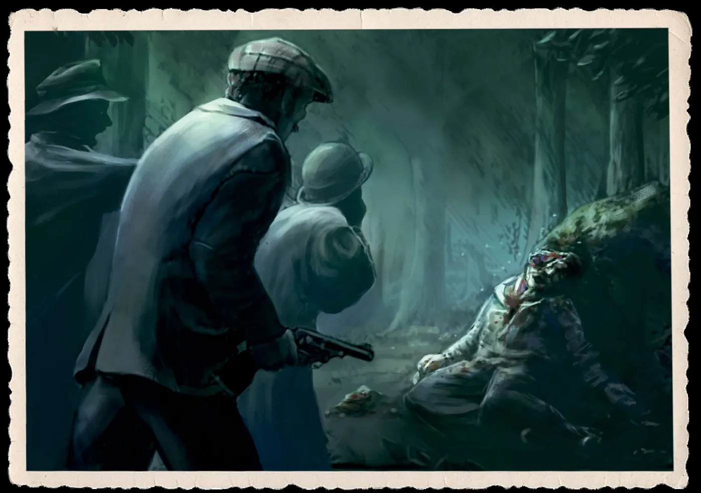

…к долгому переходу по глуши. Если сыщики заранее не сказали об обратном, то, скорее всего, одеты как принято в это время: мужчины в шляпах, галстуках, костюмах или пиджаках, женщины в платьях и чулках. В машине, впрочем, может найтись что-нибудь полезное.

В это время года летние грозы обычны, так что можно допустить, что у них в машине завалялся зонтик-другой, а в багажнике, возможно, пара галош. В машине может лежать и кое-какое оружие, которое сыщики почти наверняка захотят взять с собой.

Джордж пользуется случаем, чтобы принести из дома дробовик, а если уже темно или вот-вот стемнеет, прихватывает пару керосиновых фонарей. По усмотрению Хранителя он может одолжить сыщикам ещё одну-две единицы оружия.

## По следам мальчиков

Сыщикам предстоит идти по следам бойскаутов по разной местности. Через равные промежутки им нужно проходить проверки Чтения следов. Если с сыщиками Чиф, след возьмёт он, и его высокий навык пригодится всей группе. Если Чифа по какой-либо причине больше нет, сыщикам придётся полагаться на собственное Чтение следов.

Провал проверки Чтения следов сам по себе не обрывает погоню. Отряд лишь зря тратит время, идя по ложному следу. Когда сыщики осознают ошибку, они смогут вернуться туда, откуда сбились, и снова взять след. Эти проверки Чтения следов повторять нельзя.

Поэтому сыщики в конце концов наверняка настигнут и Элайджу, и остальных скаутов. Время, потерянное при неудачных проверках, скажется на том, как разыграется развязка.

Считайте, что скауты опережают сыщиков на полчаса. Каждый раз, когда сыщики проваливают проверку Чтения следов и уходят не туда, прибавляйте к этому отрыву ещё пятнадцать минут. На каждое жертвоприношение по всем правилам Элайдже нужно тридцать минут. Чем дольше сыщики плутают, тем больше бойскаутов погибнет.

Если сыщики убедят Джорджа вернуться к их машине до начала погони, прибавьте пятнадцать минут. Если они слишком долго спорили с Уинтропом, Хранитель может учесть ещё одну задержку.

### Чтение следов с Чифом

Лабрадоры, в отличие от ищеек вроде бладхаундов, идут по запаху, который несёт воздух. Лабрадору не нужно обнюхивать вещь разыскиваемого, чтобы начать поиск. Он рыскает по сторонам и, уловив запах в воздухе, замирает в стойке или кружит. Идя по запаху, Чиф часто далеко опережает группу.

Чиф по натуре чуткий пёс. Он любит бойскаутов, которые…
