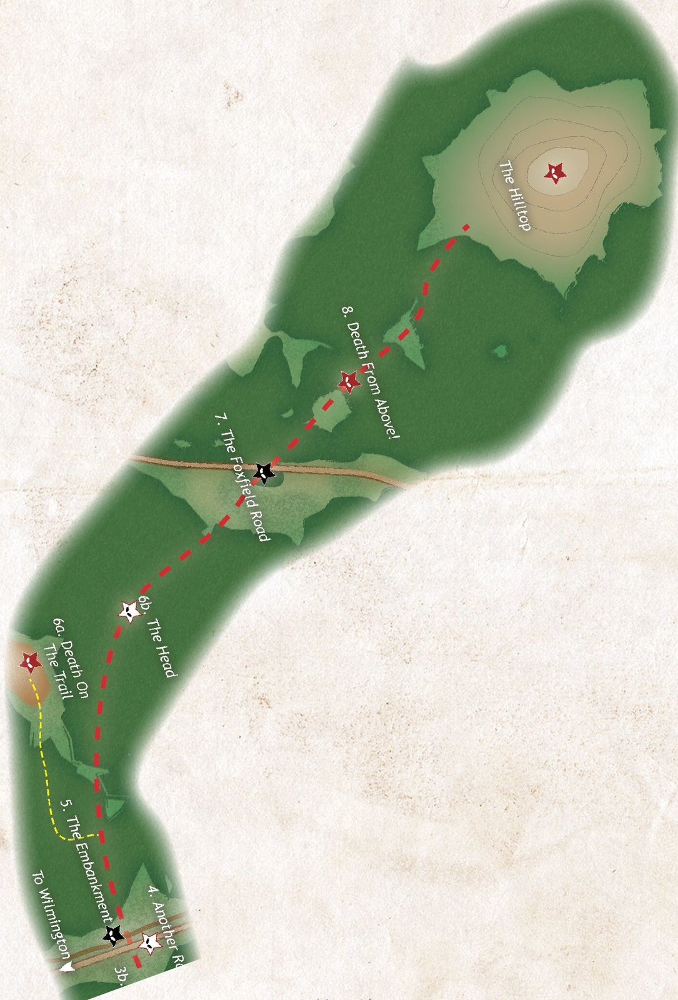

Последствия провала проверки Чтения следов описаны в первом подпункте после каждой путевой точки, требующей проверки, то есть в 2а, 3а и 6а.

Чтобы найти натоптанную тропу, уходящую от места убийства скаутмастера вглубь леса, и пойти по ней, проверка Чтения следов не нужна.

### 1. Шоссе

Переход длиной 3,2 км по холмистой лесной тропе займёт больше получаса. Наконец сыщики выходят к двухполосному грунтовому шоссе. Движение здесь редкое: днём и в начале вечера машины проезжают всего раз в 1d6+4 минут, а после 22:00 их почти не бывает.

Если сыщики заметят машину и остановят её, водитель скажет, что ничего здесь не видел. По их просьбе он найдёт где-нибудь телефон и позвонит в полицию штата, хотя толку от этого будет мало.

Тем временем бойскауты слышат далёкий лай Чифа и понимают, что за ними гонятся. Они прибавляют шагу, но всё же находят время расставить несколько ловушек для преследователей.

Вскоре после этой путевой точки группе нужно пройти проверку Чтения следов.

### 2. Железнодорожные пути

**2а.** Если группа провалит проверку Чтения следов, она уйдёт на север, в сторону от настоящей тропы, и в конце концов упрётся в обширное болото. Оно слишком глубокое и широкое, чтобы перейти его. Если сыщики поймут ошибку, они вернутся назад и снова возьмут след, потеряв пятнадцать минут. Если упорно попытаются обойти болото, оно заведёт их в обратную сторону и почти окружит. Повернуть назад ещё можно, но теперь потеряно уже тридцать минут.

**2б.** Идя по верному следу, отряд проходит ещё 3,2 км по лесу и перебирается через три небольших ручья. Первые два глубиной всего несколько сантиметров и почти не мешают. Третий глубиной около 30 см и шириной почти 2,7 м. По круглым камням можно перебраться посуху, но для этого сыщику нужна трудная проверка ЛВК. При провале он поскользнётся, угодит ногой в холодную воду и промочит ботинок и носок. Проще всего разуться, снять носки, закатать штанины и перейти вброд.

Через 800 м сыщики выходят из леса на край заросшего кукурузного поля. След бойскаутов среди зарослей легко различим.

Ещё через 800 м они выходят к небольшой насыпи, по которой с севера на юг тянутся железнодорожные пути. Примерно в это время раздаётся удар грома и с неба обрушивается ливень. На отряд льёт как из ведра.

За путями сыщики снова углубляются в лес. Нужна ещё одна проверка Чтения следов.

### 3. Смертельная петля

**3а.** При провале проверки Чтения следов сыщики около пятнадцати минут ходят по лесу кругами, пока случайно не натыкаются на следы, которые выводят их на верную тропу. Хранитель должен прибавить пятнадцать минут задержки.

**3б.** Спустя полчаса и почти 2,4 км Чиф рыскает примерно в 17 м впереди отряда. Вдруг раздаётся резкий щелчок, пёс взвизгивает и валится набок. Бедняга угодил в хитрую ловушку. Проволочная петля душит его.

Джордж и сыщики доберутся до Чифа за один раунд, но псу надо немедленно пройти трудную проверку ВЫН. При провале он начинает задыхаться и получает 1d3 урона в каждом раунде. В следующем раунде ловушку может разобрать любой, кто успешно пройдёт проверку ЛВК. Если Чиф ещё не получает урон, ему нужна ещё одна трудная проверка ВЫН, чтобы и дальше сопротивляться удушению. Проверку ЛВК для освобождения Чифа повторять нельзя, но сыщик может предпринимать новую попытку каждый раунд, пока не справится. После освобождения успешная проверка Первой помощи восстанавливает Чифу 1 ПЗ. Если Чиф погибнет, Джордж будет раздавлен, на глазах у него выступят слёзы.

До следующей путевой точки можно дойти без проверки Чтения следов.

- 3б. Чиф попал в петлю!
- 4. Ещё одна дорога.
- 5. Насыпь.
- 6а. Смерть на тропе.
- 6б. Голова.
- 7. Фоксфилд-роуд.
- 8. Смерть сверху!
- Вершина холма.
- Стрелка — на Уилмингтон.
