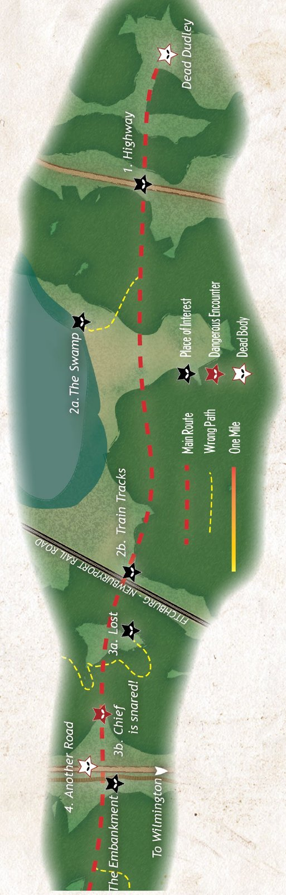

### 4. Ещё одна дорога

Через три четверти часа и примерно 4 км сыщики выходят из леса к ещё одной грунтовой дороге. От опушки до дороги около семи метров открытого пространства. По другую сторону поднимается крутая высокая насыпь, за которой начинаются холмы и глубокие долины.

Отсюда сыщики видят «Шевроле» недавней модели. Он припаркован так, что наполовину заехал на дальнюю обочину. Если дело происходит ночью, у машины горят фары.

На дороге возле машины лежат двое. В темноте нужна проверка Внимания, чтобы различить что-нибудь, кроме пары тёмных пятен.

Подойдя ближе, сыщики обнаруживают на дороге двух мертвецов: мужчину и мальчика. Мальчик лежит перед машиной, неестественно скорчившись. Видно, что он скаут и что он мёртв. Мужчина средних лет лежит на животе сбоку от машины. Из спины торчит грубо сделанное копьё. Кровь из многочисленных ран собралась вокруг тела в тёмную лужу. Потеря рассудка — 1/1d3 пункта.

Погибший мальчик был одним из скаутов. Пытаясь не отстать от остальных, он метнулся прямо под колёса мчавшейся машины. Об этом говорит большая вмятина на левом переднем крыле. Водитель вышел помочь мальчику, и остальные скауты набросились на него и убили ножами и грубо сделанными копьями.

Оба тела ещё тёплые.

Никакой проверки Чтения следов не нужно, чтобы заметить: целая группа недавно взобралась по крутому грязному откосу на другой стороне дороги.

*Прим. перев.:* В этом эпизоде в оригинале дорога названа грунтовой, но далее автор дважды употребляет слово «pavement» для её покрытия. В обоих случаях здесь переведено как «дорога».

### 5. Подъём на насыпь

Взобраться на скользкий откос по другую сторону дороги непросто, а свирепые скауты сделали всё, чтобы усложнить подъём.

Под непрерывным дождём земля раскисла и превратилась в грязевой поток. Чтобы добраться до верха, нужна успешная проверка Лазания. При провале сыщик соскальзывает обратно на обочину. Урона он не получит, зато грязь добавит неприятностей, которых у отряда, вероятно, и без того хватает. Наверху тоже ждёт скверный сюрприз: бойскауты поставили ловушку для преследователей.

Если Чиф с отрядом, он попробует их предупредить. По прошлой встрече с ловушкой он уже знает, что к чему. Почти у самой вершины насыпи Чиф яростно лает и отказывается идти дальше. Как это понять, решать сыщикам.

Если Чифа рядом нет или к нему не прислушались, первый, кто доберётся до верха, случайно хватается за растяжку. Тяжёлое бревно, подвешенное скаутами к ветвям над откосом, падает плашмя на самый его край, а затем, подпрыгивая, катится вниз, к дороге. Каждый, кто находится на откосе и провалит проверку Удачи, окажется на пути бревна. Можно выбрать проверку Прыжка или Уклонения, чтобы спастись. При провале сыщик получает 1d3 урона. Тот, кто привёл ловушку в действие, не успеет ни увернуться, ни отпрыгнуть и автоматически получит 1d6 урона.

Если сыщики прислушаются к Чифу и прямо скажут, что ищут ловушку, любой, кто осторожно протянет руку за край откоса, обнаружит растяжку. Но при провале последующей проверки ЛВК он всё равно случайно приведёт её в действие с теми же последствиями. Обнаруженную ловушку довольно легко спустить без риска. Можно и просто пройти на несколько метров вдоль дороги и взобраться на насыпь там.

Дальше тропа уходит в буковую и дубовую чащу, взбирается на крутые холмы и петляет по ложбинам. Через пятнадцать минут ходьбы сыщикам нужна ещё одна проверка Чтения следов.

### 6. Смерть на тропе

**6а.** Если сыщики собьются с пути, они уйдут на юг и окажутся в каменистой низине. Пока они пятнадцать минут бродят там в поисках следа, нужна групповая проверка Удачи. При провале они потревожат упитанного лесного гремучника, и он укусит без предупреждения. Яд гремучника сильный, см. таблицу «Примеры ядов» на с. 129 Книги хранителя «Зова Ктулху».

**6б.** Вернувшись на верный путь, сыщики проходят почти 4,8 км по густому лесу. Тут Чиф, если он ещё с ними, внезапно замирает и жалобно скулит. Если Чифа нет, группа просто натыкается на страшную находку.

- Мёртвый Дадли.
- 1. Шоссе.
- 2а. Болото.
- 2б. Железнодорожные пути.
- Железная дорога Фитчбург — Ньюберипорт.
- 3а. Сбились с пути.
- 3б. Чиф попал в петлю!
- 4. Ещё одна дорога.
- 5. Насыпь.
- Стрелка — на Уилмингтон.
- Красный пунктир — основной маршрут. Жёлтый пунктир — неверный путь. Масштабная линейка — 1,6 км.
- Чёрная звезда — примечательное место. Красная — опасная встреча. Белая — труп.
