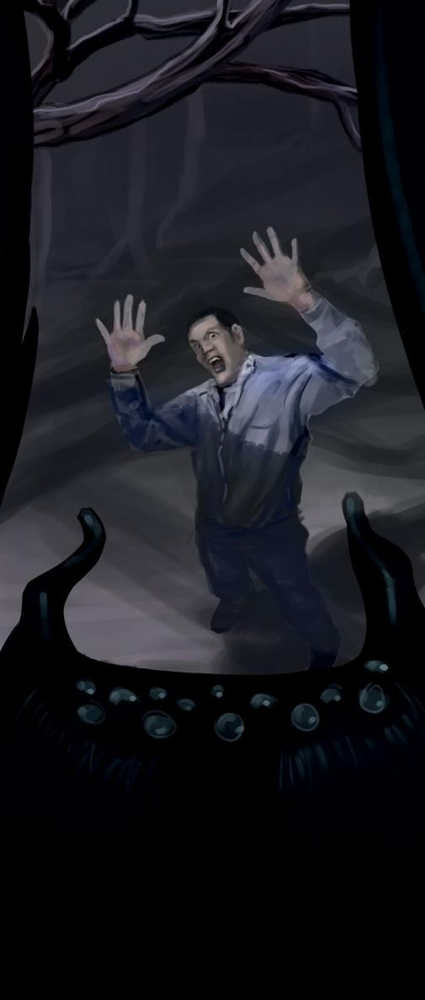

Посреди тропы в землю воткнута палка, а на ней — отрубленная голова бойскаута. Глаза открыты, изо рта вывалился язык. Тело скатили в кусты у тропы, где его по-прежнему почти целиком видно. Потеря рассудка — 1/1d6 пункта.

Несчастному скауту стало плохо по дороге, вероятно, из-за слизи, которую Элайджа подмешал ему в еду. Извергнув мерзкую субстанцию, скаут вдруг освободился от власти Элайджи и попытался убежать. Но остальные окружили его и убили, а затем изуродовали тело и насадили голову на палку. Они надеются, что страшное зрелище собьёт преследователей со следа хотя бы ненадолго.

Элайджа воспользовался гибелью скаута. Он превратил её в жертвоприношение и призвал сверхъестественного помощника, с которым сыщики скоро встретятся.

До следующей путевой точки проверка Чтения следов не нужна.

### 7. Фоксфилд-роуд

Двухполосная грунтовая дорога, укреплённая гатью из брёвен, ведёт на север, в Фоксфилд, а на юг, через Мискатоник, к Эйлсберийской дороге. На участке севернее развилки на Тьюксбери и южнее большинства фоксфилдских ферм движение редкое.

За дорогой сыщики снова углубляются в чащу.

### 8. Смерть сверху

Через 1,6 км Чиф снова останавливается. На этот раз он угрожающе рычит. Шерсть на загривке встаёт дыбом, хвост поджат. Если Чифа с группой нет, чрезвычайная проверка Слуха позволит уловить еле слышный шорох в ветвях, всего в нескольких метрах впереди.

Когда сыщики идут дальше, с ветвей над ними внезапно срывается тёмный силуэт и пикирует на ближайшего сыщика. Существо лавирует на широких крыльях и похоже на небольшого ската-манту, покрытого тёмно-бурой шерстью. Элайджа призвал его из какого-то неведомого плана бытия. Оно нападает, обвиваясь вокруг головы жертвы. Если сыщиков не предупредил Чиф и никто не прошёл проверку Слуха, тварь совершает внезапную атаку с бонусной костью. Сыщики и их союзники не могут действовать до следующего раунда, в том числе уклоняться и отвечать на удар. Те, кого не застали врасплох и у кого оружие наготове, получают обычный бонус к инициативе и могут успеть выстрелить до атаки. Если тварь промахнётся, она пронесётся мимо и развернётся для нового захода.

Чиф непременно бросится в схватку. Когда он кусает кормящегося кошмара, укусы не угрожают жертве существа. Для особенно многочисленных и сильных групп Хранитель может добавить ещё одну или несколько таких тварей.

*Прим. перев.:* Кормящийся кошмар — то же существо, что и «Гиперборейский кошмар» в статблоке на с. 48.
