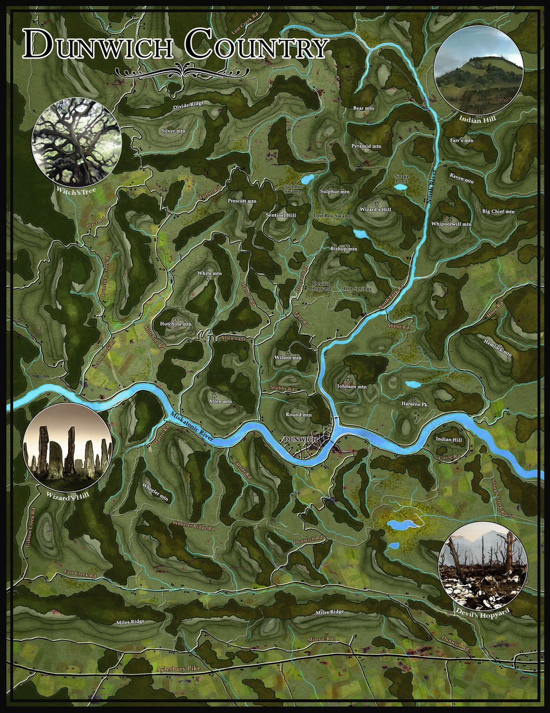

# Округа Данвича

**Подписи на карте**

- Данвич (Dunwich).
- река Мискатоник (Miskatonic River).
- Северная река (North River).
- Водораздельный хребет (Divide Ridge).
- Серебряная гора (Silver mtn).
- Ведьмино дерево (Witch’s Tree).
- Медвежья гора (Bear mtn).
- гора Пирамида (Pyramid mtn).
- Индейский холм (Indian Hill).
- гора Фарра (Farr’s mtn).
- Воронья гора (Raven mtn).
- Змеиный пруд (Snake Pond).
- гора Большого Вождя (Big Chief mtn).
- гора Козодоя (Whipoorwill mtn).
- Колдовской холм (Wizard’s Hill).
- Серная гора (Sulphur mtn).
- Серное болото (Sulphur Swamp).
- болото Пропавшего Мальчика (Lost Boy Swamp).
- гора Прескотта (Prescott mtn).
- Сторожевой холм (Sentinel Hill).
- Белая гора (White mtn).
- Чёртов хмельник (Devil’s Hopyard).
- Горячие источники (Hot Springs).
- гора Бишопа (Bishop mtn).
- гора Тсуги (Hemlock mtn).
- гора Хатчинса (Hutchins mtn).
- гора Уилсона (Wilson mtn).
- гора Джонсона (Johnson mtn).
- гора Аллена (Allen mtn).
- Круглая гора (Round mtn).
- пик Харсенс (Harsens Pk).
- гора Уилера (Wheeler mtn).
- хребет Майлса (Miles Ridge).
- дорога Лост-Крик (Lost Creek Rd).
- дорога Толбота (Talbot Rd).
- дорога Плейса (Place Rd).
- дорога Данкок-Крик (Duncock Creek Rd).
- дорога Хэтсона (Hatson Rd).
- дорога к Хмельнику (Hopyard Rd).
- дорога Норт-Форк (North Fork Rd).
- дорога Эббота (Abbot Rd).
- дорога Хука (Hook Rd).
- дорога Хатчинса (Hutchins Rd).
- дорога Скотт-Крик (Scott Creek Rd).
- Аллен-лейн (Allen Lane).
- дорога Фэй (Faye Rd).
- дорога Стаббса (Stubbs Rd).
- дорога Харриса (Harris Rd).
- дорога Кэрриера (Carrier Rd).
- Кольцевая дорога (Circle Rd).
- дорога Слау-Крик (Slough Creek Rd).
- дорога вдоль хребта Уилера (Wheeler Ridge Rd).
- дорога Гибсон-Крик (Gibson Creek Rd).
- Данвичская дорога (Dunwich Rd).
- дорога Ист-Крик (East Creek Rd).
- Восточная дорога Майлса (Miles E Rd).
- Эйлсберийская дорога (Aylesbury Pike).
