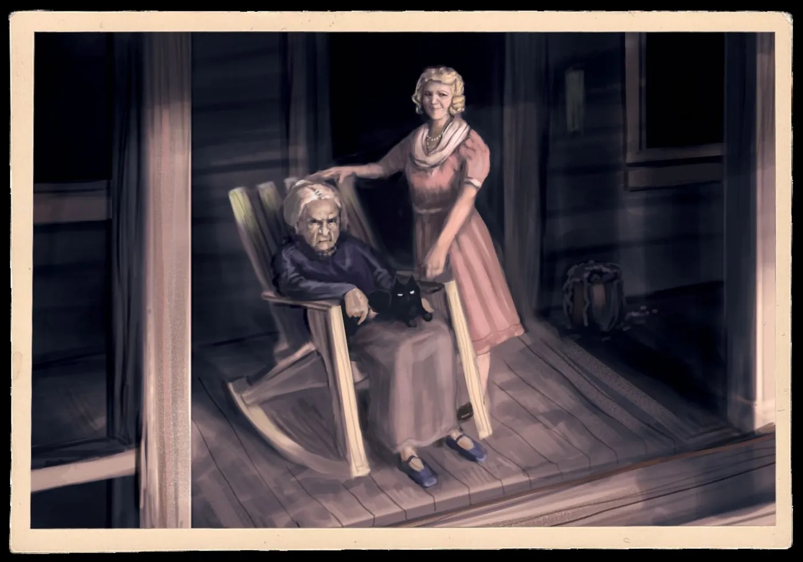

*Данвичская история*

Последняя опасность — сама лесопилка, где и впрямь поселилось привидение. Больше века назад, пока ещё шло строительство, управляющий Эверн Уэйтли пытался заточить доброго духа в четырёх огромных пильных полотнах, но допустил ошибку в заклинании. Обряд должен был наделить лесопилку «доброй душой» и обеспечить процветание новому предприятию. Увы, дух оказался злобным, жаждущим человеческих жизней и крови. Это он убил троих мальчишек, которые забрались на лесопилку незадолго до официального открытия, и насылал кошмары на рабочих все те несколько лет, что она проработала. Сыщики могут выяснить, как изгнать эту злую силу с лесопилки и из Данвича, но это опасное дело.

## Сведения для сыщиков

Ввязаться в эту историю можно по-разному. Сыщики могут быть известными исследователями паранормальных явлений, которых «Аркхэм Адвертайзер» наняла сопровождать Флойда Тоби и помогать ему с материалом. Или их мог прислать доктор Эллиот Миллс, профессор истории Мискатоникского университета, с поручением уговорить его некогда любимого студента Гарольда Бишопа вернуться в Аркхэм и окончить учёбу. Возможно, сыщики прочли в «Аркхэм Адвертайзер» короткий анонс будущей статьи о лесопилке с привидениями в тауншипе Данвич и отправились туда из чистого любопытства. Наконец, репортёр Флойд Тоби может оказаться кузеном одного из сыщиков, и родные, беспокоясь за него, попросят кого-нибудь присмотреть за ним. Если сыщики предложат Флойду помощь, он с радостью согласится, при условии, конечно, что свои расходы они возьмут на себя.

## Флойд Тоби

Тоби немного за тридцать. С собой у него небольшой фотоаппарат со складной треногой, переносная пишущая машинка, верные блокнот и ручка, надёжный фонарь, тёплая зимняя одежда и крепкие сапоги. Флойд внимателен к мелочам и продумал поездку до последней детали.

Работает он с грехом пополам, зато этот приятный человек легко располагает к себе. Низковатый, полноватый, уже начинающий лысеть, Тоби восполняет нехватку журналистского мастерства энтузиазмом. Скептик до мозга костей, он может совсем растеряться, если столкнётся с доказательством сверхъестественного.

Тоби ездит на ухоженном «Форде» модели T 1922 года. Печки в машине нет и в салоне холодно, зато она прекрасно держит дорогу, даже когда Эйлсберийская дорога зимой местами обледеневает. Водит Тоби очень осторожно.

Он будет только рад компании в дороге и предложит сыщикам скинуться на бензин. В машине есть место для троих пассажиров, а если потесниться, то и для четверых. Однако Тоби предупреждает, что собирается подвозить кое-кого из местных. Если сыщиков больше трёх, им, возможно, придётся найти ещё одну машину и поехать по Эйлсберийской дороге следом за Тоби. Репортёр договорился встретиться с Германом Блейком в полдень в универсальном магазине Осборна, единственной торговой точке деревни. Встреча назначена на завтра либо, по усмотрению Хранителя, через день-другой.

