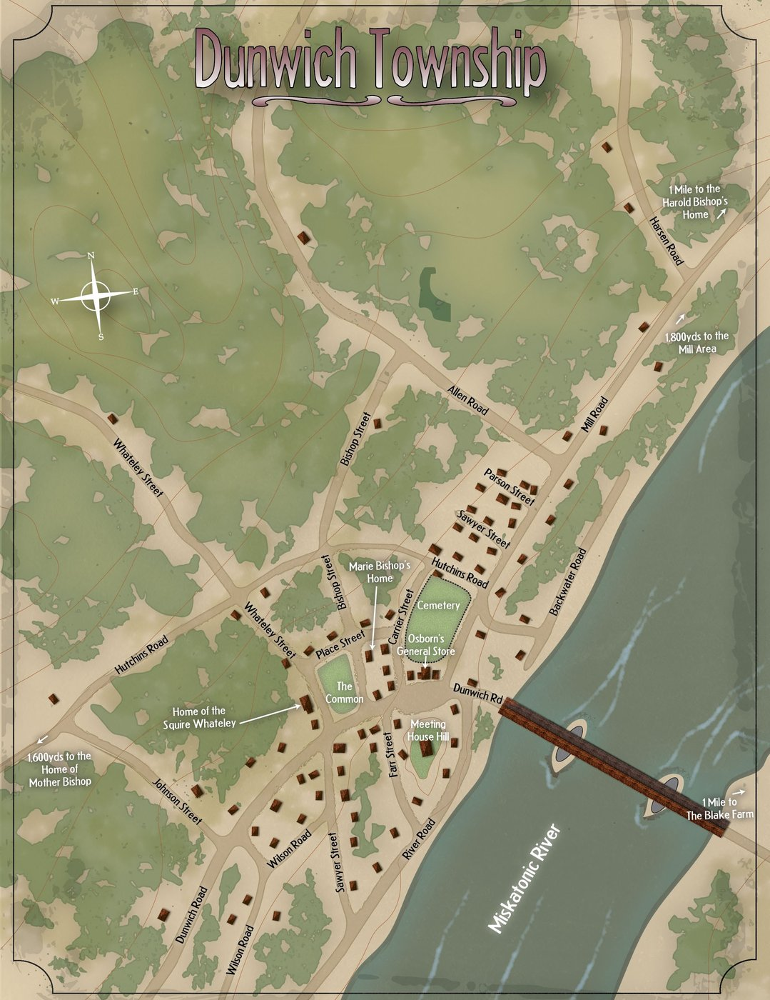

## Тауншип Данвич

- Универсальный магазин Осборна, дом Мари Бишоп, дом сквайра Уэйтли.
- Кладбище Данвича, общинный луг Данвича, Холм молитвенного дома.
- До дома Матушки Бишоп — 1 600 м. До района мельниц Данвича — 1 800 м. До фермы Гарольда Бишопа — 1,6 км. До фермы Блейков — 1,6 км.
- Аллен-роуд, Бэкуотер-роуд, Бишоп-стрит, Данвич-роуд, Джонсон-стрит, Кэрриер-стрит, Милл-роуд, Парсон-стрит, Плейс-стрит, Ривер-роуд, Сойер-стрит, Уилсон-роуд, Уэйтли-стрит, Фарр-стрит, Харсен-роуд, Хатчинс-роуд.
- Река Мискатоник. Стороны света: С, В, Ю, З.

*Прим. перев.:* дорога к ферме Гарольда Бишопа обозначена на карте как Харсен-роуд, а в описании маршрута на с. 58 — как Стаббс-роуд. В английской подписи к ферме лишний артикль — «to the Harold Bishop’s Home».
