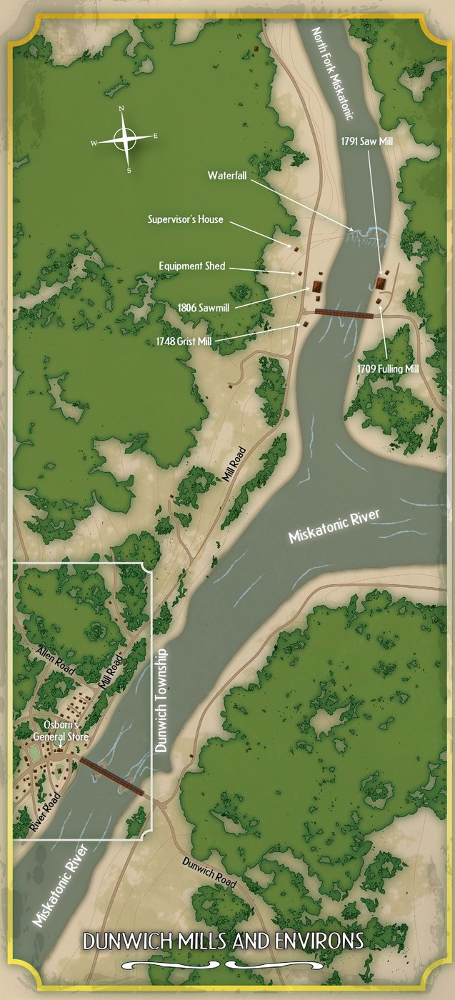

## Часть II. Осваиваемся в Данвиче

Утро в Данвиче начинается с сытного завтрака, приготовленного Нэнси Блейк и Мари Бишоп: оладьи с кленовым сиропом, колбаски и кофе. Сыщики могут удивиться, что Мари уже здесь, хотя сами они только встали. Если её спросят, она объяснит, что с утра её подвёз сосед, которому было по пути.

Сегодня Тоби собирается взять интервью у местного историка Гарольда Бишопа, а потом осмотреть лесопилку.

Тем временем весть о приезжих разошлась по деревне и, к несчастью, дошла до Эймоса Уэйтли и Темпла Поттера.

### За сыщиками следят

С утра Лем Уэйтли ездит за Тоби и сыщиками повсюду. Эймос велел ему сесть им на хвост и докладывать, чем они занимаются. Лем держится позади на своём разваленном «Форде» модели T, куда более старом, чем машина Тоби. Скрытностью Лем не отличается, так что сыщики, скорее всего, его заметят. Если они потребуют объяснений, здоровяк разозлится и станет отрицать, что за кем-то следит. «Я своими делами занимаюсь, — скажет он с угрозой. — И вам того же советую». Пока он держит себя в руках, но скоро это изменится.

### Мимо мельниц

Самый короткий путь от фермы Блейков до фермы Гарольда Бишопа лежит по Саут-Ривер-роуд до Данвич-роуд, затем направо через мост над Мискатоником. За мостом нужно свернуть в первый поворот налево, на Милл-роуд, проехать на север до Стаббс-роуд и опять повернуть налево. Ферма Гарольда Бишопа — вторая справа. По дороге сыщики проедут мимо нескольких заброшенных ферм и домов и ряда закрытых данвичских мельниц, в том числе лесопилки 1806 года, где, по слухам, водятся привидения.

*Прим. перев.:* Стаббс-роуд в этом описании соответствует Харсен-роуд на карте на с. 57.

- Лесопилка 1806 года, дом управляющего, сарай для оборудования, мукомольная мельница 1748 года, лесопилка 1791 года, сукновальня 1709 года.
- Водопад у лесопилки, Северный рукав Мискатоника, река Мискатоник, Милл-роуд.
- Врезка «Тауншип Данвич»: Аллен-роуд, Милл-роуд, Ривер-роуд, универсальный магазин Осборна. За мостом — Данвич-роуд.
- Стороны света: С, В, Ю, З.
