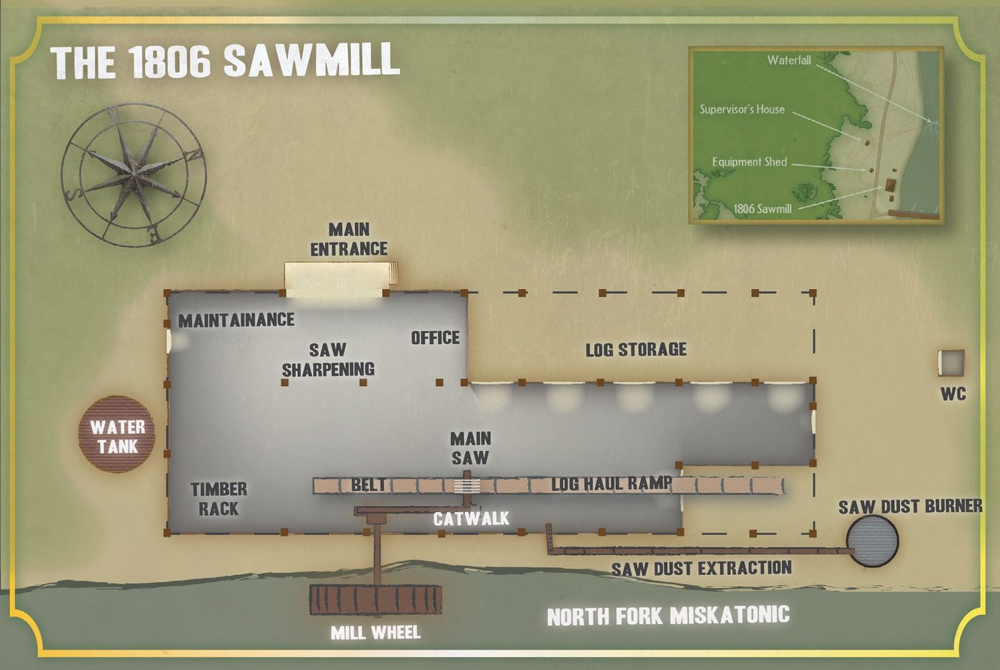

Между штабелями старого, никому не нужного пиломатериала пол усыпан мёрзлыми опилками. Крыша в нескольких местах прохудилась, и по углам намело сугробы.

При осмотре сыщики не находят ничего необычного, разве что лесопилку, похоже, бросили в спешке. Доски, напиленные больше века назад, всё ещё сложены в штабеля и готовы к отправке. На верстаках разбросаны по большей части проржавевшие инструменты. Тоби и Мари Бишоп внимательно осматриваются. Репортёр на ходу делает заметки и фотографирует.

В какой-то момент один случайно выбранный сыщик слышит совсем рядом страшный звук, зловещее нечеловеческое рычание. Он должен пройти проверку **Рассудка** с потерей 0/1. В конце концов выясняется, что шумит крупный перепуганный опоссум. Сыщик случайно загнал его в угол, и зверь отчаянно шипит. Если дать ему дорогу, он юркнет прочь и найдёт, где ещё поспать.

### Пильные полотна

Единственная странность на лесопилке — четыре длинных пильных полотна, которые при работе движутся взад-вперёд. Каждое длиной почти 2,7 м. Они закреплены в раме наподобие короба и служили для продольной распиловки брёвен на доски. Хотя пилой не пользовались больше века, полотна в почти безупречном состоянии: ни пятнышка ржавчины, а зубья по-прежнему острые.

Каждый сыщик, задержавшийся возле полотен, должен пройти проверку **МОЩ**. При успехе ничего не происходит. При провале сыщик теряет 1 пункт Рассудка и чувствует такую угрозу, что почти цепенеет от страха. Это быстро проходит, но сыщика ещё трясёт, а под тяжёлой зимней одеждой выступает холодный пот.

Тот, кто осмелится дотронуться до полотен, должен пройти трудную проверку **МОЩ** или потерять ещё 1 пункт Рассудка. При провале сыщику кажется, что всё вокруг вдруг задрожало, а полотна почему-то горячие и скользкие. На миг ему видится, как всё вокруг забрызгивает кровь. Это тревожное видение быстро проходит. Запечатлеть его или доказать, что оно было, невозможно.

### Тоби падает

Осматривая верхние мостки лесопилки, репортёр Тоби внезапно вскрикивает, оступается и, проломив старые деревянные перила, падает вниз. Он ударяется о старый верстак и с размаху падает на ледяной пол. На короткое время Тоби теряет сознание. На голове у него небольшая кровоточащая рана. Успешная проверка **Медицины** позволяет оценить травмы и обнаружить, что Тоби к тому же вывихнул плечо. Мари Бишоп подбегает к нему: «Его надо отсюда вынести. Ему нужен врач».

- Главный вход, мастерская, заточка пил, контора, склад брёвен, уборная.
- Водонапорный бак, стеллаж для бруса, главная пила, приводной ремень, рампа подачи брёвен, мостки лесопилки.
- Опилочная печь, вытяжка опилок, водяное колесо, Северный рукав Мискатоника.
- На врезке: водопад у лесопилки, дом управляющего, сарай для оборудования, лесопилка 1806 года.

*Прим. перев.:* на плане мастерская подписана «Maintainance» вместо «Maintenance».
