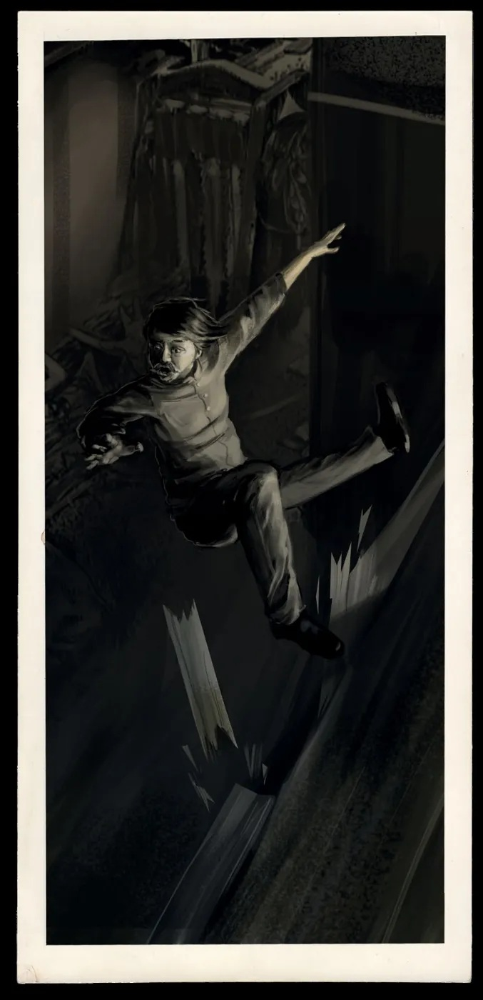

Если среди сыщиков есть врач или хотя бы человек с медицинской подготовкой, он может оказать Тоби помощь на ферме Блейков. Если врача в группе нет, Мари проводит всех в деревню, к дому местного доктора Такера Джонса. Его врачебная лицензия давно просрочена, но своё дело он знает. Джонс быстро осматривает Флойда Тоби, вправляет ему плечо и подвешивает пострадавшую руку на перевязь.

Тоби сильно ушибся, но ни одна из травм не угрожает жизни. Такер Джонс отпускает его при условии, что кто-нибудь присмотрит за ним и проследит, чтобы он не заснул в ближайшие четыре часа. «У тебя ведь может быть сотрясение, понимаешь?»

Хотя травмы Тоби сравнительно лёгкие, он перепуган и на лесопилку уже не вернётся. Его трясёт даже от одного разговора о ней.

### Разговор с Тоби после падения

Вернувшись на ферму Блейков, Тоби заметно встревожен. Если спросить, что случилось, он ненадолго задумается, а потом ответит: «Наверное, поскользнулся на льду и неудачно ступил». Успешная проверка **Психологии** покажет, что он врёт и что ему очень страшно. Если сыщики пройдут проверку **Убеждения** и разговорят его, он признается, что «кое-что увидел», а потом почувствовал, как что-то толкнуло его назад, через перила. В тени стоял мальчик. Когда он повернулся к Тоби, стало видно, что мальчик распилен пополам от промежности до макушки. Тоби тут же добавляет: «Это всё воображение. Мозг со мной шутки шутит, вот и всё».

Затем Тоби меняет тон и признаётся, что продолжать расследование не будет. «Думаю, на статью материала хватит. Хотел осмотреться как следует, но, пожалуй, напишу и так». Он просит сыщиков заглянуть в дом управляющего рядом с лесопилкой, сделать для него несколько снимков, а завтра отвезти его в Аркхэм.

Блейки расстраиваются и тут же спрашивают, значит ли это, что награды им не видать. «Решать мистеру Гедни, моему редактору, — отвечает Тоби. — Но довести расследование до конца я не смог. Всё выглядело многообещающе, только доказательств у меня никаких. Очень жаль, но едва ли он согласится выплатить награду».

Нэнси плачет и обнимает мужа: «Герман, что же нам теперь делать? Ведь ферму отберут!» Герман торопливо её успокаивает, прижимает к себе и говорит: «Не бойся, Нэнси, всё будет хорошо. Как-нибудь выкрутимся». Если сыщики расспросят Германа, он признается, что Первый банк Эйлсбери вот-вот заберёт ферму и им нужно срочно раздобыть 250 долларов. Если сыщики предложат подарить или одолжить деньги, гордые супруги откажутся: «Подаяния мы принять не можем, спасибо. Мы своим трудом живём. Как-нибудь управимся. Спасибо вам от души».

### Что делать дальше

У сыщиков теперь несколько вариантов. Можно сделать пару снимков, наскоро осмотреть дом управляющего и отвезти Тоби в Аркхэм. Можно вовсе не возвращаться в район мельниц и с утра первым делом уехать с раненым репортёром. В любом из этих случаев Блейки потеряют ферму, тайна останется нераскрытой и сценарий окончится неудачей.

Если сыщики берут расследование в свои руки и хотят докопаться до правды, Хранителю следует перейти к части III. Мари Бишоп предложит помощь. Герман и Нэнси обрадуются и сделают всё, чтобы сыщикам и раненому Тоби было у них как можно удобнее.

*Прим. перев.:* в начале абзаца оригинал даёт «In the investigators…» вместо «If the investigators…».
