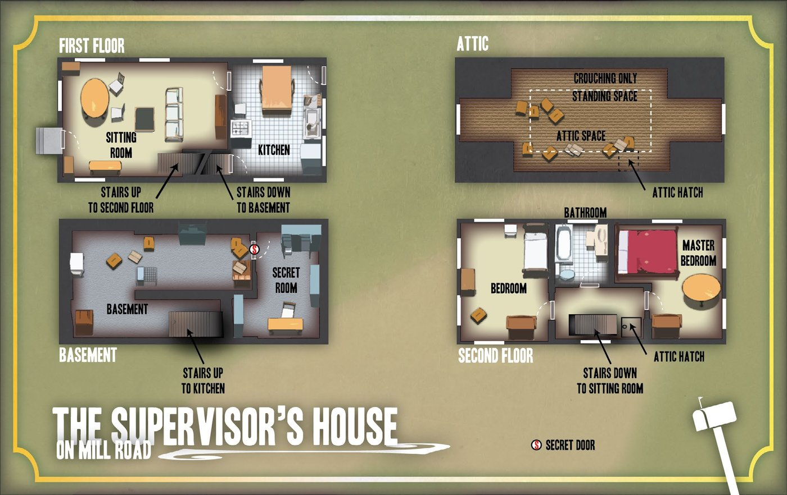

## Часть III. Тайна лесопилки

В доме управляющего есть улики, которые помогут понять, что произошло на лесопилке и как с этим покончить. Сыщики могут выяснить, отчего пошёл наперекосяк обряд Эверна Уэйтли, и, возможно, даже найдут небольшой тайник со знаменитым золотом Уэйтли. Узнав правду, они могут попытаться изгнать злобного духа, поселившегося на лесопилке. Этому, однако, будут мешать Эймос и Лем Уэйтли и трое их союзников из выродившегося рода Поттеров.

### Неприятный сюрприз

На следующее утро сыщики выходят к своим машинам и обнаруживают, что ветровое стекло разбито, капот взломан, несколько шлангов и проводов перерезаны или вырваны. Починка машин занимает два часа и требует успешной проверки **Механики**. Если спросить Блейков, кто мог это сделать, они ответят, что понятия не имеют, и попросят прощения за то, что такое случилось у них на ферме. Если сыщики сами не справятся с починкой, за неё может взяться Герман Блейк. Впрочем, сыщики всё равно не доберутся до района мельниц до позднего утра, даже если оставят машины и пойдут пешком.

Лем Уэйтли этим утром не следит за сыщиками: он помогает обыскивать лесопилку. Если сыщики не заметят его отсутствия, на это укажет Мари Бишоп. По её мнению, машину, скорее всего, испортил Лем, один из тех, кто позорит деревенских. Она обещает при первой возможности доложить об этом сквайру Уэйтли. Позже в тот же день Хранителю следует вернуть Лема к его поручению: пусть снова ходит за сыщиками по пятам.

### Возвращение в район мельниц

Вернувшись в район мельниц, сыщики должны пройти проверку **Внимания**. При успехе они замечают свежий конский навоз. Внутри лесопилки видны свежие следы сапог на заснеженном полу и признаки грубого обыска: вещи опрокинуты, оборудование сдвинуто, ящики опустошены.

### Дом управляющего

Сыщики могут отпереть этот дом ключами, которые дал сквайр Уэйтли. Дом двухэтажный. Как и на лесопилке, в крыше зияют дыры, половицы просели. Без успешных проверок **Внимания** здесь мало что найдётся, кроме старой мебели и выцветших бумаг. Важные улики находятся на чердаке, в подвале и в главной спальне.

- Первый этаж: гостиная, кухня, лестница на второй этаж, лестница в подвал.
- Второй этаж: спальня, главная спальня дома управляющего, ванная, лестница вниз в гостиную, люк на чердак.
- Чердак дома управляющего: чердачное пространство, место, где можно стоять, место, где нужно пригнуться, люк чердака.
- Подвал дома управляющего: лестница наверх, на кухню, потайная комната — алхимическая лаборатория Эверна Уэйтли.
- Условный знак «S» — потайная дверь.
