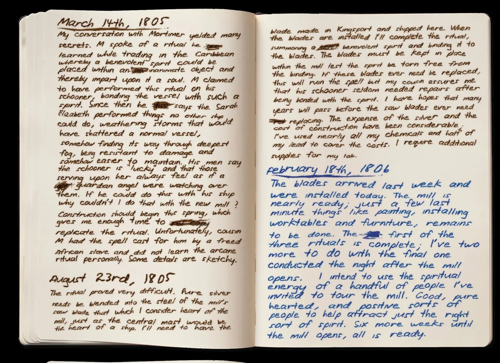

> **Раздатка 1a. «Дух предприятия»: дневник Эверна Уэйтли (1805–1806)**
>
> 14 марта 1805 года
>
> Разговор с Мортимером открыл мне многие тайны. М рассказал об обряде, которому научился, торгуя на Карибах: с его помощью доброго духа можно поместить в неодушевлённый предмет и тем самым наделить его душой. М утверждал, что провёл этот обряд над своей шхуной, связав судно с таким духом. С тех пор, по его словам, «Сара Элизабет» творила то, что не под силу ни одному другому кораблю: выдерживала шторма, которые разбили бы обычное судно, каким-то образом находила путь в густейшем тумане, не боялась повреждений и как-то легче поддавалась уходу. Его люди говорят, что шхуна «везучая» и что те, кто на ней служит, всегда чувствуют, будто над ними бдит ангел-хранитель. Если он смог сделать такое со своим кораблём, почему бы мне не сделать то же с новой лесопилкой? Строительство должно начаться этой весной, так что времени повторить обряд у меня достаточно. К несчастью, кузену М заклинание сотворил освобождённый африканский раб, и сам он тайному обряду не научился. Некоторые подробности смутны.
>
> 23 августа 1805 года
>
> Обряд оказался очень трудным. В сталь пильного полотна лесопилки, которое я считаю её сердцем — как грот-мачта — сердце корабля, — нужно подмешать чистое серебро. Придётся заказать полотно в Кингспорте и доставить сюда. Когда полотна установят, я завершу обряд: призову доброго духа и привяжу его к полотнам. Полотна должны оставаться на месте в лесопилке, иначе дух вырвется из уз. Если полотна когда-нибудь придётся заменить, это разрушит заклинание, но кузен уверяет, что его шхуна после связывания с духом почти не нуждалась в ремонте. Надеюсь, пройдёт много лет, прежде чем полотна понадобится менять. Серебро и строительство обошлись недёшево. Чтобы покрыть расходы, я извёл почти все свои химикаты и половину свинца. Для лаборатории нужны новые запасы.
>
> 18 февраля 1806 года
>
> Полотна прибыли на прошлой неделе и сегодня установлены. Лесопилка почти готова; осталось лишь кое-что в последнюю минуту — покраска, установка верстаков и мебели. Первый из трёх обрядов завершён; осталось ещё два, последний — в ночь после открытия лесопилки. Я намерен использовать духовную энергию нескольких людей, которых пригласил осмотреть лесопилку. Добрые, чистосердечные, светлые люди помогут привлечь именно того духа, что нужен. До открытия ещё шесть недель, всё готово.

*Прим. перев.:* в записи от 23 августа слова «that which» напечатаны подряд после «saw blade». В записи от 18 февраля сказуемое «remains» стоит в единственном числе при подлежащем «a few last minute things».
