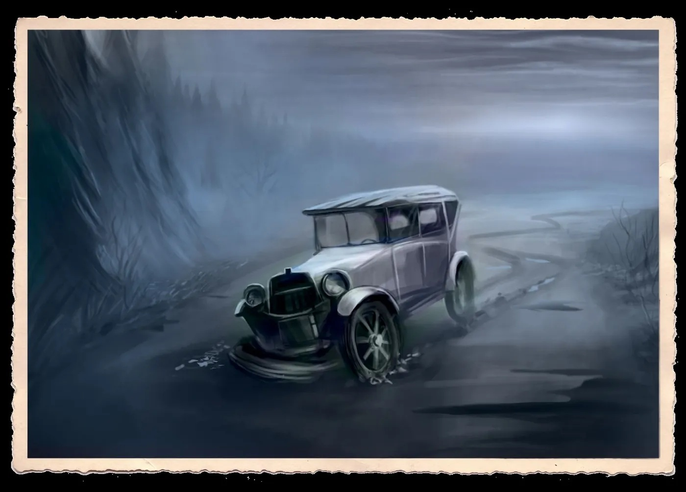

Однако констебль настоятельно посоветует сыщикам уехать из Данвича как можно скорее. «У этих людей есть родня, а я везде поспеть не могу. Крови и так довольно пролилось, так что вам бы лучше уехать. Понятно?»

Если верх возьмут местные, они бросят Мари Бишоп там, где она упала, а сыщиков без сознания отвезут на ближайшую заброшенную ферму. Там ждёт Темпл Поттер. Он обыскивает сыщиков и крепко связывает их верёвкой. Темпл выпытывает у пленников, что им известно о золоте Уэйтли, и жестоко избивает каждого на глазах у Лема, Джубала и Джедедайи. Узнав всё, что сможет, Темпл намерен убить их ржавым кухонным ножом, который нашёл на заброшенной ферме, и бросить тела в погребе для припасов. Когда дело дойдёт до развязки, Хранитель может воспользоваться одним из следующих вариантов спасения.

### Спасение на ферме

Если сыщики попали в плен, а Хранитель не хочет, чтобы сценарий завершился их гибелью, спасти их можно двумя способами. В первом случае Мари Бишоп приводит местного констебля и его людей к месту нападения. Оттуда они идут по следам к ферме, где держат сыщиков. Во втором Мари Бишоп собирает отряд Верующих и находит нападавших и пленников с помощью заклинания «Авгурия (народное)». Хранитель может выбрать вариант, который лучше всего подходит к тому, что произошло до пленения сыщиков.

*Прим. перев.:* здесь заклинание названо «Augur», а в статблоке Мари на с. 69 — «Augury». Речь об одном заклинании. В том же абзаце «affecting a rescue» напечатано вместо «effecting a rescue».

### Спасение констеблем

Констебль Тристрам Уэйтли с вооружённым отрядом появляется в самый последний момент. Он приказывает всем выйти с поднятыми руками. Темпл даёт Джубалу пистолет и велит стрелять в любого, кто приблизится к дому, а Джедедайе приказывает убить пленников, пока никто из отряда не вошёл. Затем Темпл Поттер и Лем Уэйтли выскальзывают через заднюю дверь и скрываются в холмах. Отряд приближается к дому. Джубал несколько раз стреляет, но сильно мажет. Люди констебля открывают ответный огонь, ранят обоих братьев Поттеров и врываются в дом. Сыщики спасены.

Джубала и Джедедайю берут под стражу. В конце концов они во всём признаются, но отрицают, что в деле участвовал кто-то ещё. Братья выдумывают, будто сыщики напали на них первыми, а они только защищались. Констебль Уэйтли не верит ни единому слову и велит их увести. Сыщики на свободе, и благодарить за это стоит избитую Мари Бишоп, которая привела сюда констебля.
