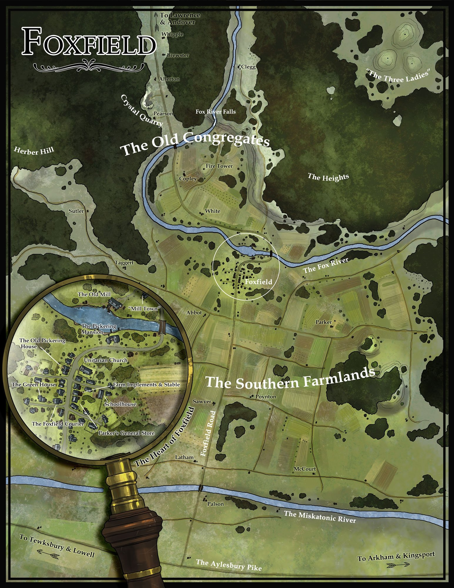

## Карта Фоксфилда

- Дорога на север — к Лоуренсу и Андоверу. Эйлсберийская дорога — на запад к Тьюксбери и Лоуэллу, на восток к Аркхэму и Кингспорту. Фоксфилд-роуд ведёт в Фоксфилд.
- Река Фокс, река Мискатоник, водопад Фокс-Ривер, Кристальный карьер, «Три дамы», Холм Хербер, Высоты Фоксфилда, пожарная вышка Фоксфилда.
- Земли конгрегантов — Северные фермы Фоксфилда: ферма Уипплов, ферма Брюстеров, ферма Клеггов, Аллертон, ферма Пирсонов, ферма Копли, ферма Уайтов. К западу от Фоксфилда — ферма Сатлеров и ферма Таггертов.
- Южные фермы Фоксфилда: ферма Эбботтов, ферма Паркеров, ферма Пойнтонов, ферма Сойеров, ферма Лэтемов, ферма Маккортов, ферма Палсонов.
- Центр Фоксфилда, под лупой: старая фабрика Пикерингов, Милл-Таун, особняк Пикерингов, Старый дом Пикерингов, Фоксфилдская унитарианская церковь, Дом Гринов, «Сельхозинвентарь Фоксфилда» и конюшня, Фоксфилдская школа, редакция «Фоксфилд курьер», универсальный магазин Паркера.
