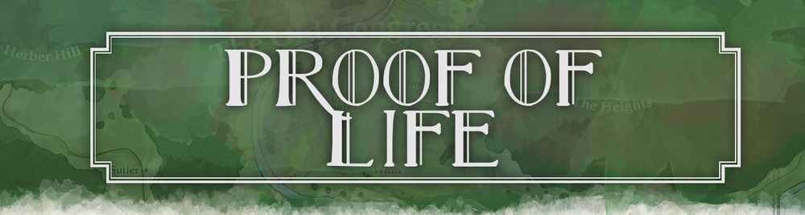
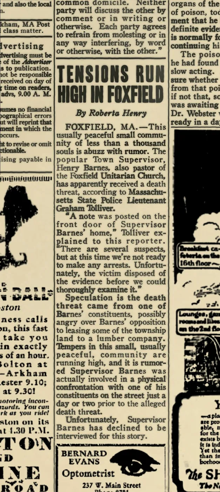

# Доказательство жизни

- Видимые подписи на фрагменте карты: холм Хербер, земли конгрегантов, пожарная вышка, Высоты, фермы Сатлеров и Уайтов.

К северо-западу от Аркхэма, у Эйлсберийской дороги, стоит маленький городок Фоксфилд. По слухам, Генри Барнсу, который давно возглавляет тауншип и пользуется любовью горожан, угрожают смертью. По всей видимости, угроза исходит от кого-то из местных. Живётся здесь нелегко, жителей осталось меньше тысячи. Обычно они держатся сообща, но события последнего года раскололи прежде дружную общину.

Лесозаготовительная компания предложила взять в аренду большой участок неосвоенной земли тауншипа в холмах к северу от города. В здешних дубовых и клёновых рощах она рассчитывает добывать первосортную древесину. Для городка, который едва сводит концы с концами, сделка стала бы настоящим подарком. Тауншип получил бы солидную арендную плату, а новое производство дало бы работу местным предприятиям.

Глава тауншипа Барнс, который также возглавляет местную унитарианскую церковь, поначалу поддерживал предложение, а теперь выступает категорически против. Больше всего его тревожит «осквернение Божьих владений». До сих пор его поддерживали двое из трёх членов совета и чуть больше половины горожан. Однако одна из них подумывает изменить своё решение, и Барнс об этом не знает.

Доказательств того, от кого исходила угроза, ни у кого нет. Большинство подозревает Айка Копли, местного фермера и давнего политического соперника Барнса.

## Сведения для Хранителя

Корявую записку с угрозой на входной двери Барнса и вправду оставил Айк Копли. Вредить главе тауншипа он не собирался. Пьяный и злой после публичного унижения, Копли хотел всего лишь припугнуть соперника. Настоящая беда Барнса кроется куда глубже, под холмами к северу от города.

В северных холмах расположена небольшая, но древняя исследовательская станция ми-го. Их логово скрыто за водопадом, а Врата соединяют его с главной колонией в Вермонте. Ми-го стараются не привлекать внимания и редко тревожат здешних жителей, хотя обитают здесь уже несколько столетий.

> **Раздатка 1. «Страсти накаляются в Фоксфилде»**
>
> СТРАСТИ НАКАЛЯЮТСЯ В ФОКСФИЛДЕ
>
> Роберта Генри
>
> ФОКСФИЛД, Массачусетс. — Этот обычно мирный городок, где живёт меньше тысячи душ, полнится слухами. Популярный глава тауншипа Генри Барнс, также пастор Фоксфилдской унитарианской церкви, по-видимому, получил угрозу смертью, сообщил лейтенант полиции штата Массачусетс Грэм Толливер.
>
> «К входной двери дома главы тауншипа Барнса была приклеена записка, — пояснил Толливер вашему корреспонденту. — Подозреваемых несколько, но пока мы не готовы никого арестовать. К сожалению, потерпевший избавился от улики прежде, чем мы смогли её как следует осмотреть».
>
> По предположениям, угроза исходила от одного из избирателей Барнса — возможно, недовольного тем, что Барнс противится сдаче части земли тауншипа в аренду лесозаготовительной компании. Страсти в этой маленькой, обычно мирной общине накаляются, и ходят слухи, что за день-два до предполагаемой угрозы глава тауншипа Барнс даже подрался с одним из своих избирателей прямо на улице.
>
> К сожалению, глава тауншипа Барнс отказался дать интервью для этой статьи.
