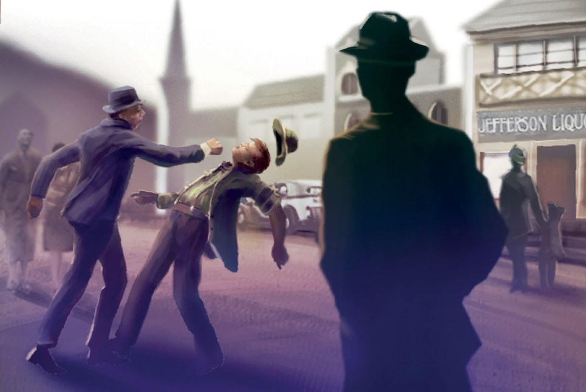

*На вывеске различимо «Jefferson Liquo…» — винный магазин «Джефферсон».*

В первый же год на этой должности Барнса постигло несчастье: врачи обнаружили у Хелен рак яичников. Через год она умерла, и Барнс остался один с двумя маленькими детьми.

Через несколько недель после смерти Хелен в Фоксфилд переехала её старшая сестра Сара, чтобы вести хозяйство и присматривать за маленькими племянниками. Она поселилась у Барнсов, и Фоксфилд быстро принял её, как прежде принял её сестру.

Будучи пастором единственной церкви Фоксфилда и главой тауншипа, Барнс снискал уважение жителей, особенно за годы, прошедшие после смерти его молодой жены. Он занимает свой пост четвёртый срок подряд, а через полгода ему предстоит вновь идти на выборы. В обычных обстоятельствах победа была бы у него в кармане, но спор о лесной аренде дал шанс его политическому сопернику Айку Копли.

### Айк Копли

Консерватор по натуре, Айк Копли давно противостоит Барнсу и шумно оспаривает многие его решения. Копли дважды выставлял свою кандидатуру на должность главы тауншипа против Барнса и оба раза проигрывал с большим отрывом. Он фактически возглавляет фермеров к северу от реки Фокс, но редко может собрать достаточно сторонников, чтобы отменить решение Барнса. Теперь, когда споры о лесной аренде разгораются, Айк, похоже, дождался своего часа.

После того как фабрику забросили в 1911 году, большинство южных фермеров перестали разводить овец и снова засеяли поля продовольственными культурами. Каменистые фермы в северных холмах куда хуже подходят для земледелия, и их хозяевам пришлось тяжелее, чем южанам. К тому же часть леса стоит на участках северных фермеров, так что они могут выручить ещё больше.

Фермеров с северного берега часто зовут «конгрегантами» или «староверами». Это семьи, которые разошлись с прежней Фоксфилдской конгрегационалистской церковью, когда её прихожане в 1844 году проголосовали за переход к унитарианству. Вольные взгляды Барнса-унитарианина неизменно раздражают Айка Копли, человека строгого и старой закалки. О конгрегантах давно ходят слухи, хотя на деле они просто исповедуют суровую кальвинистскую веру своих предков-пуритан.

## Прибытие в Фоксфилд

Город Фоксфилд находится примерно в 6,4 км к северу от Эйлсберийской дороги. Пока сыщики трясутся по брёвнам Фоксфилд-роуд, по обе стороны тянутся многочисленные фермы. Узкие песчаные дороги ответвляются к другим хозяйствам.
