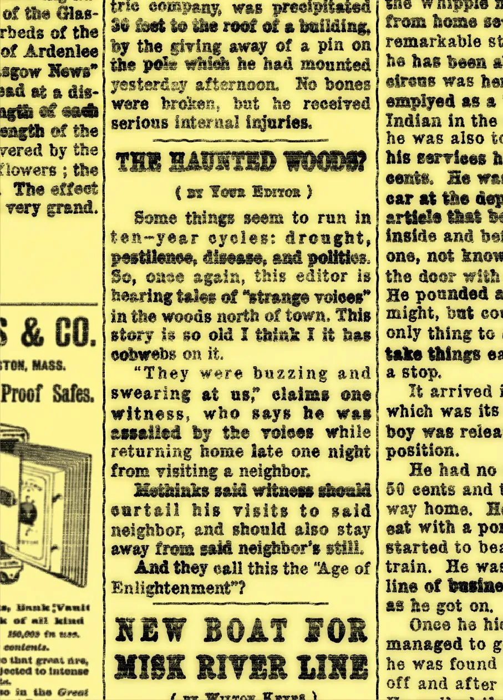

Копли ей не особенно нравится, но она не верит, что он мог угрожать всерьёз. «Айк вспыльчивый, от него многого можно ждать, — говорит она. — Но убивать бы он не стал».

Луиза видела их ссору за день до того, как нашли записку с угрозой. Копли и правда ударил первым, попав Барнсу в лицо. Но Барнс дважды быстро ударил в ответ, и Копли остался на коленях посреди пыльной улицы, хватая ртом воздух.

### Городской архив

Как городской секретарь, Луиза имеет доступ ко всем городским документам. Сейчас их хранят в большом доме неподалёку, который все знают как старый дом Пикерингов. В этом просторном доме жили Пикеринги, пока не построили особняк над рекой.

Архив открыт для всех, хотя Луиза неохотно допускает посторонних без веской причины. Здание держат под замком, и Луиза должна присутствовать, пока сыщики перебирают бумаги. «А мне придётся оставить магазин на Родни, пока мы там будем», — жалуется она.

### Редакция «Фоксфилд курьер»

У Луизы также есть ключи от запертой редакции с закрытыми ставнями, где некогда помещалась газета «Фоксфилд курьер». Как и с городскими документами, она настоит на том, чтобы присутствовать при просмотре газетного архива.

> **Раздатка 2. «Призрачный лес?»**
>
> ПРИЗРАЧНЫЙ ЛЕС?
>
> (от вашего редактора)
>
> Некоторые вещи, кажется, ходят десятилетними кругами: засуха, мор, болезни и политика. Вот и снова ваш редактор слышит байки о «странных голосах» в лесу к северу от города. История эта так стара, что, по-моему, уже поросла паутиной.
>
> «Они жужжали и ругались на нас», — утверждает один свидетель, на которого, по его словам, голоса напали, когда он поздно ночью возвращался домой от соседа.
>
> Сдаётся мне, означенному свидетелю следовало бы пореже ходить к означенному соседу, а также держаться подальше от самогонного аппарата означенного соседа.
>
> И это они называют «веком просвещения»?

*Прим. перев.:* в оригинале в словах «I think I it has cobwebs» лишнее I.

### Подробнее о Родни Грине

Грин пошёл в армию в 1916 году, в восемнадцать лет. Не прошло и года, как его отправили за океан. Во Франции его ранило артиллерийским снарядом, и он едва выжил. Некогда красивый, теперь он страшно обезображен. На голове и лице грубые шрамы после поспешной полевой операции. Его IQ, вероятно, около семидесяти, а левая сторона тела частично парализована, и на ходу его заносит. Соображает он медленно, но прежнюю жизнь помнит ясно. Помнит и возлюбленную, которая, увидев, что с ним стало, ушла к другому, а затем уехала из города. Родни никогда об этом не говорит, но Луиза может поведать сыщикам эту грустную историю.

Родни живёт с матерью, Идой, в маленьком доме через дорогу от магазина. Почти всё свободное время он проводит в школе: помогает по хозяйству, чистит губки для доски и играет со школьниками в кикбол. Он совершенно безобиден, а горожане относятся к нему с особым уважением.

Если заговорить с Родни, он застесняется. Рассказать ему особенно нечего, разве что он живёт с матерью за углом. Если спросить о ранениях, улыбка сойдёт с его лица, и он молча вернётся к метле. Если Луиза рядом, она отчаянно подаст сыщику знак не задавать таких вопросов, но, скорее всего, будет уже поздно.

### Почтальон

В любой из визитов в универсальный магазин сыщики могут случайно встретить фоксфилдского почтальона Сидни Этцлера, когда Хранитель сочтёт это уместным. Сидни — вдовец лет шестидесяти пяти, служит в Почтовой службе США. В Фоксфилд почту привозят на грузовике в универсальный магазин. Здесь Этцлер её сортирует и развозит по городу и южным фермам на небольшом пикапе «Форд» модели T. После обеда запрягает лошадь в повозку у «Сельхозинвентаря Фоксфилда» и едет по северным фермам.

В разговоре с Сидни сыщики уловят лёгкий запах спиртного.

Если спросить Сида, он отсоветует ехать туда на автомобиле. «Завязнете, как пить дать». Сидни может сообщить следующее.

### Глава тауншипа Барнс

Сидни симпатизирует Барнсу, хотя признаётся, что в церковь нынче ходит редко.

### Лесная аренда

Он признаёт, что аренда леса принесла бы городу хорошие деньги, но ему тяжело представить, что «эти красивые холмы останутся голыми». Развозя почту по северным фермам, Сидни наслаждается тишиной, покоем и красотой этих мест.
