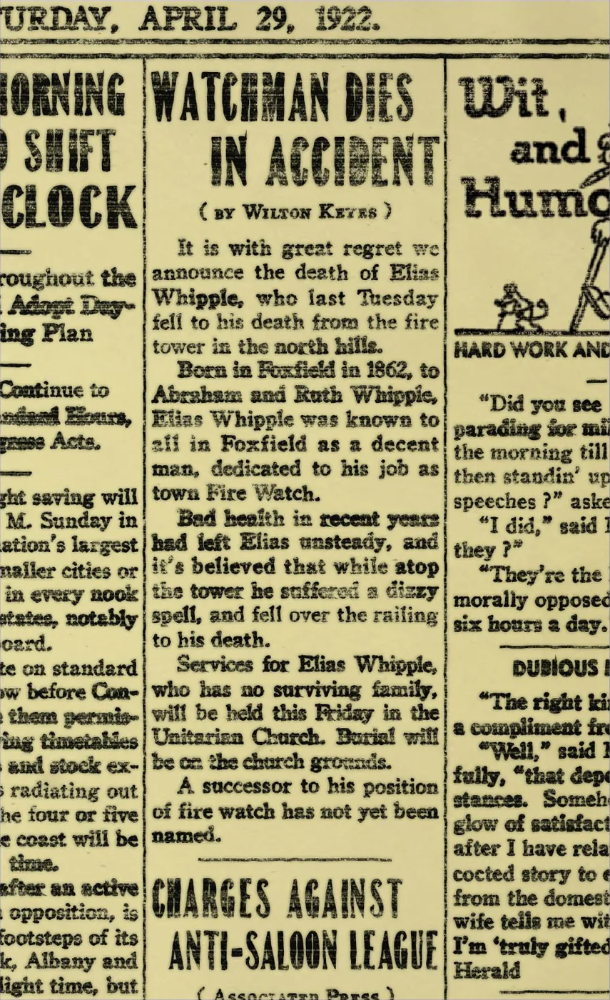

Рассказывают, что он упал головой вниз и о выступ скалы разбил голову вдребезги.

Дора Слейт, городской коронер, выдала свидетельство о смерти, признав гибель Уиппла несчастным случаем. Если спросить её об этом, она может признаться, что допускает самоубийство. Но ни доказательств, ни предсмертной записки не было, и она записала несчастный случай, чтобы не пятнать имя Уипплов. При успешной проверке Убеждения Дора разговорится и расскажет сыщикам, что голова Уиппла была разбита в кашу, а мозгового вещества на месте нашли на удивление мало.

Почтальон Сидни Этцлер и Элайас Уиппл любили выпить вместе. Уиппл рассказывал ему о голосах. Сидни не верит ни в самоубийство, ни в несчастный случай. «А мозги-то где? — спрашивает он. — Вот сами скажите, а?»

*Прим. перев.:* в оригинале здесь «Sydney Etlzer». На с. 77 и 95 фамилия напечатана Etzler.

> **Раздатка 3. «Смотритель погиб при несчастном случае»**
>
> …СУББОТА, 29 АПРЕЛЯ 1922 ГОДА.
>
> СМОТРИТЕЛЬ ПОГИБ ПРИ НЕСЧАСТНОМ СЛУЧАЕ
>
> (Уилтон Киз)
>
> С глубоким прискорбием сообщаем о смерти Элайаса Уиппла, который в прошлый вторник разбился, упав с пожарной вышки в северных холмах.
>
> Элайас Уиппл родился в Фоксфилде в 1862 году в семье Абрахама и Руфи Уиппл; весь Фоксфилд знал его как порядочного человека, преданного своей работе городского пожарного смотрителя.
>
> Плохое здоровье в последние годы сделало Элайаса нетвёрдым на ногах, и считается, что наверху вышки у него закружилась голова и он упал через перила навстречу смерти.
>
> Отпевание Элайаса Уиппла, не оставившего родных, состоится в эту пятницу в унитарианской церкви. Похоронят его на церковной земле.
>
> Преемник на должность пожарного смотрителя пока не назначен.

*Прим. перев.:* заметка подписана «Уилтон Киз», тогда как в тексте сценария владельца газеты зовут Уилсон Киз (с. 79).

### Фоксфилдская унитарианская церковь

Унитарианская церковь с её высоким кирпичным шпилем — самое большое и внушительное здание в городе. Этот массивный кирпичный храм в неоготическом стиле построили в 1846 году целиком на деньги Аарона Пикеринга, после того как прихожане Фоксфилда проголосовали за переход от конгрегационализма к более современному и гораздо более либеральному унитарианству. Церковь вмещает триста прихожан, и по воскресеньям она почти полна.

Церковь содержится на средства фонда, учреждённого Аароном Пикерингом. Из него оплачивают содержание здания, небольшое жалованье пастора и жильё для его семьи в особняке Пикерингов.

К востоку от церкви находится кладбище. Здесь сотни могил, некоторые ещё с XVIII века. Над ними возвышается большой мавзолей из белого мрамора с надписью «Пикеринг» над дверью. Внутри погребены Аарон Пикеринг с женой Анной и Бертран Пикеринг с женой Эммой.

Входная дверь церкви всегда открыта. Если при первом посещении сыщики придут днём, они застанут пастора Генри Барнса. Он работает в кабинете, услышит, как открывается дверь, и с улыбкой выйдет навстречу гостям.

### Генри Барнс

Тридцатипятилетний Генри Барнс — искренний, обаятельный и образованный человек. Он встречает гостей широкой улыбкой и протягивает руку. «Добро пожаловать, друзья мои».

Похищение детей свело его с ума, но по нему этого не скажешь. Он держится уверенно и с достоинством, охотно беседует с сыщиками. Смотря как сыщики оказались втянуты в эту историю, он, возможно, уже ждёт их. В любом случае он постарается представить ссору с Айком Копли пустяком, а то и вовсе обойдёт молчанием угрозу. «Айк просто пар выпускает, — скажет он. — За свою жизнь я не боюсь». Записку с угрозой он, по его словам, выбросил.

### История Фоксфилда

Барнс может рассказать историю города, уделив особое внимание фабрике и тому, как тяжело её гибель ударила по Фоксфилду. Он скажет, что переехал сюда с семьёй двенадцать лет назад.

### Айк Копли

«Человек он хороший, — говорит Барнс, — просто слишком уж привык к своему». Если спросить о драке, Барнс криво улыбнётся: «Немного повздорили. Не сошлись в городских делах. Право, пустяк».
