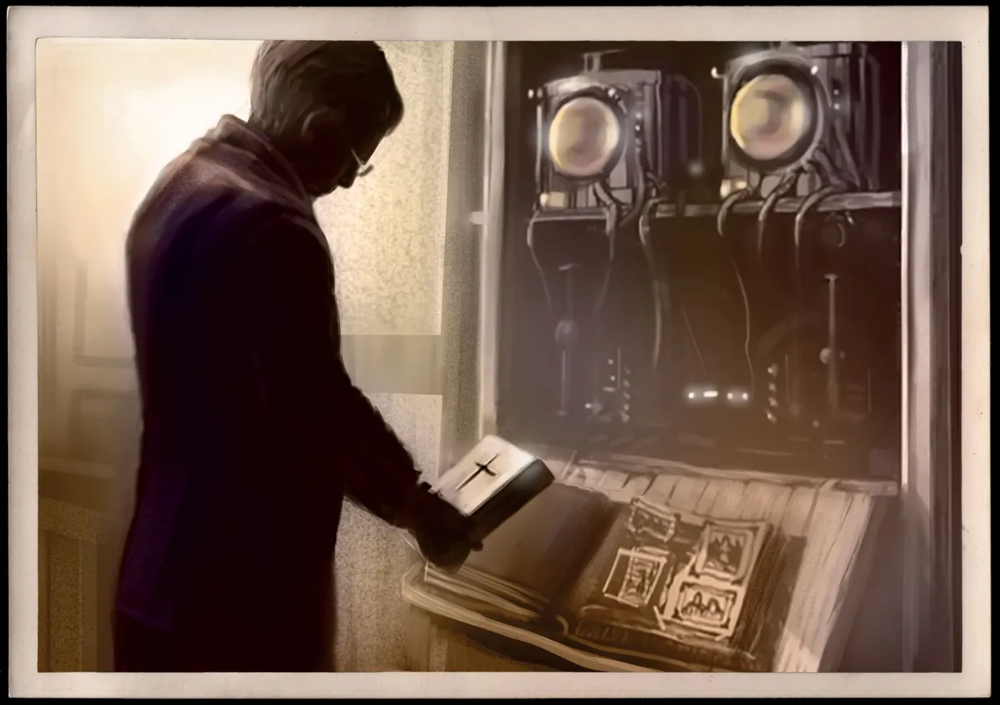

«Он строгий, — говорит Бетти об отце подруги. — Вечно заставлял Мэри учить Библию». Это преувеличение, хотя доля правды в её словах есть. Кое-кто, впрочем, сказал бы, что родителям самой Бетти и Бобби не помешало бы быть построже. Оба, похоже, ходят по городу где хотят, и их часто видят на улице поздно ночью.

### Учительница Аида Симпсон

Аида преподаёт здесь почти двадцать лет и помнит ещё те времена, когда были заняты все четыре комнаты и в Фоксфилде учились до выпускного класса. «Теперь столько ребят бросает школу после восьмого класса, а то и раньше, — сокрушается она. — Горькая ирония в том, что работы здесь почти нет и большинство всё равно перебирается в Болтон, чтобы наняться на фабрику простыми рабочими».

Она учила и Мэри, и Роберта Барнсов. Оба хорошо успевали, хотя Роберту порой трудно было усидеть на месте. На вопросы об интернате она ответит, что знает только, где они теперь учатся: в школе Брукдейл в Аркхэме. «Как-то всё внезапно вышло». Она может заметить, что с тех пор их не видела.

### Южные фермеры

Сыщики могут вернуться по дороге, которой приехали, и навестить кого-нибудь из фермеров вдоль Фоксфилд-роуд. К югу от города фермы идут одна за другой до самого Мискатоника, за которым проходит Эйлсберийская дорога.

После гибели фабрики, лишившей всех заработка, южные фермеры справились лучше северных. Они сократили отары и смогли отвести немалую часть своей каменистой земли под продовольственные культуры.

Большинство из них унитариане и стоят за Генри Барнса, хотя многие тревожатся из-за его упорного сопротивления лесной аренде. Среди здешних фамилий — Эбботты, Паркеры, Сойеры, Сатлеры и Таггерты.

*Прим. перев.:* здесь напечатано Abbott, а на карте на с. 72 — Abbot.
