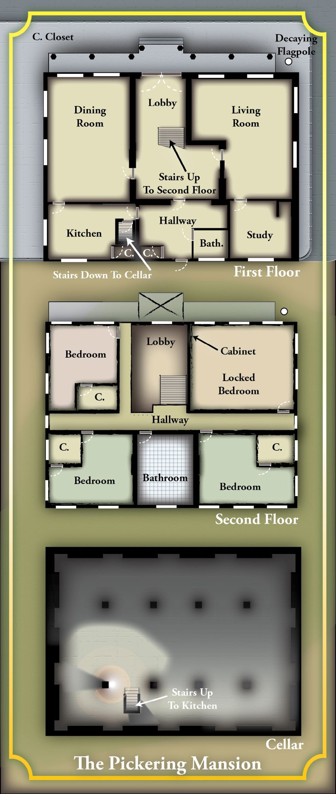

**Подписи на плане**

- C. — стенной шкаф.
- Покосившийся флагшток у веранды.
- Первый этаж.
    - Столовая, прихожая, гостиная.
    - Кухня, коридор, ванная, кабинет, два стенных шкафа.
    - Лестница на второй этаж, лестница в подвал.
- Второй этаж.
    - Три спальни, прихожая, коридор, ванная, три стенных шкафа.
    - Запертая спальня, шкаф.
- Подвал.
    - Лестница на кухню.

### Фоксфилдский мост

Прежде этот типичный для Новой Англии крытый мост называли мостом Пикеринга. Теперь его зовут просто Фоксфилдским мостом, и под этим именем он числится в большинстве исторических реестров. Его построили на деньги Пикерингов в первые годы работы фабрики взамен прежнего простого деревянного моста. Он и теперь крепок.

Копыта приятно стучат по деревянному настилу под двускатной крышей, почти сплошь заросшей зелёным мхом. За мостом дорога сворачивает налево и тянется вдоль холмов на север. Сперва она проходит мимо руин Милл-Тауна и фабрики Пикерингов, а дальше ведёт к северным фермам.

### Милл-Таун

Четыре больших общежития и несколько отдельных маленьких домов за последние годы пришли в запустение. Одно деревянное жилище, рядом с маленькой католической часовней, почти не пострадало и до сих пор обитаемо.

### Дом Хылиньских

В этом маленьком доме на одну семью живут Роуз Хылиньская и её тринадцатилетний сын Питер. Муж Роуз, Войцех, несколько лет работал на фабрике, пока разрушительный пожар 1911 года не оставил его без заработка. Большинство семей иммигрантов уехали из Фоксфилда, многие перебрались в Болтон, где ещё можно было устроиться на фабрику. Хылиньские остались, пользуясь бесплатным жильём. Войцех подрабатывал в городе мастером на все руки или нанимался батраком на фермы. В 1921 году он умер от гриппа, оставив жену и маленького сына. Роуз зарабатывает чем может: чаще всего стирает бельё для горожан, берёт и шитьё на дом.

*Прим. перев.:* в оригинале в этом предложении лишнее «the»: «for the some of the town folk».

Роуз мало знает о городских делах, но любит пастора Барнса. Он не раз выручал бедствующую семью парой долларов или корзиной продуктов из магазина Паркера. Недавно Роуз заметила, что Барнс ведёт себя странно. Сама она об этом не заговорит. Сыщикам придётся настоять или успешно применить Обаяние, Красноречие либо Убеждение.
