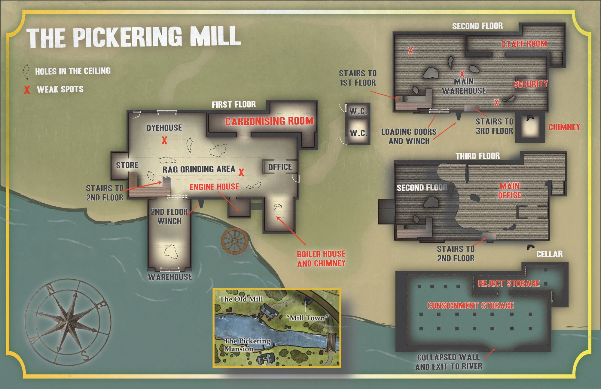

Огромное водяное колесо сорвалось с вала и теперь недвижно гниёт в воде. Бетонная плотина ещё цела, и через её край переливается вода. По плотине можно перейти реку, но на скользком гребне, по которому бежит вода, нужна проверка ЛВК. При провале сыщик падает. С вероятностью 50% он свалится в фабричный пруд и лишь основательно промокнет. Вода там по грудь, утонуть почти невозможно. Если же он сорвётся на другую сторону, то упадёт с высоты 2 м на каменистое дно реки. В это время года там меньше трети метра воды. Успешная проверка Прыжков позволит приземлиться на ноги без травмы. При провале сыщик получит 1d2 пункта урона: скорее всего, подвернёт лодыжку или растянет запястье.

Все двери заколочены. На наружных стенах прибиты обветшавшие таблички «Вход воспрещён», чтобы дети не лезли внутрь и не покалечились. Тому, кто твёрдо решил войти, доски не помешают. На восточном и северном торцах может понадобиться ломик, а на главных двустворчатых дверях с юга доски настолько сгнили, что их можно отодрать руками.

Если с сыщиками Питер Хылиньский, он покажет свой «тайный вход» у северной двери. В пролом в стене может протиснуться любой сыщик с ТЕЛ 65 или меньше.

### Внутри фабрики

Внутри действительно опасно. Полы завалены обломками, ослабли и местами едва держатся. Самые опасные места на плане отмечены знаком X. Если нагрузка окажется выше предельной, сыщики провалятся на этаж ниже.

Если сыщики взяли с собой Питера Хылиньского, он предупредит их о большинстве слабых мест, но знает далеко не все.

### Первый этаж

Это самая большая часть фабрики. Деревянный пол покрыт обломками, пылью и звериным помётом. Сквозь просветы во втором этаже падает немного света, но здесь довольно темно, так что пригодится фонарь или другой источник света. Два знака X отмечают слабые места пола (оба известны Питеру). Если сыщики ступят туда или задержатся там, пол может рухнуть и сбросить их в частично затопленный подвал. Западный участок выдерживает до ТЕЛ 100. Восточный — не больше ТЕЛ 70. Провалившись, сыщики получают 1d3 пункта урона: они падают в каменный подвал, наполовину залитый мутной водой глубиной около метра.

На второй этаж можно попасть двумя способами. Самый очевидный — сильно обгоревшая лестница. Она шатается, и пары ступеней недостаёт. Питер часто ею пользуется,

**Ключ и подписи на плане**

- Пунктирный контур — дыры в потолке. X — слабые места пола. Стороны света: север, восток, юг, запад.
- Первый этаж.
    - Красильня, карбонизационный цех, кладовая, зона измельчения ветоши, контора.
    - Машинное отделение, котельная и труба, склад, две уборные.
    - Лестница и лебёдка на второй этаж.
    - Два слабых места (западное и восточное).
- Второй этаж.
    - Комната персонала, главный склад, охрана, труба.
    - Лестница на первый этаж, лестница на третий этаж, погрузочные двери и лебёдка.
    - Три слабых места (западное, центральное и юго-восточное).
- Третий этаж.
    - Главная контора, лестница на второй этаж.
    - Второй этаж виден через провал.
- Подвал.
    - Склад брака, склад партий, обрушенная стена и выход к реке.
- На врезке: старая фабрика, Милл-Таун, особняк Пикерингов.
