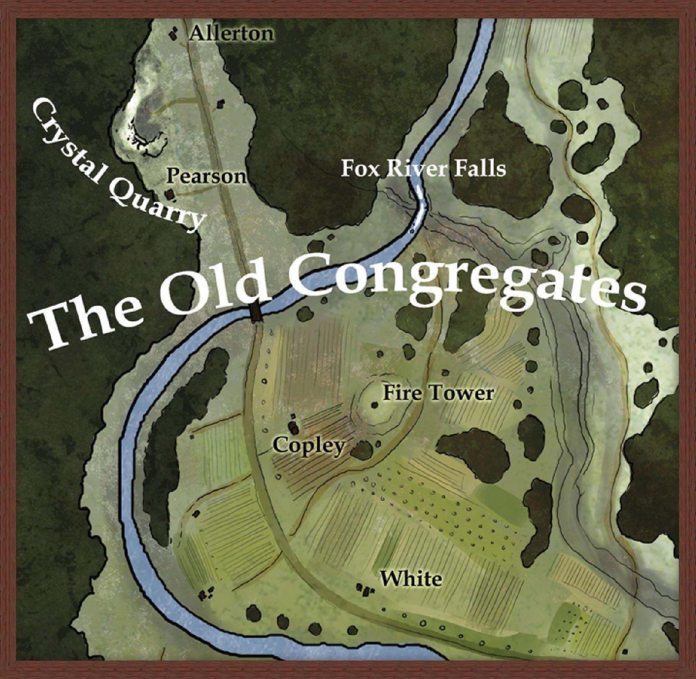

## События в Фоксфилде

Пока идёт расследование, в городе и окрестностях происходят описанные ниже события. Для каждого предложено своё время, но Хранитель сам решает, когда оно придётся к месту, исходя из темпа игры и привычек группы.

### Ночные прогулки Барнса

Сыщики могут узнать, что Барнс время от времени выходит на прогулку поздно ночью. Об этом могут рассказать Бетти и Бобби, которых сыщики уже могли встретить возле школы или на пожарной вышке. Расспросы Роуз Хылиньской, самовольно поселившейся в Милл-Тауне, тоже могут вывести на этот след.

*Прим. перев.:* в первом предложении английского абзаца у фамилии Barnes пропущен притяжательный апостроф.

Барнс обычно выходит из дома около одиннадцати вечера, когда весь город давно спит. Прикрутив фитиль керосиновой лампы до минимума, он выскальзывает через парадную дверь.

**Подписи на карте**

- Земли конгрегантов.
- Фермы Аллертон, Пирсонов, Копли и Уайтов.
- Кристальный карьер.
- Водопад Фокс-Ривер.
- Пожарная вышка.
