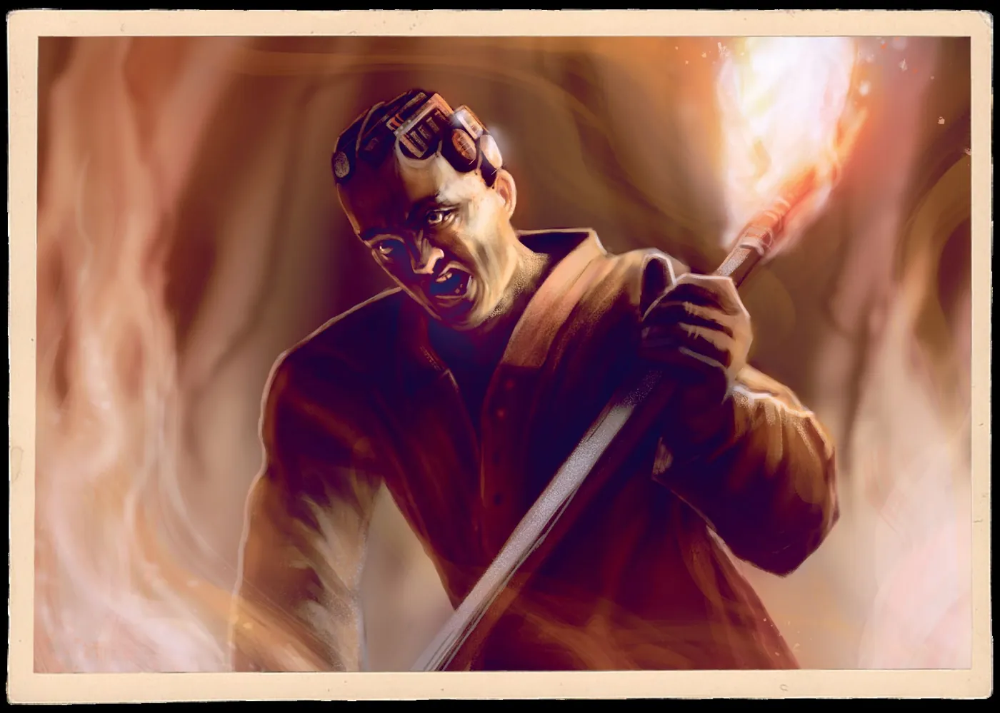

Если ключ повернули как надо, срабатывает механизм, и дверь плавно отъезжает в сторону. За ней низкий узкий тоннель, тоже пятиугольный в сечении, шириной чуть меньше метра. Он уходит в глубь холма.

Если у сыщиков нет ключа, они всё равно могут найти замочную скважину, как описано выше. Отпереть дверь без каменного ключа невозможно, но в скважину как раз помещается динамитная шашка. Одной хватит, чтобы уничтожить замочную скважину и большую часть скалы вокруг, выведя из строя дверь, которая перекрывает тоннель. Через несколько минут работы по расчистке обломков проход откроется.

### Планы Грибов

Ми-го хотели бы сохранить станцию, но для них важнее остаться незамеченными людьми. Если их последний расчёт на поджигателя Айка Копли не оправдается, они начнут готовиться к уходу: соберут оборудование и всё, что можно унести, и уйдут через Врата в главную колонию в Вермонте.

От событий перед развязкой зависит, что сыщики застанут в тайном логове. Они могут прийти уже после ухода всех ми-го. А могут застать станцию в процессе свёртывания, когда в пещере ещё остаётся несколько тварей. Хранитель решает сам, учитывая действия сыщиков и то, какую развязку хочет провести.

### Часовой ми-го (Фоксфилд)

Если сыщики доберутся до водопада, пока ми-го ещё эвакуируются, они нарвутся на часового. Тот сидит над водопадом, скрытый камнями и кустарником. Вооружённый электропушкой, он открывает огонь, как только сыщики собираются пройти за водопад.

*Прим. перев.:* здесь оружие названо «lightning gun». Использовано название по статблоку на с. 97 — «Electric Gun», электропушка.

Если часовой на месте, тайная дверь за водопадом открыта.

### Ужас в холмах

Найдя дверь и тем или иным способом открыв её, сыщики увидят гладкий пятиугольный тоннель. Он около метра в поперечнике и примерно 6,7 м длиной, с уклоном в глубь холма. В конце виднеется жутковатый фиолетовый свет. Глубокая, неслышимая пульсация машин скорее ощущается телом.

По тоннелю приходится ползти на четвереньках, пока он не выходит в скальный зал комплекса. Если ми-го ещё не покинули станцию, первый сыщик на выходе сталкивается с 1d3 внеземными существами.
