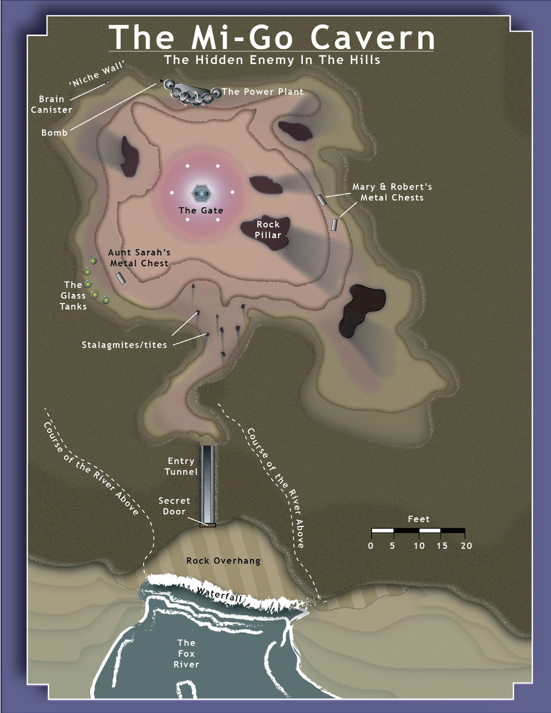

Крупная самка, предводительница ми-го, встречает первого сыщика клешнями, едва тот высунет голову из тоннеля. По нижней стороне её тела копошатся шмыгуны. При каждой успешной атаке по ней 1d3 шмыгунов срываются вниз. Оставшись без матери, они падают на пол и с вероятностью 50% бросаются на сыщиков прыжком с захватом. Остальные разбегаются. Если предводительницу убьют, два других Гриба отступают сквозь странное устройство Врат неподалёку. Как только ми-го проходят между двумя рогами-полумесяцами, кончики соединяет синяя дуга, а твари бледнеют и исчезают.

*Прим. перев.:* на с. 92 в зале может оказаться от одного до трёх ми-го. Здесь текст предполагает, что помимо предводительницы там ещё двое.

### Вход в зал

Шмыгунов здесь много, и они могут больно докучать сыщикам, пока те осматривают комплекс ми-го. Хранитель может вводить их по своему усмотрению.

Миновав тоннель, сыщики оказываются в примерно круглом зале с куполообразным сводом, почти 33 м в поперечнике. Мягкий фиолетовый свет исходит от пятиугольных модулей, разбросанных по потолку и верхней части стен. Каждый около 15 см в поперечнике.

Первое, что бросается в глаза, — подиум с пятью ступенями в центре зала, около 3,3 м в поперечнике. Над ним выгибаются два стержня в форме полумесяцев, похожие на слоновьи бивни. Между их кончиками зазор около двух третей метра, в котором время от времени вспыхивает синяя дуга. Успешная проверка Мифов Ктулху позволяет опознать в сооружении своего рода Врата.

Слева, метрах в десяти, вдоль стены стоят пять стеклянных цилиндров высотой около 3,3 м. Они подсвечены изнутри и заполнены пузырящейся желтоватой жидкостью. В каждом виднеется что-то неразличимое. Перед баками стоит большой металлический сундук около 2,7 м длиной, 1 м шириной и 1,3 м высотой. На другом конце зала сыщики замечают ещё два таких сундука.

В глубине пещеры громоздится машина высотой почти 6,7 м — источник низкой пульсации. Она усыпана огнями, которые мигают в разных, словно случайных последовательностях. В стене слева от машины вырублено несколько глубоких ниш высотой около двух третей метра. Все пусты, кроме одной, где стоит мозговой цилиндр ми-го.

### Врата ми-го в Фоксфилде

Это сложное устройство ми-го связано с их главной колонией в Вермонте. Сами Врата — два изогнутых рога на ступенчатом подиуме, почти сходящихся вверху. На панели, установленной на подиуме, столько огоньков, переключателей и шкал, что в них трудно разобраться.

Сыщик может попробовать воспользоваться Вратами, но это будет последнее, что он сделает. Врата настроены на физиологию ми-го и смертельны для людей. Если кто-то шагнёт сквозь них в любом направлении, с другой стороны тут же выплюнет дымящуюся груду мяса без кожи, волос и костей. Ослепший, лишённый возможности дышать несчастный ещё пару минут корчится на земле и умирает. Свидетели теряют 1/1d6 пункта Рассудка.

**Подписи на плане «Пещера ми-го. Тайный враг в холмах»**

- Стена с нишами, мозговой цилиндр, бомба ми-го, энергоустановка.
- Врата, скальный столб.
- Металлические сундуки Мэри и Роберта, металлический сундук тёти Сары.
- Стеклянные баки, сталагмиты и сталактиты.
- Входной тоннель, тайная дверь, русло реки над пещерой (обе границы).
- Скальный навес, водопад, река Фокс.
- Шкала: 0 / 1,7 / 3,3 / 5 / 6,7 м.
