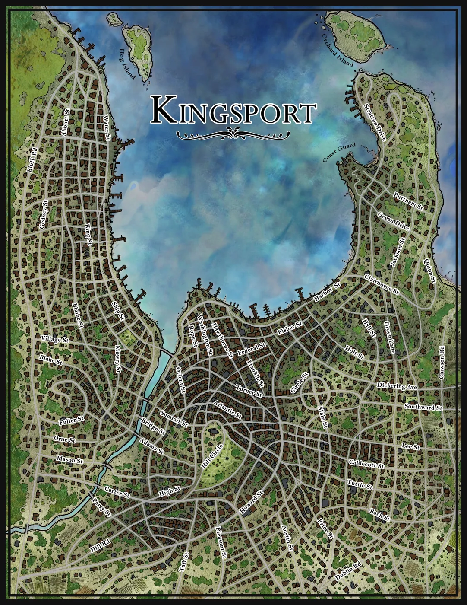

# Кингспорт

**Подписи на карте**

- Острова и берег.
    - Hog Island — остров Хог.
    - Orchard Island — остров Орчард.
    - Coast Guard — Береговая охрана.
- Западный берег.
    - Abbott St — Эбботт-стрит.
    - Water St — Уотер-стрит.
    - Bluff Rd — Блафф-роуд.
    - Gedney St — Гедни-стрит.
    - King St — Кинг-стрит.
    - Blaine St — Блейн-стрит.
    - Ship St — Шип-стрит.
    - Village St — Виллидж-стрит.
    - Blake St — Блейк-стрит.
    - Mowry St — Маури-стрит.
    - Fuller St — Фуллер-стрит.
    - Orne St — Орн-стрит.
    - Mason St — Мейсон-стрит.
    - Carter St — Картер-стрит.
    - Perry St — Перри-стрит.
    - Hill Rd — Хилл-роуд.
- Центр.
    - Rope St — Роуп-стрит.
    - Washington St — Вашингтон-стрит.
    - Hawthorne St — Хоторн-стрит.
    - Orient St — Ориент-стрит.
    - Summit St — Саммит-стрит.
    - Bridge St — Бридж-стрит.
    - Adams St — Адамс-стрит.
    - Fisher St — Фишер-стрит.
    - Federal St — Федерал-стрит.
    - Franklin St — Франклин-стрит.
    - Turner St — Тёрнер-стрит.
    - Atlantic St — Атлантик-стрит.
    - Hill Circle — Хилл-сёркл.
    - High St — Хай-стрит.
    - Howard St — Хауард-стрит.
    - Taft St — Тафт-стрит.
    - Pleasant St — Плезант-стрит.
    - Austin St — Остин-стрит.
- Восточная часть города.
    - Stratton Drive — Страттон-драйв.
    - Puttnam St — Паттнам-стрит.
    - Ocean Drive — Оушен-драйв.
    - Jackson St — Джексон-стрит.
    - Quinn St — Куинн-стрит.
    - Claiborne St — Клейборн-стрит.
    - Harbor St — Харбор-стрит.
    - Hall St — Холл-стрит.
    - Green Lane — Грин-лейн.
    - Holt St — Холт-стрит.
    - Clawson Rd — Клосон-роуд.
    - Dickering Ave — Дикеринг-авеню.
    - Southward St — Саутуорд-стрит.
    - Circle St — Сёркл-стрит.
    - Main St — Мейн-стрит.
    - Lee St — Ли-стрит.
    - Caldecott St — Колдекотт-стрит.
    - Tuttle St — Татл-стрит.
    - Price St — Прайс-стрит.
    - Back St — Бэк-стрит.
    - Dublin Rd — Дублин-роуд.
