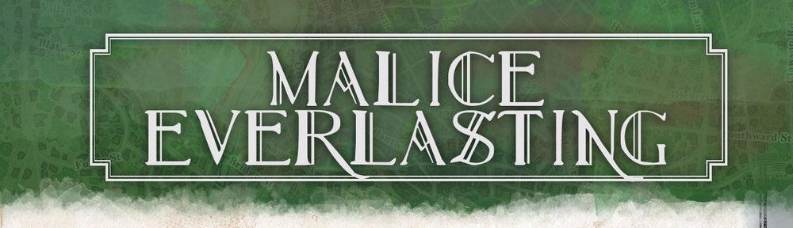

# Вечная злоба

С самого основания в 1639 году Кингспорт, город в туманах, хранит множество тайн. Ныне этот старый тихий город славится как мирный приморский курорт. Из года в год отдыхающие здесь обедают в изысканных ресторанах, ходят по художественным галереям или целыми днями гуляют под парусом. С первым осенним холодком туристы уезжают, оставляя кингспортцев наедине с узкими извилистыми улочками и тайнами, укрытыми туманом. Но в этом году всё иначе. С концом лета дни стали короче, а на несколько старейших семейств города обрушилась беда.

Всё началось три недели назад, когда «Кингспорт кроникл» сообщила, что горожанина по имени Саймон Макдональд поразил загадочный недуг. Ещё за несколько дней до этого он казался совершенно здоровым, а потом внезапно ослеп. Через шесть дней та же участь постигла другого жителя города, Бернарда Уайта. Вскоре объявились ещё две жертвы: обе разом лишились зрения. Никто из четверых не живёт по соседству, они не работают вместе и даже не знакомы друг с другом. Они не ели одного и того же и не пили из одного питьевого фонтанчика. Врачи местной Конгрегационалистской больницы не могут установить даже причину недуга, не говоря уже о том, как он передаётся и чем его лечить.

Страх овладел сонным приморским городком. Никто не знает, кого постигнет беда следующим и как от неё уберечься. Власти почти ничего не могут объяснить, и больше никто не чувствует себя в безопасности. Кингспортцы требуют ответов и заверений, но в «городе в туманах» их ждать неоткуда.

## Сведения для Хранителя

В начале 1690-х годов в Кингспорте жил Мэттью Чандлер, свечник, колдун и служитель Великого Древнего И’голонака. Много лет Чандлер служил своему тёмному богу: похищал путников, а порой и горожан, и приносил их в жертву в тайном помещении под домом. Тела он прятал в бочках с грузом, а в безлунные ночи топил бочки в заливе.

В один роковой день рыбачья сеть зацепила несколько затопленных бочек. Когда бочки вскрыли, обнаружилось их жуткое содержимое. В некоторых погибших опознали горожан, бесследно исчезнувших в последние месяцы. Бочки были запечатаны воском, и эта улика быстро вывела на городского свечника.

Колдун увидел, как над местом, куда он сбрасывал бочки, собираются лодки, а на берегу растёт толпа. Он понял, что времени почти не осталось. Если не удастся бежать и уцелеть, он по крайней мере обеспечит себе бессмертие и однажды вернётся.

В спешке Чандлер провёл обряд, привязавший его душу к этому миру, что бы ни случилось с телом. Заклинание позволяло колдуну остаться здесь «призраком» и при случае завладеть чужим телом. Для завершения обряда он отрубил себе левую кисть: ей предстояло стать якорем для его сознания. Обработав страшную рану, он спрятал руку в тайном храме, куда вёл ход из подвала, заложил тесный проход кирпичом и приготовился бежать.

Бросив дом, Чандлер скрывался до темноты, а потом попытался ускользнуть на маленькой лодке. Но туман его не укрыл. Рыбаки на небольшом судне отрезали ему путь и втащили к себе на борт. Избитого и связанного Мэттью Чандлера доставили в Кингспорт, чтобы он ответил за свои преступления. На другой день убийцу судили и повесили, а его дом сожгли дотла. Заподозрив колдовство, горожане сожгли и тело, а кости истолкли в прах. Чтобы колдун не смог вернуться, останки смешали с морской солью и рассеяли в нескольких местах на освящённой земле. Увы, и этого оказалось мало. Пропавшую руку, ключ к его бессмертию, так и не нашли.

В 1750 году на этом месте построили новый дом, воспользовавшись уцелевшим фундаментом. Тогда дух Мэттью Чандлера, привязанный к этому месту спрятанной рукой, и начал искать себе новое тело. Попытка за попыткой кончалась провалом. Всё, чего он добился, — напугал сменявших друг друга жильцов. Большинство из тех, кого он избрал своей жертвой, мучились страшными кошмарами и со временем сходили с ума, а одного человека он довёл до самоубийства. Дом подолгу пустовал: очередной хозяин всякий раз спешил съехать. Завладеть новым телом
