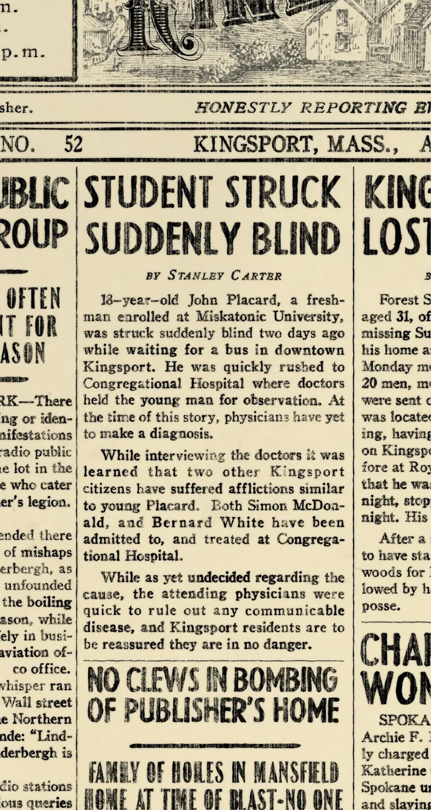

оказалось куда труднее, чем рассчитывал Чандлер.

Всё изменилось в 1913 году, когда в дом въехала молодая чета Пайнов. Дух Чандлера затаился и выжидал. Через два года у супругов родился сын, которого назвали Рональдом, и Чандлер понял, что настал его час. Теперь дух колдуна сосредоточил все силы на беззащитном младенце. Понадобилось тринадцать лет, но в конце концов Чандлер подчинил себе тело юного Ронни Пайна. К тому времени отец Ронни уже был мёртв: он погиб на работе, когда мальчику было десять лет, и с тех пор Ронни воспитывала мать.

Подчинив Ронни Пайна целиком своей воле, колдун заточил его мать в доме. Он оставил её в живых, надеясь обратить в веру И’голонака, а если она не поддастся — принести её в жертву. Затем колдун проломил кирпичную кладку, открыл свой тайный храм и вновь получил доступ к книгам Мифов и магическим реликвиям. Чандлер возобновил служение злобному Великому Древнему и со временем нашёл для своего господина подходящее вместилище — здешнюю жительницу Норму Фарр. Тогда одержимый Ронни Пайн начал мстить потомкам рыбаков, которые несколько столетий назад схватили и избили Чандлера.

Заклинанием «Наслать слепоту» колдун уже лишил зрения четверых из пяти намеченных жертв и теперь готовится взяться за последнюю. Это лишь первая часть его замысла. Вскоре он нашлёт на них жуткие кошмары, а под конец устроит их убийство. С каждым днём колдун становится всё увереннее в себе и всё опаснее.

## Сведения для сыщиков

Сыщики могут взяться за это дело по-разному. Узнать о нём легко: местные газеты сообщают о каждом повороте событий и приводят подробности о всех четырёх жертвах. Если кто-то из сыщиков служит в полиции, занимается частным сыском или работает в медицине, сами власти могут попросить его разобраться в случившемся.

## Кингспорт

В этом сценарии сыщики побывают в разных уголках Кингспорта. Город делится на семь районов: Харборсайд, Холлоу, Централ-Хилл, Саутшор, Даунтаун, Уэст-Сайд и Хиллтаун. При каждом адресе указан район.

## Часть I. Неуловимая связь

Чтобы распутать дело, нужно понять, что общего у жертв. Все они уроженцы Кингспорта, а их родословные восходят к XVII веку. Других явных связей между ними нет. Вот кто пострадал.

> **Раздатка 1. «Студент внезапно ослеп»**
>
> …ЧЕСТНО СООБЩАЯ …
>
> № 52 КИНГСПОРТ, МАСС., …
>
> СТУДЕНТ ВНЕЗАПНО ОСЛЕП
>
> СТЭНЛИ КАРТЕР
>
> Восемнадцатилетний Джон Плакард, первокурсник Мискатоникского университета, два дня назад внезапно ослеп, ожидая автобуса в центре Кингспорта. Его срочно доставили в Конгрегационалистскую больницу, где врачи оставили юношу под наблюдением. На момент выхода заметки диагноз врачи так и не поставили.
>
> Беседуя с врачами, мы узнали, что ещё двое жителей Кингспорта страдают тем же недугом, что и юный Плакард: и Саймона Макдональда, и Бернарда Уайта положили в Конгрегационалистскую больницу и лечат там.
>
> Хотя причина пока не установлена, лечащие врачи сразу исключили заразную болезнь, и жители Кингспорта могут не беспокоиться — им ничто не грозит.

*Прим. перев.:* В заметке среди пациентов больницы назван Саймон Макдональд, а по описанию на с. 103 он находится дома.
