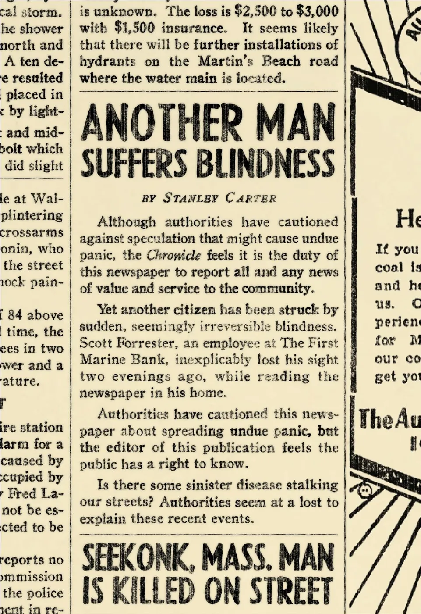

### Саймон Макдональд

Саймону сорок два года. Он женат, у него две взрослые дочери. Он ослеп первым, 20 октября, на рыбалке. Его семья живёт по адресу Шип-стрит, 820, между Баррел-стрит и Силвер-стрит, в Харборсайде. Сейчас Саймон дома, и ему до смерти надоели обследования. Он поговорит с сыщиками только ради жены Мириам, которая просит его помочь расследованию.

### Бернард Уайт

Бернарду тридцать пять лет. Он плотник на местной верфи «Ф. У. Иллсли и сыновья», вдовец без детей. Живёт один в Холлоу по адресу Хай-стрит, 185, между Картер-стрит и Браш-стрит. Сейчас мистер Уайт лежит в Конгрегационалистской больнице, где ему делают анализы и проводят обследования. Бернард ослеп 25 октября, когда одевался к церкви, и теперь совсем пал духом. Он охотно ответит на вопросы сыщиков в надежде, что кто-нибудь поможет ему вернуть зрение. Как он сам говорит: «Кому нужен слепой плотник?»

*Прим. перев.:* В предисловии Бернард ослеп через шесть дней после Саймона, а между указанными датами, 20 и 25 октября, пять дней.

### Джон Плакард

Джону восемнадцать лет. Он живёт в Саутшоре по адресу Холт-стрит, 555, между Грин-стрит и Холл-стрит. Он первокурсник Мискатоникского университета и намерен изучать химию. Джон потерял зрение 1 ноября, пока ждал автобуса. Теперь он дома с матерью, вдовой Вирджинией Плакард, и его часто навещает Эбигейл Уэйт, с которой он встречается со школы. Плакард держится бодро: говорит, что недуг вот-вот пройдёт, и уверяет, что уже различает свет и тени. Вирджиния и Эбигейл тоже не унывают и говорят, что Джон понемногу поправляется. Успешная проверка Психологии покажет, что Джон врёт о выздоровлении, скорее всего, чтобы успокоить мать и Эбигейл.

### Скотт Форрестер

Скотту пятьдесят один год. Он служит в кредитном отделе Первого морского банка Кингспорта и живёт неподалёку, в Даунтауне по адресу Колдекотт-стрит, 460. Сейчас он лежит в Конгрегационалистской больнице. Его жена Марта проводит большую часть времени у его постели. Форрестер ослеп всего день назад, 5 ноября, в обеденный перерыв. У супругов две замужние дочери, обе живут в Аркхэме, а сын погиб на Великой войне. Мистер Форрестер, кажется, больше боится огорчить жену, чем остаться слепым. Марта приходит к нему в каждый час посещений и обычно читает ему газету или держит его за руку и беседует с ним.

> **Раздатка 2. «Ещё один человек ослеп»**
>
> ЕЩЁ ОДИН ЧЕЛОВЕК ОСЛЕП
>
> СТЭНЛИ КАРТЕР
>
> Хотя власти предостерегают от домыслов, способных посеять ненужную панику, «Кроникл» считает своим долгом сообщать обо всём, что ценно и полезно обществу.
>
> Ещё один горожанин внезапно и, по-видимому, необратимо ослеп. Скотт Форрестер, служащий Первого морского банка, позавчера вечером необъяснимым образом лишился зрения, читая газету у себя дома.
>
> Власти предостерегали нашу газету от распространения ненужной паники, но редактор издания считает, что публика имеет право знать.
>
> Неужели по нашим улицам крадётся какая-то зловещая болезнь? Власти, похоже, не могут объяснить последние события.

*Прим. перев.:* В заметке Форрестер ослеп позавчера вечером, читая дома газету. По тексту сценария это произошло день назад в обеденный перерыв, 5 ноября. В описании Форрестера напечатано «stuck blind» вместо «struck blind», а в последней строке заметки — «at a lost» вместо «at a loss».

### Что удалось узнать

Сыщики, расспросившие всех четверых, могут заметить несколько общих черт. Одни видны сразу, другие станут ясны из ответов пострадавших или после успешной проверки Знаний. Уроженцы Кингспорта получают на эту проверку бонусную кость. Все жертвы — мужчины, все они последние мужчины в своих семьях и все происходят из старых кингспортских родов, живущих здесь с колониальных времён.

## Газетчик

Колдун в теле тринадцатилетнего Ронни Пайна следит за каждым, кто проявляет слишком большой интерес к его жертвам. Он не хочет, чтобы его снова выследили и схватили. Ронни недавно устроился подрабатывать газетчиком в «Кингспорт кроникл». Так он узнаёт обо всех новых поворотах дела.

В редакции «Кингспорт кроникл» его знают под именем Олли Мэтток. Он надеется, что вымышленное
