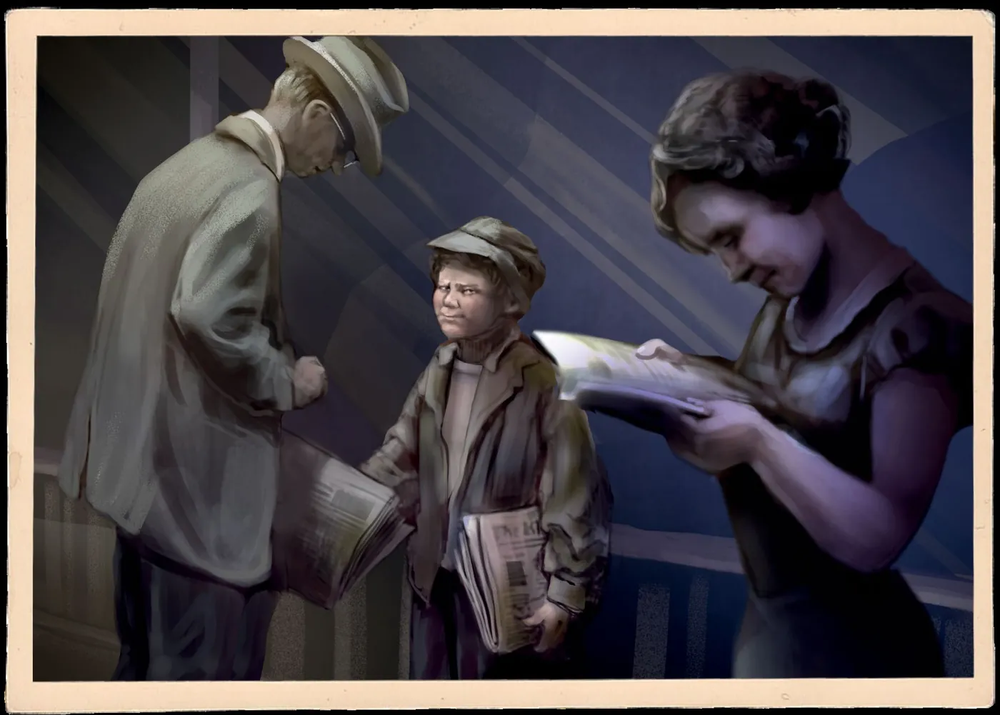

имя помешает связать его с домом Ронни Пайна и с тайнами, которые колдун хранит в подвале. Домой он обычно едет на велосипеде и никогда не выбирает прямой путь. Кружит по улицам, чтобы заметить возможную слежку и оторваться от неё.

Ронни подолгу торчит у Конгрегационалистской больницы и продаёт газеты. На самом деле он следит за полицейскими и врачами, которые занимаются его жертвами. Ронни держится приветливо и старается разговорить всякого, кто приходит в отделение, где лежат Скотт Форрестер и Бернард Уайт. Узнав, что сыщики взялись за дело, он попробует с ними подружиться.

Колдун старается выведать у сыщиков, что им известно. Достаёт ручку и блокнот со словами: «Вот вырасту — буду газетным репортёром». Олли добавляет: «Я и сам за этим делом слежу. Смотрю, не шныряет ли кто подозрительный у больницы». Если сыщики клюнут и попросят рассказать подробнее, он изложит им историю о «таинственном моряке» (см. ниже раздел «Ложный след газетчика»). «А вдруг, если я помогу вам раскрыть дело, меня в „Кроникл“ возьмут репортёром?»

*Прим. перев.:* В конце реплики газетчика в оригинале пропущена закрывающая кавычка.

Узнав, кто такие сыщики, колдун начнёт портить им жизнь. Он может пустить в ход заклинания, подстроить несчастный случай или послать за ними кого-нибудь из своих чудовищных прислужников.

## Ложный след газетчика

Ронни говорит сыщикам, что заметил у больницы таинственного человека, который появлялся всякий раз, как привозили новую жертву. На нём будто бы были толстое пальто, сапоги и «греческая рыбацкая кепка». Ронни уверяет, что человек прихрамывал и надвигал кепку на глаза, стоило полицейским пройти мимо. Он показывает сыщикам маленький фотоаппарат «Кодак Брауни»: «В следующий раз увижу — попробую его снять».

Всё это выдумка. Под описание Ронни подходит с десяток кингспортских рыбаков, а такие кепки особенно любят местные рыбаки-португальцы. По ходу сценария газетчик может сказать сыщикам, что видел «таинственного моряка» и в других местах Кингспорта, особенно там, где случилось что-нибудь жестокое, необычное или сверхъестественное.
