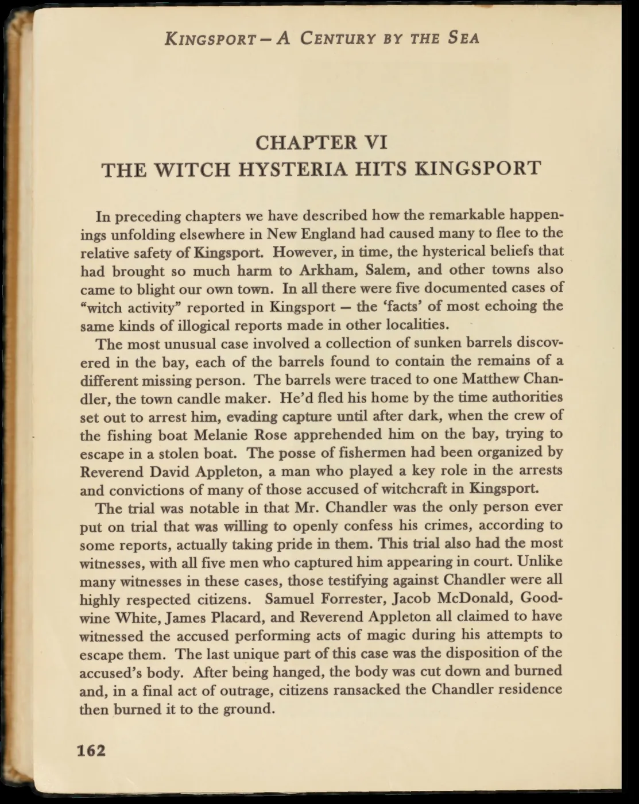

> **Раздатка 3. «Кингспорт: столетие у моря», глава VI**
>
> Кингспорт: столетие у моря
>
> ГЛАВА VI
>
> ОХОТА НА ВЕДЬМ ДОХОДИТ ДО КИНГСПОРТА
>
> В предыдущих главах мы рассказали, как удивительные события, разворачивавшиеся в других местах Новой Англии, заставили многих бежать в сравнительно безопасный Кингспорт. Однако со временем те истерические поверья, что принесли столько бед Аркхэму, Салему и другим городам, поразили и наш город. Всего в Кингспорте задокументировано пять случаев «ведьмовства» — и «факты» большинства из них повторяют те же нелепые донесения, что и в других местах.
>
> Самый необычный случай связан с затопленными бочками, найденными в заливе: в каждой оказались останки одного из пропавших людей. Бочки вывели на некоего Мэттью Чандлера, городского свечника. Когда власти отправились его арестовать, он уже бежал из дома и скрывался до темноты, пока команда рыбацкой лодки «Мелани Роуз» не задержала его в заливе, когда он пытался уплыть на краденой лодке. Отряд рыбаков собрал преподобный Дэвид Эпплтон, сыгравший ключевую роль в арестах и осуждении многих обвинённых в колдовстве в Кингспорте.
>
> Суд был примечателен тем, что мистер Чандлер оказался единственным подсудимым, открыто признавшим свои преступления, а по некоторым сведениям — даже гордившимся ими. На этом суде было и больше всего свидетелей: в суд явились все пятеро, кто его поймал. В отличие от многих свидетелей по таким делам, все, кто давал показания против Чандлера, были весьма уважаемыми горожанами. Сэмюэл Форрестер, Джейкоб Макдональд, Гудвайн Уайт, Джеймс Плакард и преподобный Эпплтон — все утверждали, что видели, как обвиняемый творил колдовство, пытаясь от них уйти. Последняя особенность дела — участь тела обвиняемого. После повешения тело сняли и сожгли, а в довершение возмущённые горожане разграбили дом Чандлера и сожгли его дотла.
>
> 162

*Прим. перев.:* В раздатке преподобный Дэвид Эпплтон назван организатором отряда, а на с. 107 — пятым членом рыбацкой команды.
