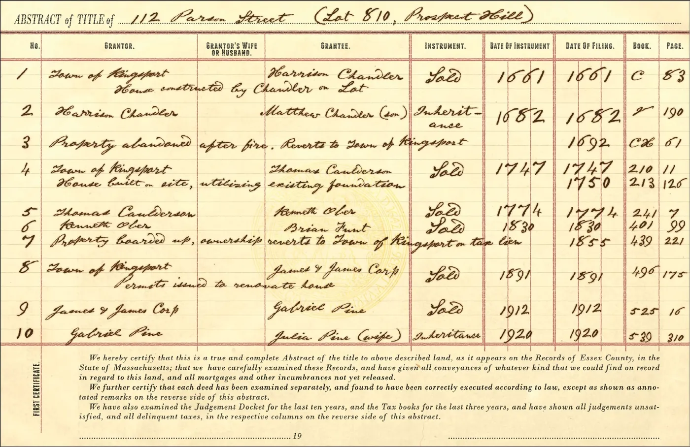

и с готовностью поможет сыщикам отыскать нужные старые бумаги.

Если у сыщиков уже есть раздатка «Вечная злоба» 3, они могут заняться здесь тремя вопросами. Для каждого нужна успешная проверка Работы в библиотеке. Если Уонда Дрейк помогает им в поисках, сыщики получают бонусную кость.

### Родословные жертв

Выяснить, приходятся ли четверо ослепших потомками рыбаков, которые схватили Мэттью Чандлера, а затем дали показания против него.

Для этого можно разобрать городские свидетельства о рождении. Четверо ослепших — Саймон Макдональд, Бернард Уайт, Джон Плакард и Скотт Форрестер — прямые потомки людей, выступавших на суде над Мэттью Чандлером. Из документов также видно, что каждый из них — последний живой наследник мужского пола в своей семье.

### Род Эпплтонов

Выяснить, остались ли потомки у пятого члена команды, Дэвида Эпплтона.

Из тех же бумаг можно узнать, что в Кингспорте живёт потомок Дэвида Эпплтона, Уоллес Эпплтон, тридцати семи лет. Его нынешний адрес — Харпер-стрит, 204, Уэст-Сайд. Чтобы узнать адрес, нужна ещё одна успешная проверка Работы в библиотеке или трудная проверка Знаний для сыщика, живущего в Кингспорте.

*Прим. перев.:* Здесь Уоллесу Эпплтону 37 лет, на с. 112 ему 29.

### Дом колдуна

Найти место, где некогда стоял дом Мэттью Чандлера. Нынешний адрес — Парсон-стрит, 112, Хиллтаун.

Местонахождение дома колдуна выяснить труднее всего. Нужна проверка Работы в библиотеке со штрафной костью, которую легко уравновесить бонусной костью за помощь миссис Дрейк. Из бумаг видно, где стоял дом и как с тех пор переходило из рук в руки право на участок. Сведения разбросаны по нескольким документам. Их сводка дана в раздатке «Вечная злоба» 4.

При успешной проверке Знаний сыщики, живущие в Кингспорте, узнают в нём печально известный Дом Фантов. Об этом доме местные говорят вполголоса и велят детям держаться от него подальше. С давних пор ходит слух, что там водятся привидения, хотя вот уже больше ста лет ничего странного в доме не случалось. Приезжим сыщикам, которым помогает миссис Дрейк, о дурной славе дома расскажет она сама.

> **Раздатка 4. выписка о праве собственности на Парсон-стрит, 112**
> ВЫПИСКА О ПРАВЕ СОБСТВЕННОСТИ на Парсон-стрит, 112 (участок 810, Проспект-Хилл)
>
> | № | Отчуждатель | Супруг(а) отчуждателя | Приобретатель | Документ | Дата документа | Дата регистрации | Книга | Страница |
> | --- | --- | --- | --- | --- | --- | --- | --- | --- |
> | 1 | Город Кингспорт — дом построен Чандлером на участке | | Харрисон Чандлер | Продажа | 1661 | 1661 | C | 83 |
> | 2 | Харрисон Чандлер | | Мэттью Чандлер (сын) | Наследство | 1682 | 1682 | v (?) | 190 |
> | 3 | Имущество брошено после пожара. Возвращено городу Кингспорту | | | | | 1692 | CX (?) | 61 |
> | 4 | Город Кингспорт — на участке построен дом на существующем фундаменте | | Томас Колдерсон | Продажа | 1747 | 1747; 1750 | 210; 213 | 11; 126 |
> | 5 | Томас Колдерсон | | Кеннет Обер | Продажа | 1774 | 1774 | 241 | 7 |
> | 6 | Кеннет Обер | | Брайан Фант | Продажа | 1830 | 1830 | 401 | 99 |
> | 7 | Дом заколочен, собственность возвращена городу Кингспорту за долги по налогам | | | | | 1855 | 439 | 221 |
> | 8 | Город Кингспорт — выданы разрешения на ремонт дома | | «Джеймс энд Джеймс корп.» | Продажа | 1891 | 1891 | 496 | 175 |
> | 9 | «Джеймс энд Джеймс корп.» | | Габриэль Пайн | Продажа | 1912 | 1912 | 525 | 16 |
> | 10 | Габриэль Пайн | | Джулия Пайн (жена) | Наследство | 1920 | 1920 | 539 | 310 |
>
> Настоящим удостоверяем, что это верная и полная выписка о праве собственности на описанный выше участок в том виде, в каком она значится в реестрах округа Эссекс штата Массачусетс; что мы тщательно изучили эти реестры и привели все сделки любого рода, какие смогли найти в отношении этого участка, а также все не погашенные ещё закладные и иные обременения.
>
> Далее удостоверяем, что каждая купчая изучена отдельно и составлена по закону, кроме отмеченного в примечаниях на обороте выписки.
>
> Мы изучили также реестр судебных решений за последние десять лет и налоговые книги за последние три года и указали все неисполненные решения и все налоговые недоимки в соответствующих графах на обороте выписки.
>
> 19

*Прим. перев.:* По выписке Пайны купили дом в 1912 году, а по тексту въехали в 1913-м. Наследство Джулии в выписке датировано 1920 годом, хотя по тексту Габриэль погиб, когда Ронни было десять, то есть около 1925-го. Покупка участка Колдерсоном оформлена в 1747 году, постройка отмечена в 1750-м, продажа датирована 1774-м. На с. 108 сказано, что семья съехала в 1752-м.

*Прим. перев.:* В выписке участок отнесён к Проспект-Хиллу, а в тексте нынешний адрес указан в Хиллтауне.
