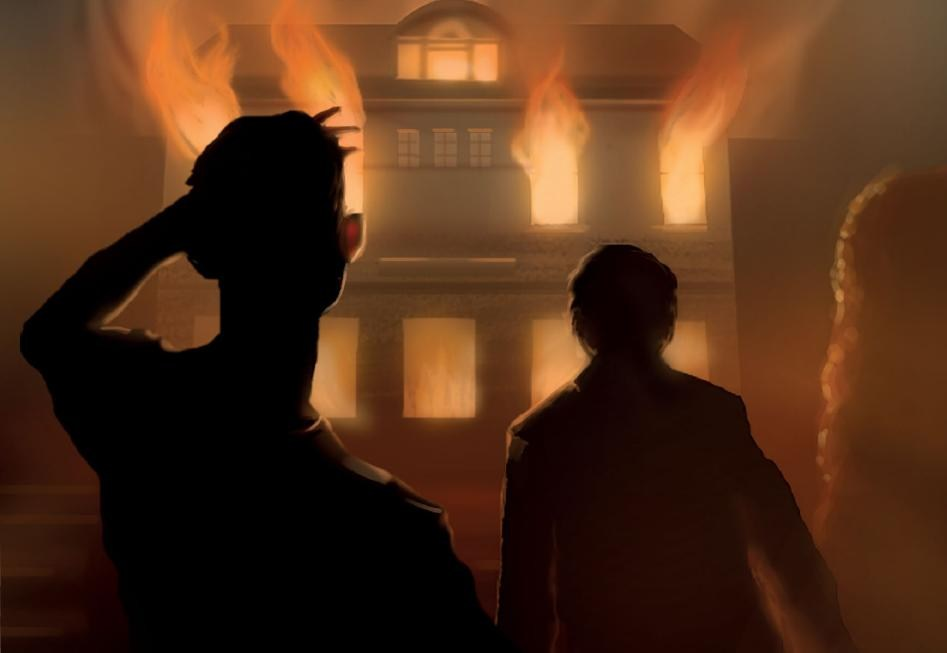

У сыщиков два способа выбраться из огня. Они могут пробежать через горящий второй этаж к лестнице или протиснуться через единственное чердачное окно. Оба пути опасны, но остаться на чердаке, где всё жарче и всё больше дыма, значит обречь себя на медленную гибель. Пожар застаёт сыщиков врасплох. Со второго раунда пожара они начинают задыхаться от удушливого дыма (см. таблицу «Другие виды урона» в «Книге хранителя» «Зова Ктулху», с. 411).

### Через чердачное окно

Проще всего выбраться через единственное чердачное окно. Оно скрыто за штабелем ящиков, и заметить его можно только при успешной проверке Внимания. За раунд через окно может выбраться лишь один сыщик. Остальным придётся ждать своей очереди, вдыхая удушливый дым. Окно к тому же совсем маленькое. Протискиваясь сквозь узкий проём, сыщик обдирается и получает 1 пункт урона за каждый пункт ТЕЛ сверх 50. Выбравшись, он падает на землю и получает ещё 2d6 урона. Успешная проверка Прыжков снижает урон от падения до 1d6.

### Через второй этаж

Другой путь — спуститься с чердака на горящий второй этаж, оттуда пробраться на первый и выбежать из здания. По узкой складной лестнице за раунд могут спуститься только двое. Остальные ждут на чердаке, рискуя надышаться дымом. На втором этаже нужно пробежать сквозь огонь к лестнице, ведущей на первый. Пройдите проверку Удачи, чтобы увернуться от языков пламени и падающих балок. При провале сыщик получает 1d8 урона, при успехе — 1d4.

По пути к лестнице сыщики минуют спальню хранителя и увидят на полу старого мистера Харта без сознания. Он надышался дымом, и у него 0 ПЗ, но его ещё можно спасти, если вынести из горящего здания. Хранителю стоит упомянуть два важных предмета в спальне: большой папоротник в горшке и аквариум на 15 л.

У лестницы на первый этаж сыщики окажутся рядом с притаившимся огненным вампиром. Он скрывается среди пламени и попытается убить любого, кто захочет спуститься. Тварь бросается вперёд,
