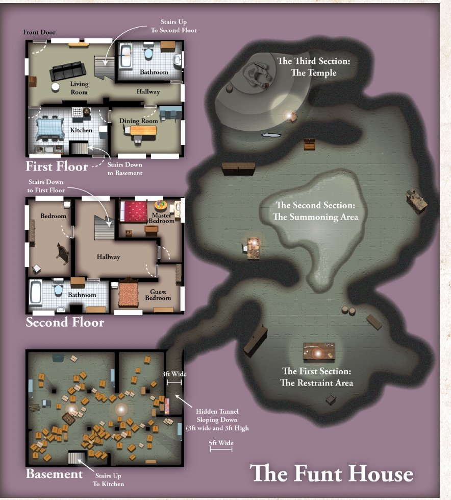

### Ванная Дома Фантов

Здесь недавно убирались, и ванной в последнее время часто пользовались. При осмотре найдутся женские принадлежности: косметика, лосьоны и прочее. Большой женский корсетный пояс и бельё недавно постираны и сушатся на штанге для душевой занавески.

### Хозяйская спальня Дома Фантов

Кровать аккуратно застелена. На тумбочке ваза со свежими цветами. На диске виктролы с ручным заводом оставили пластинку «Любовь дарит букетик роз» в исполнении Карла Фентона и его оркестра. Половина одежды в комоде, похоже, принадлежит юноше, скорее всего подростку, остальная — более взрослой, довольно крупной женщине. Под кроватью лежат медицинская сумка с обычными средствами первой помощи и женский чемодан. Ещё здесь есть маленький портновский манекен, на который набросили заготовку чёрно-фиолетового облачения. Его явно шьют на невысокого и худощавого человека.

### Гостевая спальня Дома Фантов

В комнате стоит кровать с кожаными ремнями. На тумбочке в беспорядке лежат пузырьки с таблетками, стоит стакан и наполовину полный кувшин воды. Под кроватью сыщики найдут только подкладное судно. Хранитель может решить, что здесь держат привязанную, лишившуюся рассудка Джулию Пайн. Если её здесь нет, она внизу, в храме, и Мэттью Чандлер, скорее всего, читает ей вслух.

### Подвал Дома Фантов

В захламлённом подвале между ящиками, старой мебелью и мешками с одеждой расчищен проход. Он ведёт к тяжёлому персидскому ковру, подвешенному у стены на старой бельевой верёвке, привязанной к трубам. За ковром слева — наклонный ход длиной 4 м, ведущий вниз, в естественную пещеру под домом. Ковёр глушит звуки между храмом и остальным домом.

### Храм И’голонака

Храм И’голонака занимает большую пещеру под домом и разделён на три части. В первой собраны орудия пыток и приспособления для удержания пленников, часть из них закреплена на столах. Цепи вделаны в стены и пол. Посреди помещения стоит большой стол, заваленный железными шипами, клещами и молотками. Джулию Пайн часто держат здесь, привязав к стулу и заткнув ей рот. Если её освободить, она останется сидеть неподвижно. Она лишилась рассудка на неопределённый срок и находится в кататонии.

- **Первый этаж:** входная дверь, гостиная, ванная, прихожая, кухня, столовая, лестница на второй этаж, лестница из кухни в подвал.
- **Второй этаж:** лестница на первый этаж, спальня, хозяйская спальня, коридор, ванная, гостевая спальня.
- **Подвал:** лестница на кухню, тайный ход с уклоном вниз (1 м в ширину и 1 м в высоту), отметки ширины 1 м и около 1,7 м.
- **Пещера:** первая часть — место для пленников, вторая — место призыва, третья — храм.
