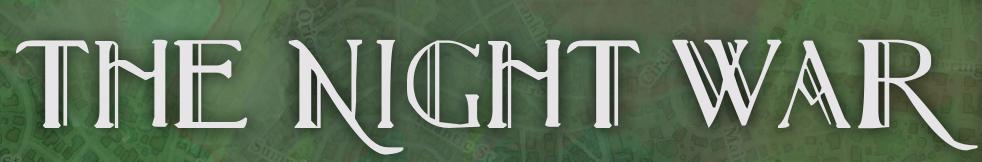

# Ночная война

Сценарий рассчитан на сыщиков, которые живут в Аркхэме или Кингспорте либо могут провести в этих городах достаточно времени. Хранитель может провести это приключение сразу после «Вечной злобы», поскольку в начале одному из сыщиков предстоит лечь в больницу в Кингспорте. Играть можно с любым числом сыщиков, любых профессий и с любым опытом. Основные события разыгрываются в череде жестоких снов. Если сыщиков очень мало или очень много, хранителю, возможно, придётся изменить число противников и значения их навыков. С небольшими поправками сценарий годится и для современной кампании. Тогда Уиллсон Маккенна станет ветераном Вьетнамской войны, а раскисшие окопы Европы сменятся грязью джунглей и рисовых полей Юго-Восточной Азии.

## Примечание автора

Знаменитый фантаст Уильям Хоуп Ходжсон был одним из любимых писателей Г. Ф. Лавкрафта. Его книги «Дом на краю» и «Ночная земля» во многом предвосхитили тот космический ужас, которым прославился Лавкрафт. Во время Великой войны Ходжсон ушёл добровольцем на фронт. После тяжёлого ранения его уволили со службы, но, оправившись, он вернулся в армию и снова попал на передовую. В 1918 году он писал сестре:

> «На обратном пути солнце стояло уже низко, и вдали, среди пустоши, то тут, то там виднелись бесформенные, почти квадратные громады без углов. Люди воздвигли их против адской бури, что день и ночь, ночь и день несётся над этой чудовищной Равниной Разрушения. Боже мой! Затерянный мир, конец света, Ночная земля — всё это здесь, в каких-нибудь трёх с лишним сотнях километров от тебя, а кажется, что нас разделяет бесконечность. И сколько бесконечной, чудовищной, страшной скорби во всём, что видишь: огромная воронка, из которой торчит больше тридцати крестов. Иные едва поднимаются над водой, а мертвецы лежат под водой… Если я выживу и как-нибудь отсюда выберусь (а я надеюсь, что так и будет, дай Бог), какую же книгу я напишу, если ещё не утратил прежнего „умения“ владеть пером…»

Несколько недель спустя Ходжсон погиб при артиллерийском обстреле под Ипром, в Бельгии. Этот сценарий навеян его произведениями и посвящён его памяти.

## Сведения для хранителя

Уиллсону Маккенне было восемнадцать, когда в начале 1918 года он добровольцем вступил в Американский экспедиционный корпус, чтобы помочь армиям Европы воевать с гуннами. Он и представить себе не мог, какой ужас его ждёт: нескончаемый дождь, вездесущая грязь, озёра крови, непрерывные обстрелы, внезапная смерть, бессмысленные разрушения. Жизнь там отмеряли секундами. За первую неделю рядовой Маккенна увидел столько смертей, сколько врач на родине мог не увидеть за всю жизнь. Однажды тёмной ночью Маккенну и ещё нескольких солдат послали в рейд по ближайшим вражеским окопам. Его товарищи успели повоевать, а он был совершенно не готов к такой жестокой схватке в тесноте. Но Маккенна какой-то мелочью прогневал своего лейтенанта, и тот решил его проучить.

Они убивали из дробовиков, дубинками, ножами и гранатами, штыками и кулаками. Маккенна видел одну только грязь, кровь и искалеченные тела. На обратном пути к своим снайпер подстрелил одного из окровавленных бойцов. Это была их первая потеря за ночь. Остальные поползли дальше сквозь колючую проволоку и воронки. Потом пулемёт скосил половину отряда. Маккенна и двое других выживших уже ползли прочь на животе, когда начался обстрел. Снаряды рвались прямо среди них. Маккенна в панике вскочил и побежал. Следующим взрывом его швырнуло в воронку, где он пролежал несколько часов, оглушённый, но целый. Придя в себя, он так и пролежал там весь следующий день, боясь шелохнуться. Наконец, под покровом ночи его нашёл союзный патруль. Он всё ещё был парализован страхом. Его отнесли в свой окоп, где он узнал, что один из всей группы остался в живых.

А потом с Уиллсоном Маккенной случилось то, что после такого могло случиться с любым нормальным человеком. Он сломался. Близкие разрывы снарядов повредили его мозг,
