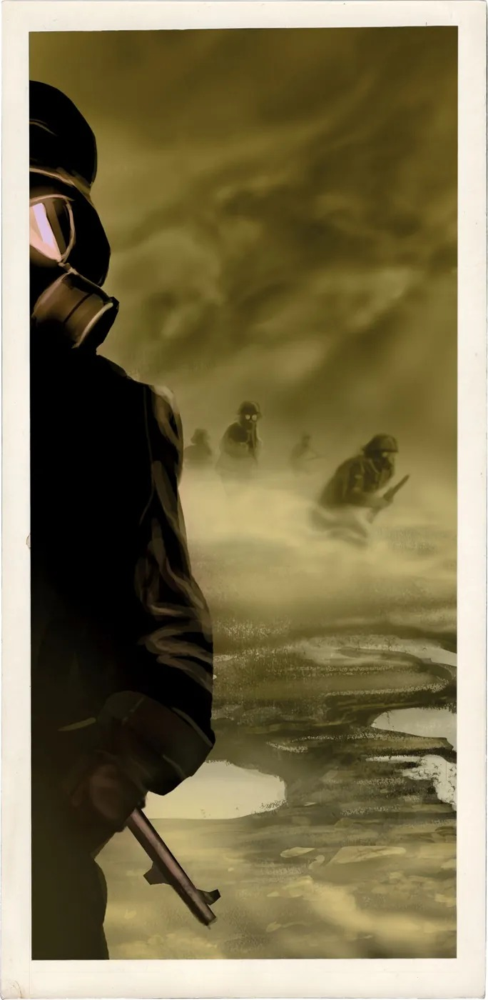

да и увиденное оставило свой след. Юношу отправили поправляться в полевой госпиталь, но война кончилась раньше, чем он успел оправиться. Уиллсона Маккенну отправили домой с позором, который навлёк на него срыв.

Дома, в Аркхэме, Маккенна по-прежнему страдал телом и душой. Из-за частых головных болей он не мог сосредоточиться, а от лекарств клевал носом и едва соображал. Хуже всего были сны. В них его больной мозг делал ужасы войны ещё страшнее: теперь в вечной темноте окопов таились чудовища. И в этих снах Уиллсон Маккенна бросал товарищей умирать, а их жалобные крики летели через страшное поле боя к воронке, где он лежал, не в силах пошевелиться.

Мать Маккенны решила, что сыну просто нужен хороший отдых. Она предположила, что приятная обстановка соседнего приморского Кингспорта сотворит с ним чудо. Но в Кингспорте сны обретают особую силу. Кошмары сделались ещё страшнее, и Уиллсон Маккенна впал в кому, оказавшись в плену на поле боя из своих ночных видений. Его отвезли в Конгрегационалистскую больницу на Централ-Хилл. Там Маккенна лежит и умирает в собственных снах. Хуже того, каждый, кто соприкасается с ним в Кингспорте, в той или иной мере разделяет его кошмары. Теперь больничный персонал спит беспокойно, а поутру смутно припоминает сны о далёкой войне.

А один из сыщиков, попавший в больницу в Кингспорте, делит палату с юношей, чьи сны грозят свести их всех с ума.

## Сведения для сыщиков

Один из сыщиков попал в больницу в Кингспорте. Возможно, это случилось в результате предыдущего приключения в кампании хранителя. В ином случае сыщика доставляют в Конгрегационалистскую больницу после несчастного случая или, скажем, пищевого отравления в местном ресторане. Сыщик оказывается в одной палате с другим больным,
