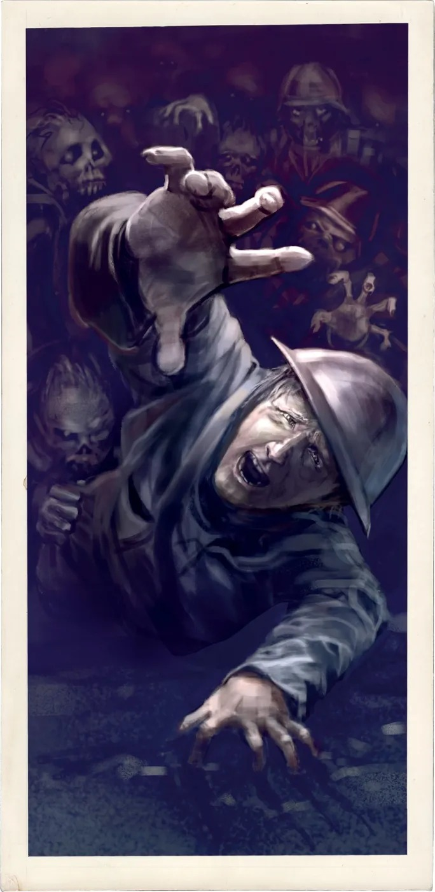

## Воспоминания о первом дне

Хранителю теперь следует обрисовать события, которые предшествовали страшным снам о Ночной войне, то есть события первого дня. Сыщики узнают, что накануне один из них во время визита в приморский Кингспорт внезапно заболел или получил травму. Остальные навестили товарища в Конгрегационалистской больнице Кингспорта. За время визита тот, кто успешно прошёл проверку Слуха или Медицины, между делом узнал, что пациент на соседней койке лежит в коме. Каждый, кто прошёл чрезвычайную проверку МОЩ (или выбросил меньше всех, если успехов не было), помнит, как кто-то из больничного персонала жаловался, что плохо спал предыдущей ночью из-за кошмаров.

Для разнообразия хранитель может оставить госпитализированного сыщика на больничной койке на всё расследование, особенно если тот тяжело ранен или болен. Кроме того, на беседы со всеми, кто знает Уиллсона Маккенну и может рассказать о его службе, в Аркхэме и Кингспорте должно уйти больше одного дня.

## Кингспорт и больница

Сыщики, скорее всего, захотят выяснить, откуда взялся такой яркий кошмар о войне, особенно когда поймут, что всем приснился один и тот же сон. Если сыщик, лежащий в Конгрегационалистской больнице, расспросил медсестру о соседе по палате, она назвала имя и возраст больного: Уиллсон Маккенна, 28 лет. Маккенна родом из Аркхэма и приехал погостить в Кингспорт. Два дня назад он потерял сознание и впал в кому. С тех пор он не очнулся, и ему становится хуже. При успешной проверке Обаяния, Красноречия или Убеждения медсестра добавит, что лечащий врач, доктор Ньюберг, считает положение Маккенны «крайне серьёзным». Если спросить, не снились ли ей в последнее время кошмары, медсестра ответит, что ничего такого не помнит, но последние две ночи спала плохо. Её подруга из хозяйственной службы тоже плохо спала. Из всего больничного персонала только доктор Ньюберг знает, что Маккенна служил в Великую войну.

*Прим. перев.:* здесь Маккенне 28 лет, а в статблоке на с. 143 указан возраст 24 года.

Если госпитализированный сыщик успешно пройдёт проверку Удачи, мать Уиллсона, Дженис, придёт навестить сына. При трудном успехе придёт и его отец Эверт. Что могут рассказать родители, см. в разделе «Расследование в Аркхэме».
