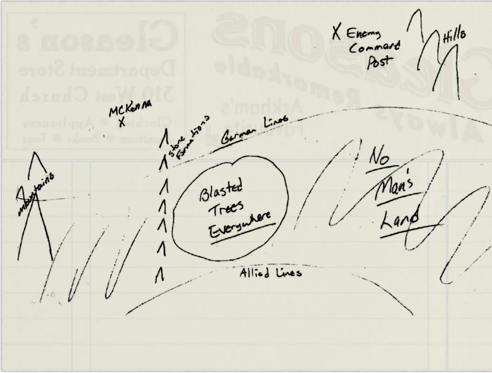

## Доктор Хортон Уилсон

Если сыщики разыщут постоянного врача Уиллсона Маккенны, он ничего им не скажет без рекомендательного письма от родителей Маккенны или доктора Ньюберга из Кингспорта. Доктор Уилсон навещал Маккенну в больнице Кингспорта, но ему нечего добавить к диагнозу доктора Ньюберга. Если Маккенна каким-то образом не выйдет из комы, молодой человек, по мнению Уилсона, умрёт через считаные дни. «Тут уже никто ничего не может сделать. Но, если вспомнить, как мальчик мучился эти десять лет, может, так и лучше?» Видно, что судьба Маккенны глубоко печалит доктора.

## Братья по оружию?

Сыщики могут найти Огаста Кирка в городском справочнике Аркхэма. По телефону или при встрече выясняется, что теперь он лейтенант Огаст Кирк и очень этим гордится. Высокий, красивый, высокомерный Кирк во время войны был капралом и хорошо помнит Уиллсона Маккенну. По его словам, это был совсем мальчишка, собственной тени боялся. Когда он ушёл в тот последний рейд, никто не ждал, что он вернётся, бедный трусливый зайчонок. Нашли его в яме: забился от страха, а товарищей бросил умирать. Доказательств у Кирка нет, но как ещё мальчишка мог выжить? Если попросить прямо, Кирк может набросать очень грубую карту с расположением позиций и местом, где нашли Маккенну (см. раздатку «Ночная война» 1). На вопрос, кто ещё может знать о Маккенне что-нибудь полезное, Кирк советует обратиться к майору Чарльзу Харту в Арсенале Национальной гвардии Массачусетса, рядом с площадью Независимости. Если там ничего не узнают, можно сходить в Дом ветеранов долины Мискатоника, сразу за углом от спортивного поля Мискатоникского университета. «Только приготовьтесь, если пойдёте. Такого, как там, нигде по эту сторону ада не увидите». Если спросить, о чём он, Кирк хмурится: «Осколочные ранения, отравленные газом, люди без рук и ног».

*Прим. перев.:* в путеводителе «Аркхэм» спортивное поле университета находится за городом (OS110).

## Арсенал Национальной гвардии Массачусетса

В Арсенале Национальной гвардии Массачусетса сыщиков попросят подождать несколько минут, после чего они смогут увидеться с майором Хартом, невысоким, коренастым, потливым человеком. Харт не помнит Маккенну, но знает лейтенанта Кирка и помнит капрала Толберта, гвардейца, который работает механиком в авторемонтной мастерской. Харт может также поднять армейские документы, чтобы выяснить, кто ещё служил с Маккенной. Он называет ещё двоих: Кристофера Карнелла, который живёт в Доме ветеранов долины Мискатоника, и некоего Томаса Линча с адресом на Ист-Ривер-стрит.

## Алан Толберт

Алана «Тола» Толберта можно найти за работой в авторемонтной мастерской. Он охотно поговорит с сыщиками: лишний повод перекурить. Маккенну он помнит.

«Парню с самого начала не везло, едва в грязь ступил. Хотел за свою страну воевать, да куда ему. Этому сукину сыну, лейтенанту Суйдаму, всё казалось, что он медленно шевелится. Вот ублюдок и послал парня как-то ночью в окопный рейд. Послал зелёного пацана в зубы гуннам, драться с ними в кромешной тьме. Никто не знает, что там было, но следующей ночью мы нашли Маккенну: свернулся клубком в воронке и совсем не в себе. Больше никто не вернулся, а парня здорово потрепало. Суйдам думал, что тот придуривается. А кровь у него из обоих ушей так и текла. Суйдаму, козлу, тоже досталось

> **Раздатка 1. Карта Кирка**
>
> - Горы
> - Маккенна ✕
> - Каменные образования
> - Немецкие позиции
> - Выжженные деревья повсюду
> - Союзные позиции
> - Ничейная земля
> - ✕ Вражеский командный пункт
> - Холмы
>
> На обороте просвечивает шапка бланка: «Универмаг Глисона, Уэст-Черч, 310. Одежда ✱ Бытовая техника. Мебель ✱ Книги ✱ Игрушки. Всегда что-то особенное. Аркхэмский…»
>
> *Прим. перев.:* на бланке «310 West Church». В путеводителе «Аркхэм» универмаг находится по адресу Уэст-Черч-стрит, 338A.
