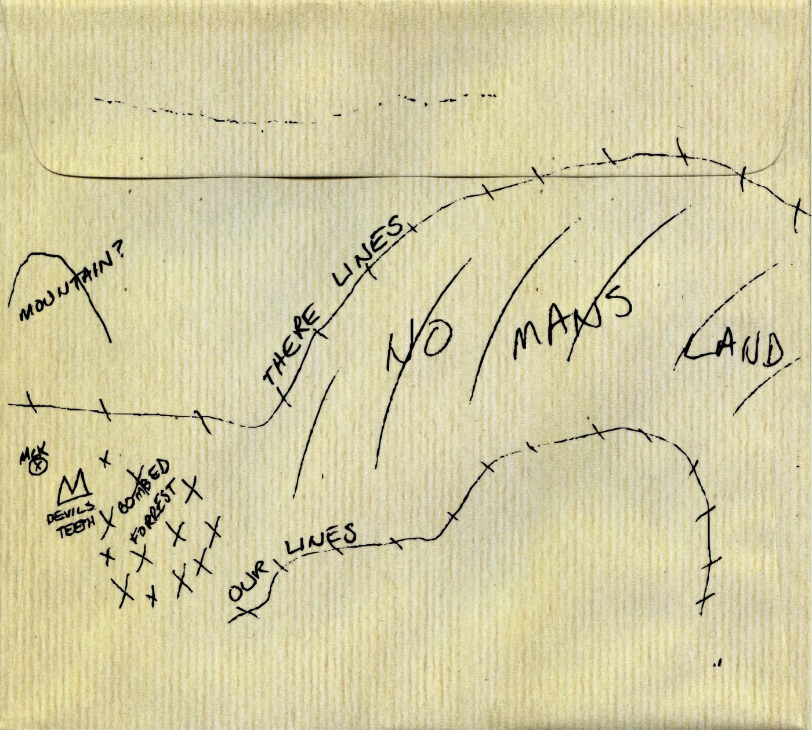

пару месяцев спустя. Вот бы посмотреть, какой он был храбрый, когда его без полутора ног потащили в полевой госпиталь. Хоть в одном Суйдаму повезло: помер, не пришлось ему маяться, как этому бедолаге».

Если попросить, Толберт расскажет подробнее о месте, где нашли Маккенну, и нарисует карту вроде той, что набросал лейтенант Кирк (см. раздатку «Ночная война» 2).

«Тол» помнит имена, которые назвали другие, но говорит, что по старому адресу Линча не найти: «Дома того уж нет. Снесли много лет назад. Он теперь в „Борден-Армс“». «Борден-Армс» — пансион в Аркхэме по адресу Уэст-Хай-лейн, 488.

> **Раздатка 2. Карта Толберта**
>
> - Гора?
> - Их позиции
> - Ничейная земля
> - Наши позиции
> - МакК ⊗
> - Чёртовы Зубы
> - Разбомбленный лес
>
> *Прим. перев.:* на карте написано THERE LINES и BOMBED FORREST вместо THEIR LINES и BOMBED FOREST. В NO MANS LAND и DEVILS TEETH пропущены апострофы.

## Дом ветеранов долины Мискатоника

В вестибюле Дома ветеранов долины Мискатоника сыщиков встречает дежурная медсестра и спрашивает, по какому они делу. Она с прискорбием сообщает, что Кристофер Карнелл умер позапрошлой ночью. Ему было 46 лет. Он потерял левый глаз и страдал тяжёлым расстройством дыхания после газовой атаки. Умер во сне.

Пока сыщики говорят с медсестрой Крири, в дальнем конце коридора проходят двое искалеченных ветеранов. Один весь в бинтах, выглядывает только один глаз. Другой ковыляет на костылях: одну ногу отняли чуть выше колена, одну руку чуть выше локтя. Вид этих изувеченных солдат стоит сыщикам 0/1 пункта Рассудка. Крири не знает никого в доме, кто мог бы служить с Маккенной. Если сыщики хотят попытать удачу и поговорить с остальными жильцами, медсестра Крири предупреждает, что у многих страшные увечья. Если они всё же пойдут, то увидят несколько изувеченных мужчин, и ни один ничего не знает об Уиллсоне Маккенне. Обход дома стоит сыщикам 1/1d3 пункта Рассудка.

## Томас Линч

Томаса Линча можно застать в его убогой комнате в «Борден-Армс», если случайно выбранный сыщик успешно пройдёт трудную проверку Удачи. Иначе Линч где-то напивается. Он вернётся через 1d3+1 часа, чтобы отоспаться. Трезвый Линч мрачен, но готов помочь. Пьяным он с горечью вспоминает службу в Великую войну, проклинает заносчивых офицеров, зверей-гуннов и неблагодарное правительство, бросившее ветеранов на произвол судьбы. А те вернулись домой изрешечённые, откашливаясь ипритом, и с воспоминаниями о проклятой войне в голове.

Линч говорит, что Маккенна был хорошим парнем, просто война оказалась ему не по силам. Да кому с доброй христианской душой такое по силам? На вопрос, что случилось с Маккенной, отвечает, что отряд ушёл в рейд и не вернулся. Парня нашли следующей ночью, совсем не в себе. Линч пытался его подбодрить, а Маккенна всё бормотал, что, должно быть, бросил остальных, что посыпались снаряды и он просто побежал, дурак этакий. В общем, его отправили в полевой госпиталь с контузией. Только там толком ничего не делали: в армии считали, что почти все контуженные притворяются. А этот
