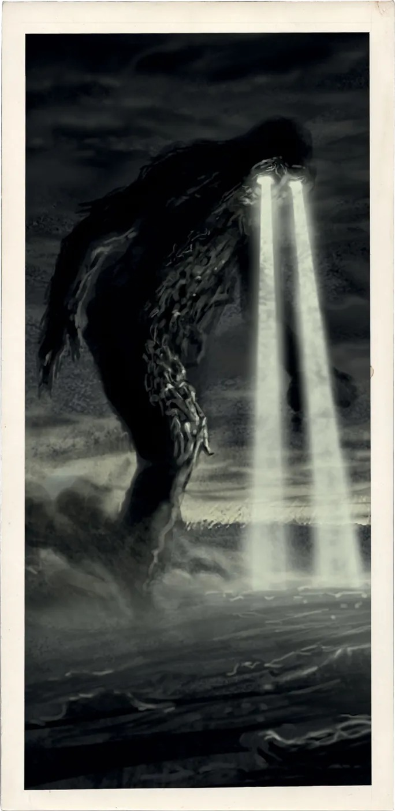

глаза, лёгкие и кожу, а каждый вдох причиняет мучительную боль. При успехе чрезвычайной проверки ВЫН сыщик получает только половину урона, по 2 ПЗ в час. Проверки навыков он проходит как обычно.

## Морриган

Как и в одном из эпизодов первой ночи, сыщики выходят на место, усеянное трупами. Одни лежат на земле, другие висят на проволоке. На трёх разных трупах сидят вороны и буравят сыщиков взглядом. Пройдя мимо, сыщики слышат за спиной голоса. Они оборачиваются и видят, что вороны сильно выросли: теперь они почти с крупных собак. «Чего вам?» — каркает одна из птиц. Услышав, как птица говорит, сыщики теряют 0/1d2 пункта Рассудка. Вороны представляются: Морриган, Нема и Маха, а все вместе — Морриган. Успешная проверка Фольклора или половинного значения Оккультизма позволяет узнать имена трёх кельтских богинь войны, известных своей кровожадностью.

*Прим. перев.:* Фольклор — название навыка в оригинале. В основной Книге хранителя 7-й редакции такого навыка нет.

Если спросить Морриган об Уиллсоне Маккенне, вороны немного покаркают между собой, а потом одна скажет: «Я не знаю, где он. Но могу найти, если договоримся о плате». Когда сыщики спрашивают о цене, остальные вороны ненадолго поднимают гвалт, но первая всё же отвечает: «Хочу снова видеть ваш мир. Мне нужен глаз. Любой из ваших вполне сгодится». Сыщики вольны поступить как угодно. Если кто-то согласится, ворона велит лечь на спину, и каркающая богиня выцарапает ему глаз острыми когтями. Затем ворона вырывает собственный глаз, проглатывает его и неловко втыкает глаз сыщика в жуткую пустую глазницу. Свидетели теряют 1/1d3 пункта Рассудка. Жертва получает 1d6 урона и теряет 1/1d4 пункта Рассудка. Сделка заключена, и ворона, сделав круг, улетает в тёмную ночь. Остальные продолжают трапезу, время от времени каркая так, будто смеются.

Через 1d3 часа (и, возможно, столько же встреч) ворона возвращается. Она точно объясняет сыщикам, как добраться до места, где Маккенна лежит, замёрзший и парализованный страхом, в неглубокой воронке рядом с вражескими позициями. «Удачи, — каркает Морриган. — Пригодится. И спасибо за глазик». Все три птицы взмывают в ночь, оглушительно каркая.

*Прим. перев.:* здесь воронка Маккенны названа неглубокой, а на с. 141 она глубокая.

У сыщика, отдавшего глаз, значения всех навыков, связанных со зрением, уменьшаются вдвое в этом и во всех последующих снах, как в этом сценарии, так и в других приключениях, связанных со снами. Эффект сохраняется до конца его карьеры. Кроме того, если сыщик провалит проверку МОЩ, он может лишиться
