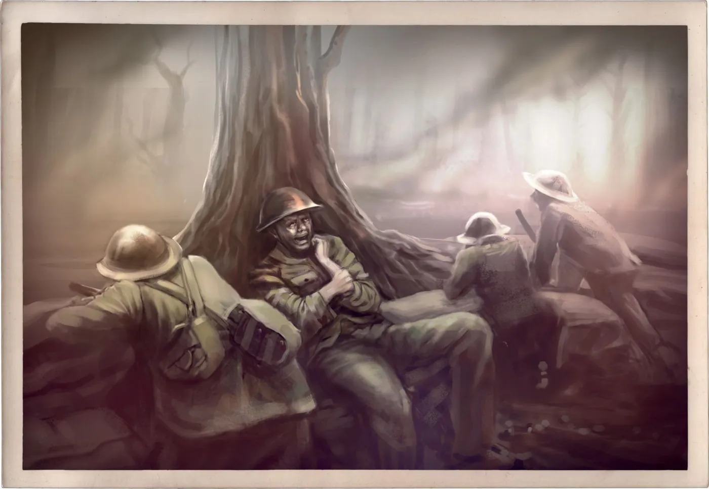

пулемётная стрельба. Чтобы добраться до укрытия, каждому сыщику нужно пройти 1d4 проверок Удачи. При каждом провале бросьте по таблице случайных событий при перемещении без модификатора. Из укрытия трудная проверка Слуха позволяет различить рыдания где-то неподалёку. Нужна ещё одна трудная проверка Слуха, чтобы определить, откуда они доносятся. Чтобы пойти на звук по открытому месту, придётся пройти ещё 1d4 проверок Удачи. При провале бросайте по таблице случайных событий при перемещении.

Разрешите каждому сыщику пройти трудную проверку Внимания, чтобы заметить скорчившегося и дрожащего юношу в ближайшей воронке. Сыщики могут броситься к нему, но сначала каждый проходит одну проверку Удачи. При провале бросьте по таблице случайных событий при перемещении без модификатора.

Уиллсон Маккенна плачет и дрожит на грязном дне глубокой воронки. Он кажется куда моложе и крепче исхудавшего человека, который умирает на больничной койке в другом времени, за целым океаном, десятилетием и кошмаром отсюда. Маккенна цел, но так напуган, что не может пошевелиться, хотя боится за жизни товарищей. Над воронкой нависает чёрный человекоподобный силуэт горы и осуждающе смотрит на юношу. Каждый, кто поднимет глаза и увидит эту зловещую фигуру, теряет 0/1 пункта Рассудка.

«Мы были в патруле. Окопный рейд. Господи, столько людей перебили, забивали насмерть, стреляли в лицо, тыкали штыком в живот, господи Иисусе. Срывали с них знаки различия. Надо же было знать, кто они. Мы… мы уже… возвращались… снайпер снёс Кенни голову. Понимаете, вот он стоял, и вдруг у него уже нет головы. Мы полезли в проволоку, а пулемёты срезали Майкла и Кита. Мы тогда поползли… а потом посыпались снаряды, всё ближе, ближе. Боже мой! Всё ближе и ближе! Господи! Я побежал. Просто бросил Джерри, Стивена, Фрэнсиса и побежал! Господи, они до сих пор там! Иисусе! Я иногда слышу, как они меня зовут…»

Сыщикам нужно решить, как поступить с обезумевшим от страха Маккенной. Он не хочет идти и не верит, что сможет, хотя вроде бы не ранен. Сыщики могут решить, что разумнее всего, а может и милосерднее, избавить юношу от мучений прямо здесь, в безлюдной пустоши. Для этого хватит пули в голову, но отчаянные крики Маккенны, который молит о помощи или пощаде, автоматически стоят сыщикам 1d6 пунктов Рассудка. Кошмар на этом кончается, и наутро сыщики просыпаются.

Если сыщики попытаются отвести Маккенну в безопасное место, его подсознание оживит поле боя. Пули и мины будут сыпаться на них, пока они не решат, что это слишком опасно. Каждый раунд нужно проверять Удачу. При провале бросайте по таблице случайных событий при перемещении. Маккенна тоже проходит проверки. Если его убьют, сон резко оборвётся. См. «Рассвет» ниже.

*Прим. перев.:* раздела «Рассвет» в книге нет. Утро описано в разделе «День третий. Возможные исходы» на с. 142.

При трудном успехе проверки Психологии можно догадаться, что Маккенне нужно найти товарищей из патруля. Иначе

