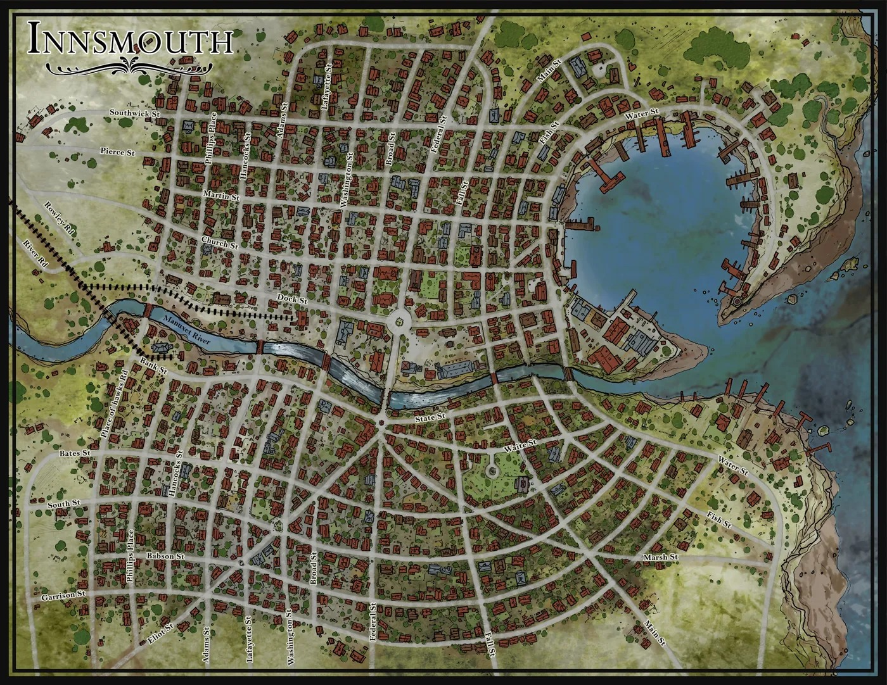

# Иннсмут

- Adams St — Адамс-стрит
- Babson St — Бэбсон-стрит
- Bank St — Банк-стрит
- Bates St — Бейтс-стрит
- Broad St — Брод-стрит
- Church St — Черч-стрит
- Dock St — Док-стрит
- Eliot St — Элиот-стрит
- Fall St — Фолл-стрит
- Federal St — Федерал-стрит
- Fish St — Фиш-стрит
- Garrison St — Гаррисон-стрит
- Hancocks St — Хэнкокс-стрит
- Lafayette St — Лафайет-стрит
- Main St — Мейн-стрит
- Manuxet River — река Мануксет
- Marsh St — Марш-стрит
- Martin St — Мартин-стрит
- Phillips Place — Филлипс-плейс
- Pierce St — Пирс-стрит
- Place of Hawks Rd — Плейс-оф-Хокс-роуд
- River Rd — Ривер-роуд
- Rowley Rd — Роули-роуд
- South St — Саут-стрит
- Southwick St — Саутуик-стрит
- State St — Стейт-стрит
- Waite St — Уэйт-стрит
- Washington St — Вашингтон-стрит
- Water St — Уотер-стрит
