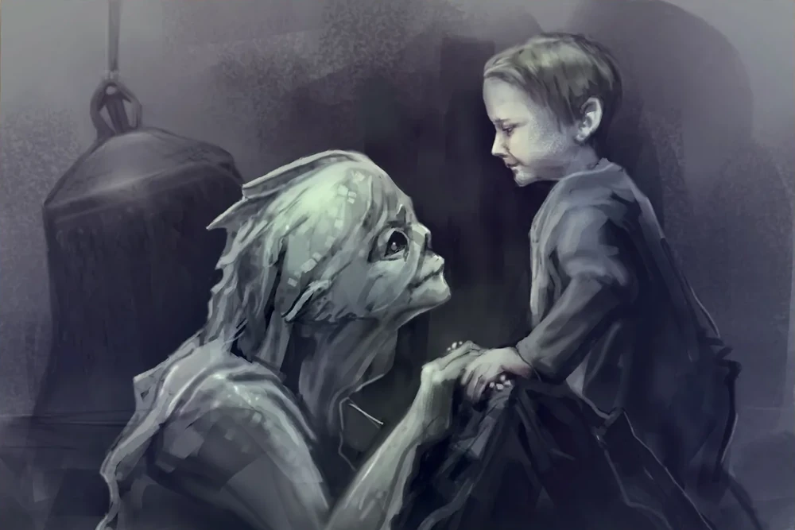

Так называют характерные черты горожан: узкую голову, синевато-серую кожу в струпьях, выпученные глаза, раннюю лысину, сморщенные уши и складки кожи на шее. С возрастом эти черты проступают всё отчётливее. В соседних городках Иннсмута и его жителей сторонятся. Его нет ни на местных картах, ни в путеводителях. Если о нём и говорят, то лишь злобным шёпотом. Самих иннсмутцев это вполне устраивает.

Тобиас Сиск, один из местных, ненавидел Иннсмут и мечтал из него вырваться. Двадцать лет назад, ещё детьми, Тобиас и его лучшие друзья, Грейс Декерт и Томас Хейнс, играли на ветхих улицах города. Однажды они пробрались на заброшенный склад и нашли под ним потайной грот. Над водоёмом висел странный колокол, и дети ударили в него. Через какое-то время на звон приплыло несколько глубоководных, среди них мать Тобиаса, Мэри Сиск. Она отчитала сына за то, что он играет с вещами, которых ещё не понимает. Но сказала, что, если она ему когда-нибудь понадобится, достаточно ударить в колокол четыре раза, и она приплывёт в грот.

За следующие годы Тобиас ещё несколько раз звал её. Он приходил один и при свете лампы делился с матерью детскими радостями и обидами. Он жаловался, что несчастлив в Иннсмуте, а она уверяла, что со временем он полюбит этот город. Мэри подарила ему золотой браслет. Пока Тобиас не мог им воспользоваться, но однажды браслет должен был его защитить. Мэри велела никому о нём не рассказывать, и Тобиас спрятал его в пещере.

Недавно в Тобиасе пробудилась кровь глубоководных и началось преображение. Ему стали сниться мать и их тайные встречи. Во сне она велела ему вернуться домой, и он, как подобает хорошему сыну, послушался.

## Как создать атмосферу

Иннсмут пришёл в упадок, но тайн у него по-прежнему много. Помните об этом на протяжении всего приключения. Над осыпающимися, изъеденными жучком домами провисли крыши. Каждый час бьёт треснувший колокол, хотя на башенных часах давно нет стрелок. Чем дольше сыщики остаются в городе, тем чаще стоит упоминать такие детали, чтобы тревога постепенно перерастала в страх.

Большинство жителей — гибриды глубоководных с иннсмутским обликом. Они с подозрением относятся к чужакам и блюстителям закона, вторгшимся в их убежище, и почти не скрывают презрения. Стоит сыщикам войти в комнату или завернуть за угол, как разговоры резко обрываются. Одни местные отводят глаза, другие глазеют с откровенным любопытством. Ни в тех, ни в других сыщики не почувствуют радушия. Разговоры с большинством жителей будут короткими: на вопросы отвечают кивком, пожатием плеч, а то и хмыканьем. В присутствии констебля Бёрча горожане держатся свободнее.

Машин в Иннсмуте мало, и в глаза бросается почти полное отсутствие кошек и собак. Ищейки и любые другие собаки, которых привезли на поиски беглецов, уже в 800 м от города начинают беспокоиться.

