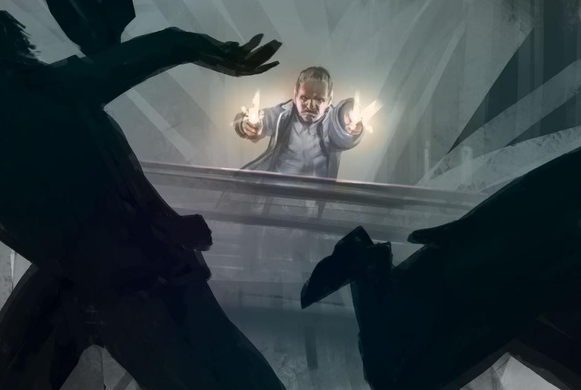

## Пользование телефоном

Все звонки по скудной телефонной сети Иннсмута проходят через телефонистку Мойру Пирс, 58-летнего гибрида. Она обслуживает коммутатор у себя дома, подслушивает разговоры приезжих и докладывает обо всём подозрительном Ордену и главному констеблю Мартину.

Через коммутатор проходят и все звонки в Иннсмут и из него. Если Мойра заподозрит, что кто-то может выдать городские тайны, она внезапно оборвёт разговор, а потом извинится: снова соединить абонентов якобы невозможно.

## События в городе

Пока сыщики осматривают Иннсмут, может произойти несколько событий.

### Местные дети

На улице сыщики встретят нескольких чумазых детей, прыгающих через скакалку. Они напевают знакомую детскую песенку, только слова у неё другие.

> *(На мотив «Хоровод вокруг розы», Ring Around the Rosie)*
>
> Глянь в водицу, загляни,  
> Там отца найдёшь, смотри.  
> Дагон! Дагон!  
> Йа! Й’ха-нтлеи!

*Прим. перев.:* в английском тексте песенки напечатано «You with find the father» вместо «You will find the father».

Если спросить, что значит песенка, дети захихикают, скажут что-нибудь вроде «Он в воде!» и убегут. Полезных сведений от них не добиться, но встреча поможет задать настроение приключению.

### Песнь шогготов

В первую ночь, в 23:30, на город обрушится весенняя гроза. Вспышки молний на миг озарят небо, обрисуют угловатые крыши и отбросят на улицы резкие тени. В самый разгар грозы один из шогготов, скрывающихся в трущобах, пронзительно закричит: «Tekeli-li! Tekeli-li!» Ему откликнется другой, с противоположного конца города. Перекличка продлится две минуты. Чтобы услышать её за громом, шумом дождя и грохотом волн в гавани, нужна проверка **Слуха**. На улице она обычная, внутри здания — трудная. Услышавший крик проходит проверку **Рассудка** (0/1). Из-за грозы и эха невозможно определить, откуда исходит звук.

*Прим. перев.:* в последней фразе этого раздела «and» напечатано с пробелом: «a nd».

