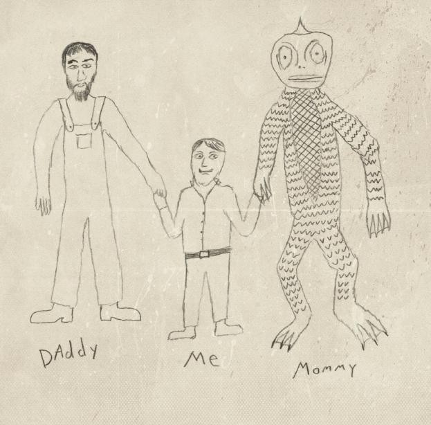

### Пропавший полицейский

На второе утро после приезда сыщиков обнаружится, что один из полицейских штата пропал. Хранитель решает, был ли он назначен патрулировать какое-нибудь место в городе или должен был находиться в отеле. От него не осталось следа, кроме вещей, которые он мог оставить в номере. Главный констебль Мартин заявит, что это наверняка дело рук банды «Лягушка». Если полицейский дежурил в гавани, Мартин предположит, что тот упал в воду во время грозы и его унесло. «Течение там сильнее, чем кажется».

На самом деле полицейский сунул нос куда не следовало, и Эзотерический орден Дагона велел его убить.

### Появление Уинна

Эта сцена может произойти где и когда угодно, по усмотрению Хранителя. Тедди Уинн, водитель банды, увидел что-то за окном убежища и лишился рассудка. Он украл из добычи $1 200 и бросился бежать из города. Пешком ли, на угнанной машине или лодке — ему всё равно. Уинн ведёт себя непредсказуемо и бессвязно кричит, что видел в воде каких-то «тварей».

При нём будет пистолет .38 калибра. По желанию Хранителя Уинн может напасть на полицейского штата и разоружить его ещё до встречи с сыщиками. Если сыщики подстрелят Уинна, из его куртки посыплются деньги и разлетятся вокруг.

Уинн стреляет в любого, кто пытается его остановить. Сыщики могут укрыться и попробовать его образумить. Если сыщик пройдёт трудную проверку **Обаяния** или **Убеждения**, пытаясь уговорить Уинна сдаться или выдать убежище сообщников, тот скажет: «Тоби тоже из них», — и покончит с собой. Как именно это произойдёт, решает Хранитель: Уинн может застрелиться, броситься под пули, выпрыгнуть из окна или откусить себе язык и истечь кровью. Где находится убежище, он ни за что не скажет.

## Дом Сиска

На углу Хэнкок-стрит и Саутуик-стрит стоит разваливающийся двухэтажный дом, где вырос Тобиас Сиск. Замок на входной двери примитивный, что даёт бонусную кость к проверкам **Взлома**. Замок также можно сломать успешной проверкой **СИЛ**.

*Прим. перев.:* в оригинале «a bonus dice» вместо «a bonus die». Речь об одной бонусной кости.

Поперёк заднего входа прибита одна доска, но сама дверь приоткрыта. В дом надуло листьев, и теперь они разбросаны по полу. Дождь, затекавший через приоткрытую дверь, прогноил пол сразу за порогом. Кто не попытается обойти гнилые доски, должен пройти проверку **Удачи**. При неудаче доска проламывается. Тогда нужна успешная проверка **ЛВК**, иначе нога провалится сквозь трухлявый пол и сыщик получит 1d2 урона.

В доме темно: электричество отключили много лет назад. Радиоприёмник, диван и утварь растащили, отчего и сломана дверь. Всё остальное осталось как при Иезекииле Сиске. Успешная проверка **Внимания** покажет, что здесь нигде не выставлено ни одной фотографии Мэри Сиск. Их вообще не найти в доме.

Из-за скрипучей лестницы сыщики получают штрафную кость к проверкам **Скрытности**.

Если не считать пыли и крысиного гнезда в матрасе, комната Тобиаса Сиска с того дня, как он ушёл на войну десять лет назад, не изменилась. Успешная проверка **Внимания** позволит найти рисунок, спрятанный в комоде. Тобиас нарисовал его на обёрточной бумаге в девять лет. Две кое-как нарисованные человеческие фигурки держатся за руки. Они подписаны «Папа» и «Я». Другой рукой Тобиас держит за руку жуткое чудовище с лягушачьей головой. Его чешуйчатая кожа и перепончатые ступни прорисованы очень тщательно. Подпись под ним — «Мама». Сыщики, успешно прошедшие проверку **Мифов Ктулху**, должны пройти проверку **Рассудка** (0/1).

Другая успешная проверка **Внимания** позволит найти свёрнутый листок в старой пивной бутылке. Это грубо нарисованная карта, по которой можно добраться до «Пиратского убежища». Успешная проверка **ИНТ** может помочь опознать фигуру на квадратном постаменте.

*Прим. перев.:* в оригинале «can makes» вместо «can make».

> **Раздатка 2. Детский рисунок Тобиаса**
>
> Папа  
> Я  
> Мама

