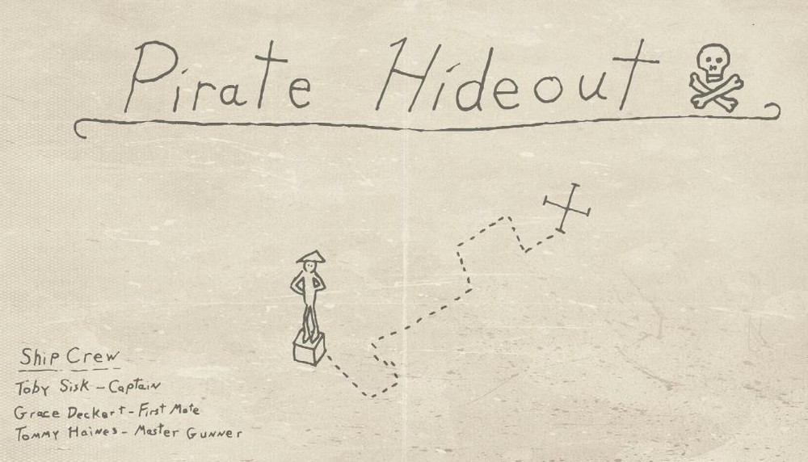
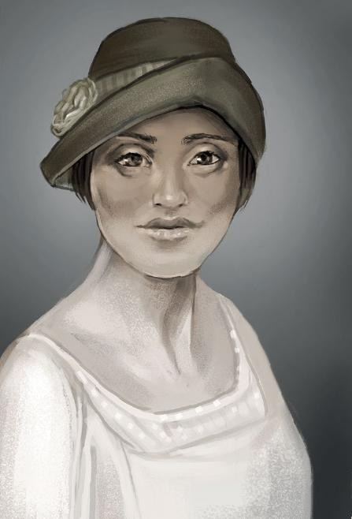

> **Раздатка 3. Карта «Пиратское убежище»**
>
> Пиратское убежище
> - Команда корабля
>     - Тоби Сиск - Капитан
>     - Грейс Декерт - Первый помощник
>     - Томас Хейнс - Главный канонир

*Прим. перев.:* на рисунке стоит «Томми Хейнс», в тексте сценария — «Томас Хейнс». В переводе раздатки сохранена форма из базы.

Фигура на карте — Мемориал Обеда Марша, статуя на пересечении Фолл-, Саут- и Марш-стрит. Разумеется, чтобы опознать памятник, сыщики должны успеть осмотреть город и увидеть его своими глазами. Они могут принять фигуру за обезглавленный памятник Войне за независимость, который стоит на углу Чёрч-стрит и Фиш-стрит.

От нарисованной статуи извивается пунктирная линия и заканчивается большим крестом. Слева написано «Команда корабля», а ниже перечислены Тоби Сиск — капитан, Грейс Декерт — первый помощник и Томас Хейнс — главный канонир. Карта так грубо нарисована, что добраться по ней от Мемориала Обеда Марша до убежища Сиска можно лишь после проверки **Ориентирования** или трудной проверки **ИНТ**.

## Грейс Декерт

Грейс Декерт родилась и выросла в Иннсмуте и работает на местных рыбоупаковочных предприятиях. Кровь глубоководных уже начала менять её тело, но Грейс всё ещё довольно привлекательна. Редеющие каштановые волосы она прячет под шляпкой, а огромные перепончатые ступни — в просторных мужских башмаках. За очками в тонкой проволочной оправе не так заметно, что её ярко-зелёные глаза слегка выпучены.

В детстве Грейс всё время проводила с Тобиасом Сиском и Томасом Хейнсом. Многие звали их тремя мушкетёрами. Грейс полюбила Сиска, и тот обещал жениться на ней, когда вернётся с войны. Но Хейнс погиб на фронте, Сиск так и не вернулся, а Грейс осталась одна с разбитым сердцем. Она так и не вышла замуж, зато всецело посвятила себя служению Отцу Дагону и Матери Гидре и стала уважаемой жрицей.

