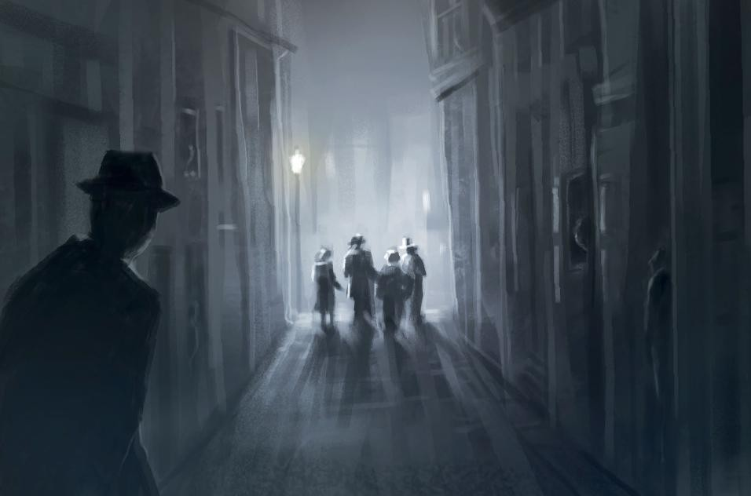

О прежней связи Грейс с Сиском все знают, но местные давно поняли, что с ней лучше об этом не заговаривать. Если её спросить, она ответит, что Сиск был её женихом. Она даже не знала, что он жив, пока в прошлом году не услышала по радио о его преступлениях. За десять лет она ни разу с ним не общалась. Успешная проверка **Психологии** подтвердит, что она говорит правду, и позволит заметить гнев, который всё ещё таится за её словами.

*Прим. перев.:* в оригинале о Сиске написано «fiancée» («невеста») вместо «fiancé» («жених»).

Если Грейс спросят, где может скрываться Сиск, она предложит поискать в его родном доме или на заброшенной железнодорожной станции, где они любили бывать. Старое «Пиратское убежище», где они с Сиском и Хейнсом играли в детстве, ей в голову не придёт. Если сыщики покажут ей карту из Дома Сиска, она объяснит, где это место, но захочет пойти с ними: вдруг ей удастся уговорить Тобиаса сдаться. Она занимает такое положение в Эзотерическом ордене Дагона, что ни один помогающий сыщикам последователь Ордена не станет с ней спорить. Наоборот, они будут уговаривать сыщиков взять её с собой. Отказаться можно, применив **Обаяние**, **Убеждение** или **Запугивание**, но даже тогда Грейс отправится в убежище другой дорогой.

Если сыщики не нашли карту в Доме Сиска или расследование зашло в тупик, Хранитель может решить, что Грейс сама вспомнит об убежище и расскажет им о нём.

Годами Грейс злилась на Сиска за то, что он её бросил, и ревновала его к Пёрл Каммайр, которую называют его подругой. От одной мысли, что Сиск и Пёрл могут быть вместе в старом детском убежище, Грейс приходит в ярость. Ведь именно там они с Сиском впервые поцеловались. Грейс собирается убить Пёрл заклинанием «Дыхание глубин», а потом зарезать Сиска ритуальным ножом в отместку за предательство.

## Убежище

Банда «Лягушка» прячется в одном из многочисленных заброшенных кирпичных и каменных складов у южной стороны гавани, в двух кварталах от воды. Из-за реек на верхних окнах хорошо видна вода с одной стороны здания и улица перед фасадом с другой. Двери стянуты тяжёлыми цепями с ржавыми навесными замками, которые уже не открыть. Большие окна закрыты прочными штормовыми ставнями. На потускневшей латунной табличке на фасаде значится фамилия прежних владельцев — Уэйт. В здание ведут два доступных входа.

Первый — решётка с северной стороны. Её скрывает заросшая бурьяном груда битого кирпича. Кажется, будто решётка прочно сидит на месте, но её легко отодвинуть. Успешная проверка **Внимания** обнаружит следы возле кирпичей, а успешная проверка **Чтения следов** подтвердит, что к решётке шли четверо, а через некоторое время один из них, Уинн, вышел обратно.

