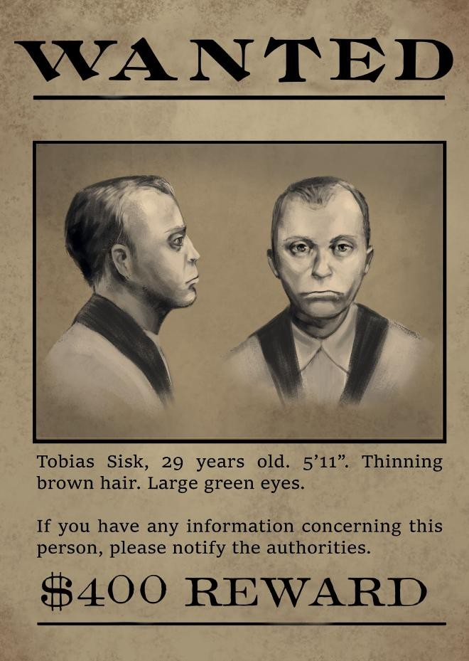

Сыщики, которые проберутся на склад через открытую решётку или перережут цепи на дверях, окажутся в лабиринте завалов. Между штабелями бочек и ящиков петляют тесные проходы. Середина склада почти свободна, если не считать двух старых конных повозок.

Пахнет пылью, старым деревом и крысиным помётом. Сквозь щели в ставнях пробивается немного света. Ещё горит один керосиновый фонарь рядом с повозкой, которая теперь служит банде столом. Если сыщики не принесут с собой свет и не откроют двери или ставни, они получат штрафную кость ко всем проверкам **Внимания** в первые пять раундов, пока глаза не привыкнут к темноте.

Роберто Сото занял верхний проход, откуда следит за подступами к складу. Если он увидит или услышит приближение полиции, то предупредит Пёрл Каммайр внизу. Как только станет ясно, что полицейские собираются войти, он откроет огонь из верхнего окна с рейками над передним или задним входом. Окна находятся на противоположных сторонах здания, и перебраться от одного к другому можно за один полный раунд.

Если Сото увидит или услышит сыщиков уже внутри, он укроется на антресолях и выждет удобный момент, чтобы напасть, когда они выйдут на открытое место. Его выдаст трудная проверка **Внимания** или обычная проверка **Слуха**.

Второй вход — широкий двустворчатый люк. Тобиас с друзьями нашли его детьми. По каменным ступеням они спустились в подземный грот, который окрестили «Пиратским убежищем». Водоём в глубине пещеры соединён с гаванью затопленным туннелем.

*Прим. перев.:* здесь в английском тексте стоит «Pirates Hideout», на карте — «Pirate Hideout».

Над водоёмом на цепи висит бронзовый трубчатый колокол длиной около 2,7 м. Нижние 30 см колокола скрыты под водой. Его покрывают странные древние знаки. Колокол установили, когда Эзотерический орден Дагона только начал тайно переправлять глубоководных в город. Так им не пользовались уже больше пятидесяти лет, и о нём забыли. Стоит кому угодно ударить в колокол, и глубоководные узнают об этом. Поэтому Тобиас запретил своим людям и трогать его, и спускаться в грот. Никому из них всё равно не проплыть 200 м по затопленному туннелю в кромешной тьме, так что делать им там нечего.

Тобиас ещё не звонил в колокол, чтобы позвать мать. Боится, что она скажет и что сделает, когда узнает, чего он натворил. Он выкопал мешок с «пиратскими сокровищами», которые они с друзьями зарыли здесь много лет назад. Среди блестящих пуговиц, ракушек и прочих безделушек он нашёл материнский браслет. В детстве браслет никак себя не проявлял, но теперь, когда в Тобиасе пробудилась кровь глубоководных, он позволяет ему творить «Разрушение». Тобиас решил, что, если полиция найдёт убежище, он перебьёт врагов этим заклинанием и избавит любимый Иннсмут от угрозы, которую сам на него навлёк. Лишь после этого он позовёт мать. Если сверху донесётся тревожный окрик или шум схватки, Тобиас выберется через люк, готовый уничтожить нападающих.

Если бой пойдёт не в его пользу и Тобиас поймёт, что всё потеряно, он вернётся в грот и призовёт Мэри Сиск, чтобы попросить помощи и прощения.

Мэри Сиск места себе не находит от тревоги за сына и ждёт в гавани звона колокола. Услышав хотя бы один удар, она поспешит по затопленному туннелю к Тобиасу. Она появится через 6 раундов после удара. Если звонил кто-то другой, а тем более кто-то, кто хочет навредить Тобиасу, Мэри нападёт со всей яростью разгневанной матери.

> **Раздатка 4. Розыскной плакат Тобиаса Сиска**
>
> Разыскивается  
> Тобиас Сиск, 29 лет. 5'11". Редеющие каштановые волосы. Большие зелёные глаза.  
> Если у вас есть какие-либо сведения об этом человеке, пожалуйста, сообщите властям.  
> Награда $400

