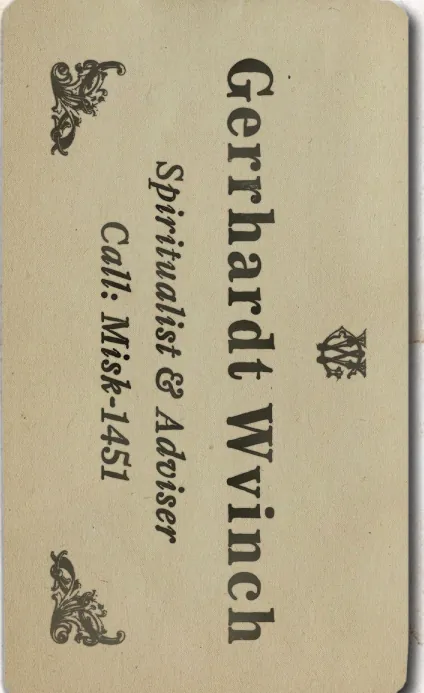
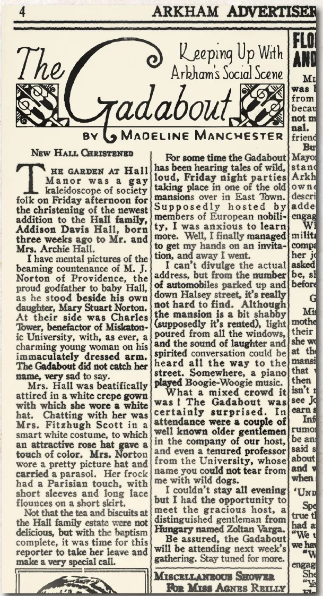

# Раздатки, карты и готовые сыщики

## Раздатки и карты

> **Раздатка «Шальная полночь», доп. 2: визитка Геррхардта Ввинча**
>
> Геррхардт Ввинч  
> Спиритуалист и советник  
> Тел.: Misk-1451

<!-- -->

> **Раздатка «Шальная полночь» 1: колонка «Гадабаут»**
>
> «АРКХЭМ АДВЕРТАЙЗЕР» — 4  
> «Гадабаут». Светская жизнь Аркхэма. МЭДЕЛИН МАНЧЕСТЕР  
> КРЕСТИНЫ У ХОЛЛОВ  
> В пятницу днём сад Холл-Мэнор пестрел калейдоскопом светского общества: крестили младшего Холла, Аддисона Дэвиса Холла, родившегося три недели назад у мистера и миссис Арчи Холл.  
> Перед глазами у меня сияющее лицо М. Дж. Нортона из Провиденса, гордого крёстного малыша Холла, рядом с его дочерью Мэри Стюарт Нортон. Подле них — Чарльз Тауэр, благотворитель Мискатоникского университета, как всегда с очаровательной молодой дамой под безупречно одетой рукой. Её имени «Гадабаут», к великому сожалению, не расслышала.  
> Миссис Холл была блаженно прекрасна в белом крепдешиновом платье и белой шляпке. С ней беседовала миссис Фицхью Скотт в элегантном белом костюме, которому шляпка цвета розы придавала нотку цвета. Миссис Нортон была в прелестной широкополой шляпе и с зонтиком; в её платье чувствовалась парижская нотка — короткие рукава и длинные кружевные оборки на короткой юбке.  
> Не то чтобы чай с печеньем в поместье Холлов был не хорош, но крещение свершилось, и вашему репортёру пора было откланяться и нанести один совершенно особый визит.  
> Уже давно «Гадабаут» слышит рассказы о буйных, шумных пятничных вечеринках в одном из старых особняков Ист-Тауна. Говорят, их устраивают члены европейской знати, и мне не терпелось узнать больше. И вот наконец мне удалось раздобыть приглашение — и я отправилась.  
> Точный адрес раскрыть не могу, но по числу автомобилей вдоль Холси-стрит найти дом совсем нетрудно. Особняк немного обшарпан (говорят, его снимают), но свет лился изо всех окон, а смех и оживлённые разговоры было слышно с улицы. Где-то рояль играл буги-вуги.  
> Какая пёстрая публика! «Гадабаут» была поистине удивлена. Там были двое хорошо известных пожилых джентльменов в обществе хозяина и даже штатный профессор университета, чьё имя из меня не вытянуть и дикими собаками.  
> Остаться на весь вечер я не могла, но успела познакомиться с любезным хозяином — видным господином из Венгрии по имени Золтан Варга.  
> Будьте уверены, «Гадабаут» посетит и встречу на следующей неделе. Следите за новостями.  
> РАЗНЫЕ ПОДАРКИ ДЛЯ МИСС АГНЕС РЕЙЛИ
