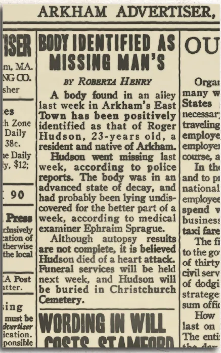

> **Раздатка «Шальная полночь», доп. 1: приглашение «Аркхэмская вакханалия»**
>
> АРКХЭМСКАЯ ВАКХАНАЛИЯ  
> Приходите все  
> в поместье Варга  
> Холси-стрит, 863  
> в пятницу вечером  
> в восемь часов

<!-- -->

> **Раздатка «Шальная полночь» 2: «Тело опознано как пропавший»**
>
> «АРКХЭМ АДВЕРТАЙЗЕР»  
> ТЕЛО ОПОЗНАНО КАК ПРОПАВШИЙ  
> Роберта Генри  
> Тело, найденное на прошлой неделе в переулке Ист-Тауна, точно опознано: это Роджер Хадсон, 23 лет, житель и уроженец Аркхэма. По данным полиции, Хадсон пропал на прошлой неделе. Тело было в далеко зашедшем состоянии разложения и, по словам судмедэксперта Эфраима Спрега, пролежало необнаруженным, вероятно, почти неделю. Хотя результаты вскрытия ещё не готовы, считается, что Хадсон умер от сердечного приступа. Похороны пройдут на следующей неделе; Хадсона похоронят на кладбище Крайстчерч.
